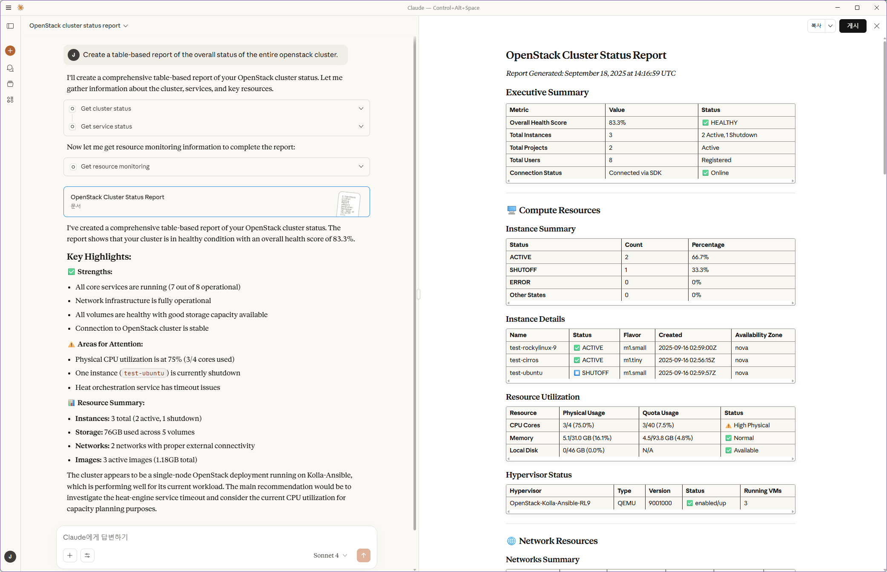
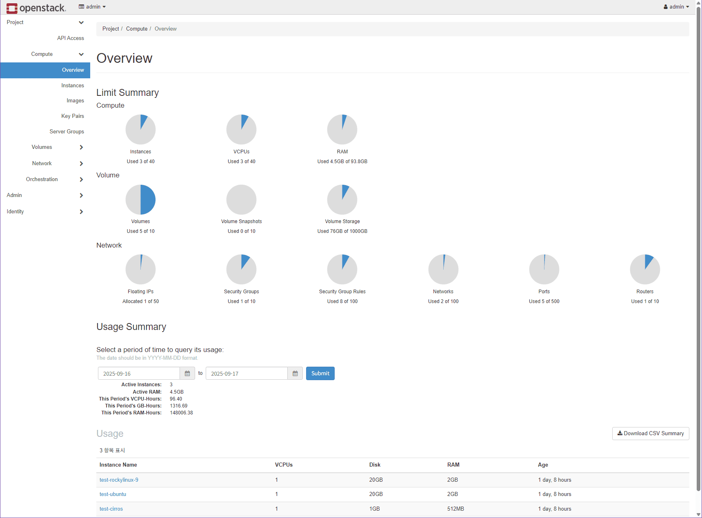

[English](README.md) | **Korean**

# MCP-OpenStack-Ops

> **MCP OpenStack Operations Server**: OpenStack 프로젝트 관리와 모니터링 기능을 제공하는 MCP(Model Context Protocol) 서버입니다. 안전 장치가 기본으로 들어 있고, 하나의 프로젝트 범위에서만 동작합니다.

[](https://mcpvault.io/servers/mcp-openstack-ops/health?utm_source=external_badge&utm_medium=referral&utm_campaign=mcp_health_report)

[](https://opensource.org/licenses/MIT)


[](https://www.buymeacoffee.com/call518)

[](https://github.com/call518/MCP-OpenStack-Ops/actions/workflows/pypi-publish.yml)


---

## MCP-OpenStack-Ops란?

MCP-OpenStack-Ops는 Claude나 OpenWebUI의 모델 같은 AI 어시스턴트가 일상 언어로
OpenStack 프로젝트를 조회하고 운영할 수 있게 해 줍니다.
[MCP](https://modelcontextprotocol.io/) 서버로서 "멈춰 있는 인스턴스가 뭐야?"
같은 요청을 OpenStack API 호출로 바꾸고 그 결과를 돌려줍니다.

- **기본은 읽기 전용**: 리소스를 만들거나 바꾸거나 지우는 도구는 직접 켜기
  전에는 등록조차 되지 않습니다.
- **한 번에 하나의 프로젝트**: 서버 하나는 OpenStack 프로젝트 하나 안에서만
  동작하고, 리소스 소유권을 확인합니다.
- **넓은 범위**: Nova, Neutron, Cinder, Glance, Keystone, Heat, Octavia,
  Gnocchi/Aodh 텔레메트리를 다루는 도구 110개(조회 55개, 관리 55개)를
  제공합니다.

AI가 생성한 코드 설명은
[](https://deepwiki.com/call518/MCP-OpenStack-Ops)
에서 볼 수 있습니다.

## 무엇을 할 수 있나요?

일상 언어로 질문하고 지시하면 됩니다. 예를 들면 다음과 같습니다.

```text
Show me the overall cluster status
Find instances in SHUTOFF state
Show all networks and their subnets
List all volumes and their status
Show the vCPUs and memory allocated to my project and the remaining quota
Show CPU usage of web-01 over the last hour
Stop all instances with name containing 'test'
```

마지막 요청은 리소스를 변경하므로 변경 도구를 켠 뒤에만 동작합니다. 텔레메트리
요청에는 클라우드에 Ceilometer와 Gnocchi가 있어야 합니다. 더 많은 예시는
[사용 가이드](docs/usage-guide.ko.md)에 있습니다.

**예시: Claude Desktop에서 본 클러스터 상태**



**같은 프로젝트를 OpenStack Dashboard(Epoxy 2025.1)에서 본 모습**



## 빠른 시작

서버를 실행하는 컴퓨터에서 API에 접근할 수 있는 OpenStack 계정(Keystone
호스트, 프로젝트, 사용자 이름, 비밀번호)이 필요합니다. 아래 두 방법 중 하나를
고르세요. 두 방법 모두 읽기 전용으로 시작합니다.

<a id="claude-desktop-integration"></a>

### 방법 A: Claude Desktop과 확장 번들 (가장 빠름)

1. 최신 [GitHub Release](https://github.com/call518/MCP-OpenStack-Ops/releases)에서
   `mcp-openstack-ops-<version>.mcpb`를 내려받습니다.
2. Claude Desktop에서 **Settings > Extensions > Advanced settings > Install
   Extension…**을 열고 파일을 선택합니다.
3. 설정 양식을 채웁니다. Keystone 호스트, 프로젝트, 사용자 이름, 비밀번호는
   필수이고, 포트, 도메인, 리전은 기본값이 미리 들어 있습니다. **Allow modify
   operations**는 꺼 둡니다.
4. Claude에게 물어봅니다: `List the instances in my OpenStack project.`

다른 Claude Desktop 설정 방법(`uvx`, 소스 체크아웃, `mcp-remote`를 통한 Docker
서버, 원격 커넥터)은 [Claude Desktop 가이드](docs/claude-desktop-guide.ko.md)에
있습니다.

### 방법 B: Docker Compose로 OpenWebUI 사용

필요한 것: Git, Compose 플러그인이 있는 Docker, 그리고 도구 호출(tool
calling)을 지원하는 모델을 제공하는 OpenWebUI용 모델 공급자.

**1. 설정**

```bash
git clone https://github.com/call518/MCP-OpenStack-Ops.git
cd MCP-OpenStack-Ops
cp .env.example .env
cp mcp-config.json.http mcp-config.json.http.local
chmod 600 mcp-config.json.http.local
openssl rand -hex 32   # use the output as WEBUI_SECRET_KEY
vi .env                # set WEBUI_SECRET_KEY and the OS_* values for your cloud
```

**2. 시작**

```bash
docker compose up -d
docker compose ps      # wait until mcp-server is healthy
```

OpenWebUI(`http://localhost:3000`), MCP 서버(`http://localhost:8000/mcp`),
MCPO(`http://localhost:8080`)가 시작됩니다.

**3. OpenWebUI를 MCP 서버에 연결**

1. `http://localhost:3000`을 열어 관리자 계정을 만들고, **Settings → Admin →
   Connections**에서 모델 공급자를 추가합니다.
2. **Settings → Admin → Tools → Integrations → External Tool Servers**에서
   유형 `MCP (Streamable HTTP)`, URL `http://mcp-server:8000/mcp`, 인증
   `None`으로 연결을 추가합니다.
3. **Settings → Admin → System → Interface → Chat**에서 **Tool Search**와
   **Defer Built-in Tools**를 켜고 **Deferral Threshold**를 `0`으로 설정합니다.
   전체 도구 목록이 모델의 제한을 넘지 않게 하기 위함입니다.
4. 새 채팅에서 **Integrations → Tools**의 연결을 켜고 물어봅니다:
   `Use mcp-openstack-ops to list the instances in my OpenStack project.`

> **MCPO는 선택 사항입니다.** MCPO는 MCP 도구를 OpenAPI(REST) 서버로 노출하는
> 프록시이며, OpenWebUI가 이 서버를 쓰는 데 꼭 필요하지는 않습니다. 어느 연결
> 방식이든 고를 수 있도록 Compose 파일이 함께 시작할 뿐입니다. MCPO 없이 실행하려면
> `docker compose up -d mcp-server open-webui`로 두 서비스만 시작하세요.

[OpenWebUI 가이드](docs/openwebui-guide.ko.md)에 직접 연결과 MCPO 연결의 차이,
OpenWebUI 설정 전체, OpenAI reasoning 모델 설정, 문제 해결 방법이 있습니다.

### 다른 설치 방법

| 구성 | 가이드 |
| --- | --- |
| `uvx`, 소스 체크아웃, `mcp-remote`, 원격 커넥터를 쓰는 Claude Desktop | [Claude Desktop 가이드](docs/claude-desktop-guide.ko.md) |
| Claude Code | [Claude Code 가이드](docs/claude-code-guide.ko.md) |
| MCPO(OpenAPI)를 거치는 OpenWebUI | [OpenWebUI 가이드](docs/openwebui-guide.ko.md) |
| 사용자마다 자신의 OpenStack Application Credential로 인증 (실험 기능) | [다중 사용자 가이드](docs/multi-user-guide.ko.md) |
| 여러 프로젝트, HTTPS와 사설 CA, 사용자 지정 endpoint와 포트 | [설정 가이드](docs/configuration.ko.md) |

어시스턴트가 리소스를 만들거나 바꾸거나 지우게 하려면
`ALLOW_MODIFY_OPERATIONS=true`로 설정하고(Claude Desktop 양식에서는 **Allow
modify operations**를 켜고) 서버를 다시 시작하세요. 이 계정이 실제로 무엇을 할 수
있는지는 여전히 OpenStack 정책이 결정합니다.

## 주요 기능

- ✅ **프로젝트 범위 작업**: 모든 도구가 설정된 `OS_PROJECT_NAME`을 적용하고 리소스 소유권을 확인하므로, 작업이 하나의 테넌트 안에서만 이루어집니다.
- ✅ **안전 장치가 있는 변경 작업**: 변경(`set_*`) 도구는 `ALLOW_MODIFY_OPERATIONS=true`일 때만 등록되므로, 기본 배포는 읽기 전용이고 감사하기 쉽습니다.
- ✅ **넓은 도구 범위**: 컴퓨트, 네트워크, 스토리지, 이미지, ID, Heat, Octavia 로드밸런싱, 텔레메트리를 다루는 도구 110개. 프로젝트 리소스는 현재 프로젝트로 범위가 제한되고, 클라우드 전체 관리 API는 OpenStack 정책을 따릅니다.
- ✅ **일괄 작업과 필터 작업**: 인스턴스, 볼륨, 네트워크, 이미지, 스냅샷, 키페어 관리 도구는 쉼표로 구분한 대상이나 필터 조건을 받아 여러 리소스를 한 번에 의도대로 변경합니다.
- ✅ **작업 후 결과와 비동기 안내**: 관리 도구는 리소스별 결과, 작업 후 다시 읽은 상태, 비동기 작업의 시간 안내를 함께 보고합니다.
- ✅ **모니터링과 사용량 정보**: `get_service_status`, `get_resource_monitoring`, `get_usage_statistics`, quota 도구는 서비스 점검, 프로젝트 할당량, 별도의 quota 한도, API 기반 컴퓨트 할당 시간을 보고합니다. 이 도구들은 실시간 사용률이나 추세를 수집하지 않습니다. Ceilometer와 Gnocchi가 배포되어 있으면 읽기 전용 `get_gnocchi_*` 도구가 텔레메트리 시계열을 돌려줍니다.
- ✅ **통합 인스턴스 조회**: `get_instance` 도구는 이름, ID, 상태, 자유 검색 경로를 하나로 묶고 페이지 처리와 요약/상세 모드를 제공합니다.
- ✅ **서버 정보와 감사 기록**: 전용 도구로 서버 이벤트, 하이퍼바이저 상세, 가용 영역, quota, 리소스 소유권을 확인해 진단을 빠르게 합니다.
- ✅ **로드밸런서 관리**: Octavia 도구는 리스너, 풀, 멤버, 헬스 모니터, flavor, quota, amphora 작업을 같은 안전 장치 아래에서 다룹니다.
- ✅ **연결과 배포의 유연성**: 연결 캐시, 설정 가능한 서비스 endpoint, Docker 패키지, Claude Desktop 확장, `stdio`/`streamable-http` 전송 방식을 지원해 프록시/배스천과 다중 프로젝트 구성에 대응합니다.

## 안전과 보안

- **기본은 읽기 전용입니다.** 관리 도구는 `ALLOW_MODIFY_OPERATIONS=true`일
  때만 등록됩니다.
- **서버 하나에 프로젝트 하나.** 리소스는 현재 프로젝트로 필터링되고 소유권이
  확인됩니다. 여러 프로젝트를 관리하려면 프로젝트마다 서버를 하나씩 실행하세요.
- **HTTP 접근을 보호하세요.** `streamable-http`로 서버를 localhost 밖에
  노출하기 전에 Bearer 토큰 인증(`REMOTE_AUTH_ENABLE=true`)과 HTTPS를 켜세요.

자세한 내용: [보안 가이드](docs/security.ko.md),
[다중 사용자 가이드](docs/multi-user-guide.ko.md).

## 호환성

> ⚠️ **호환성 안내**: 이 MCP 서버는 **OpenStack Epoxy(2025.1)**를 주 대상 환경으로 개발하고 최적화했습니다. 대부분의 API가 버전 간에 동일하므로 최근 OpenStack 릴리스(Dalmatian, Caracal, Bobcat 등)와도 대체로 호환됩니다. 구 버전 릴리스와 완전히 호환되려면 일부 API endpoint를 조정해야 할 수 있습니다.
>
> 🚧 **예정**: OpenStack API의 여러 버전을 자동으로 지원하는 기능을 개발 중이며, 이후 릴리스에서 주요 OpenStack 배포를 자동으로 지원할 예정입니다.

**공식 지원 릴리스:**
- ✅ OpenStack **Epoxy (2025.1)** - 전체 테스트 완료
- ✅ OpenStack **Dalmatian (2024.2)** - 전체 테스트 완료

**OpenStackSDK 버전 참고표:**
| OpenStack 릴리스 | 권장 SDK 버전 | 비고 |
|-------------------|------------------------|-------|
| Epoxy (2025.1) | `>=4.1.0,<=4.22.0` | 현재 기본 범위이며 `uv.lock`은 4.22.0으로 고정. 4.1.0, 4.9.0, 4.22.0에서 단위 테스트 통과 |
| Dalmatian (2024.2) | `>=3.2.0` | 완전 호환 |
| Caracal (2024.1) | `>=3.1.0` | 테스트가 필요할 수 있음 |
| Bobcat (2023.2) | `>=3.0.0` | 테스트가 필요할 수 있음 |
| Wallaby (2021.1) | `==3.1.1` | 다운그레이드 필요 |

구 버전 릴리스에 맞게 SDK 버전을 바꾸려면
[구 버전 OpenStack용 SDK 버전](docs/configuration.ko.md#구-버전-openstack용-sdk-버전)을
참고하세요.

## 문서

| 가이드 | 내용 |
| --- | --- |
| [사용 가이드](docs/usage-guide.ko.md) | 요청 예시, 일괄·필터 작업, 작업 후 상태, 페이지 처리 |
| [OpenWebUI 가이드](docs/openwebui-guide.ko.md) | Docker Compose 스택, 직접 MCP와 MCPO 비교, OpenWebUI 설정, 문제 해결 |
| [Claude Desktop 가이드](docs/claude-desktop-guide.ko.md) | 확장 번들, `uvx`, 소스 체크아웃, `mcp-remote`, 원격 커넥터 |
| [Claude Code 가이드](docs/claude-code-guide.ko.md) | Claude Code에 HTTP 서버 등록하기 |
| [설정 가이드](docs/configuration.ko.md) | 명령줄 옵션, 환경 변수, endpoint, HTTPS, 여러 프로젝트, SDK 버전 |
| [보안 가이드](docs/security.ko.md) | 프로젝트 격리, 읽기 전용 기본값, Bearer 인증 |
| [다중 사용자 가이드](docs/multi-user-guide.ko.md) | 사용자별 Application Credential 인증 (실험 기능) |
| [개발 가이드](docs/development.ko.md) | 테스트, live 도구 점검, 도구 추가, 기여 방법 |
| [OpenStack CLI와 MCP 도구 매핑](#-openstack-cli와-mcp-도구-매핑) | 모든 도구와 대응하는 CLI 명령, 검증 상태 |
| [검증 기록](docs/validation.ko.md) | live 점검과 단위 테스트의 날짜, 리비전, 조건, 결과 수치 |

---

## 📊 OpenStack CLI와 MCP 도구 매핑

✅는 구현된 API 경로를 뜻하며, 모든 action이나 모든 OpenStack 배포에서 동작함을
보증하지는 않습니다. **⚠️ Live unverified**는 실제 클라우드에서 검증에 성공하지
못한 경로이고, **❌ Not implemented**는 제공하지 않는 기능입니다. 서비스 존재 여부,
권한, 비동기 작업의 완료 여부가 결과에 영향을 줍니다.
[API 전제 조건과 결과 의미](#api-전제-조건과-결과-의미)와
[다중 사용자 설정 가이드](docs/multi-user-guide.ko.md)를 참고하세요.

**검증 근거:** 아래 Status 값의 근거가 되는 live 점검, Claude Code 프롬프트 점검,
단위 테스트 결과는 [docs/validation.ko.md](docs/validation.ko.md)에 기록되어
있습니다.

**분류별 상세 매핑**

### 1. 🖥️ **Compute (Nova)**

| OpenStack CLI 명령 | MCP 도구 | Status | 비고 |
|---------------------|---------|------|------|
| `openstack server list` | `get_instance` | ✅ | 서로 다른 reader 프로젝트가 각각 소유한 VM 정확히 10개를 반환함. 제한된 랩 검증만 수행 |
| `openstack server show` | `get_instance` | ✅ | 자기 프로젝트의 테스트 리소스 조회 완료. 다른 프로젝트의 비공개 ID는 상세 정보를 반환하지 않음. 소유 ID 16개 일괄 조회는 주장하지 않음 |
| `openstack server create` | `set_instance` (action="create") | ✅ | **ENHANCED** - 일괄 생성 지원. 2026-11-10 targeted check: 서버가 ACTIVE에 도달 |
| `openstack server start/stop/reboot` | `set_instance` | ✅ | 도구 스키마에 모든 action과 `reboot_type`이 노출됨. 프로젝트마다 테스트 VM 2대로 일괄 stop/start 최종 상태를 확인했으나, reboot는 이번에 재검증하지 않음 |
| `openstack server delete` | `set_instance` (action="delete") | ✅ | 도구 스키마에 delete와 선택적 강제 삭제가 노출됨. `name_contains` 필터로 일괄 삭제. `force=true`는 openstacksdk `delete_server(force=True)`를 사용(이전에는 존재하지 않는 SDK 메서드를 호출). 2026-11-10 targeted check: 강제 삭제로 서버가 제거됨 |
| `openstack server backup create` | `set_server_backup` | ✅ | 순환 보관을 지원하는 Nova backup action. 비동기이며 사용자 지정 metadata는 없음 |
| `openstack server image create` | `set_instance` (action="snapshot") | ✅ | 선택적 `snapshot_name`과 JSON `metadata`를 받음. 파라미터 전달은 로컬 테스트만 했고, 이번 변경에서 live 재검증하지 않음 |
| `openstack server shelve/unshelve` | `set_instance` | ✅ | 도구 스키마에 action이 노출됨. 인스턴스 shelve는 이번 변경에서 live 재검증하지 않음 |
| `openstack server lock/unlock` | `set_instance` | ✅ | 인스턴스 잠금. `get_instance_details`는 `locked` 값을 SDK의 `is_locked` 필드에서 읽음(이전에는 항상 false). 2026-11-10 targeted check: lock 후 true, unlock 후 false로 보고되어 Nova와 일치 |
| `openstack console url show` | `set_instance` (action="console") | ✅ | Nova remote-consoles API를 사용(구식 console action은 현재 Nova에서 404 반환). `console_type`: novnc(기본), spice-html5, rdp-html5, serial, webmks, spice-direct이며 클라우드 지원 여부에 따름. 2026-11-10 targeted check: noVNC URL을 반환 |
| `openstack server pause/unpause` | `set_instance` | ✅ | 인스턴스 일시 정지 |
| `openstack server suspend/resume` | `set_instance` | ✅ | 인스턴스 suspend |
| `openstack server resize` | `set_instance` (action="resize") | ✅ | 기존 `flavor` 파라미터를 대상 flavor로 사용. action 노출은 로컬 테스트만 함 |
| `openstack server resize confirm` | `set_instance` (action="confirm_resize") | ✅ | resize 확정 |
| `openstack server resize revert` | `set_instance` (action="revert_resize") | ✅ | resize 되돌리기 |
| `openstack server rebuild` | `set_instance` (action="rebuild") | ✅ | `image`를 사용하며 선택적 `new_name`, JSON `metadata`, `preserve_ephemeral`을 지원. 이미지를 openstacksdk가 기대하는 방식으로 전달하고(이전에는 rebuild가 실패), Nova가 rebuild 때 서버 metadata를 덮어쓰므로 `metadata`는 지정했을 때만 보냄. 2026-11-10 targeted check: ACTIVE로 rebuild되고 기존 metadata가 유지됨 |
| `openstack server rescue/unrescue` | `set_instance` | ✅ | 도구 스키마에 두 action과 선택적 `rescue_image_id`가 노출됨. 이번 변경에서 live 재검증하지 않음 |
| `openstack server migrate` | `set_server_migration` (action="migrate") | ✅ | Live migration |
| `openstack server evacuate` | `set_server_migration` (action="evacuate") | ⚠️ Live unverified | 서버 evacuation. `on_shared_storage`는 명시적으로 true일 때만 보냄. Nova는 compute microversion 2.14부터 이 필드를 거부함. 2026-11-10 targeted check: compute 서비스가 살아 있는 단일 호스트에서 Nova가 스키마 오류가 아닌 그 이유로 요청을 거부했고 서버는 ACTIVE를 유지. 실제 evacuation에는 장애가 난 호스트와 두 번째 compute 호스트가 필요 |
| `openstack server migration list` | `set_server_migration` (action="list") | ✅ | Migration 목록. `instance_name`을 주면 그 서버의 migration을 나열(이전에는 항상 빈 결과). 목록 조회 실패를 빈 성공 대신 오류로 보고하고, 전체 migration 목록은 SDK의 `server_id`를 읽음. 2026-11-10 targeted check: 서버별 목록을 반환했고 존재하지 않는 서버는 오류를 반환 |
| `openstack server migration show` | `set_server_migration` (action="show") | ✅ | Migration 상세 |
| `openstack server migration abort` | `set_server_migration` (action="abort") | ✅ | Migration 중단 |
| `openstack server migration confirm` | `set_server_migration` (action="confirm") | ✅ | Migration 확정 |
| `openstack server migration force complete` | `set_server_migration` (action="force_complete") | ✅ | Migration 강제 완료 |
| `openstack server add network` | `set_server_network` (action="add_network") | ✅ | 네트워크 연결. Nova가 interface port를 만들므로 네트워크를 제거하면 port도 다시 삭제됨. 2026-11-10 targeted check: 연결됨 |
| `openstack server remove network` | `set_server_network` (action="remove_network") | ✅ | 네트워크 분리. 2026-11-10 targeted check: interface port가 남지 않았고 이후 네트워크를 삭제할 수 있었음 |
| `openstack server add port` | `set_server_network` (action="add_port") | ✅ | port 이름 또는 ID로 port 연결(이전에는 이름을 주면 찾을 수 없다고 보고). 2026-11-10 targeted check: 이름으로 연결됨 |
| `openstack server remove port` | `set_server_network` (action="remove_port") | ✅ | 이름 또는 ID로 port 분리. 분리해도 사용자가 만든 port는 삭제하지 않음. 2026-11-10 targeted check: 이름으로 분리되었고 port는 유지됨 |
| `openstack server add floating ip` | `set_server_floating_ip` (action="add") | ✅ | Floating IP 연결 |
| `openstack server remove floating ip` | `set_server_floating_ip` (action="remove") | ✅ | Floating IP 연결 해제 |
| `openstack server add fixed ip` | `set_server_fixed_ip` (action="add") | ✅ | Nova가 port를 만드는 새 interface로 fixed IP 추가. 2026-11-10 targeted check: 요청한 네트워크의 주소가 할당됨 |
| `openstack server remove fixed ip` | `set_server_fixed_ip` (action="remove") | ✅ | 해당 주소를 가진 interface 전체를 분리하며, 이것이 기본 interface일 수 있음. 2026-11-10 targeted check: 제거되었고 interface port가 남지 않음 |
| `openstack server add security group` | `set_server_security_group` (action="add") | ✅ | 보안 그룹 추가 |
| `openstack server remove security group` | `set_server_security_group` (action="remove") | ✅ | 보안 그룹 제거 |
| `openstack server add volume` | `set_server_volume` (action="attach") | ✅ | member 계정의 attach가 set_server_volume으로 in-use에 도달. 게스트 I/O는 테스트하지 않음. multiattach 사전 검사는 SDK의 `is_multiattach` 필드를 읽음. 2026-11-10 targeted check (관리자): in-use에 도달 |
| `openstack server remove volume` | `set_server_volume` (action="detach") | ✅ | member 계정의 detach가 set_server_volume으로 available에 도달. 2026-11-10 targeted check (관리자): available에 도달 |
| `openstack server set` | `set_server_properties` (action="set") | ✅ | 서버 속성 설정 |
| `openstack server unset` | `set_server_properties` (action="unset") | ✅ | 서버 속성 해제 |
| `openstack server dump create` | `set_server_dump` | ❌ Unsupported | 지원하지 않음을 명시적으로 반환하며 dump는 만들지 않음 |
| `openstack server event list` | `get_server_events` | ✅ | 서버 이름이나 UUID를 `server_id`가 아닌 `instance_name`으로 전달. action 목록에는 완료 시각이 없으므로, `include_event_details=true`로 action별 이벤트 결과를 가져와 마지막 완료 시각을 계산. 상세 조회는 최대 10개 action. 이벤트 노출 범위는 Nova 정책을 따름 |
| `openstack server group list` | `get_server_groups` | ✅ | 서버 그룹 목록. `member_ids`를 읽고, compute microversion 2.64부터는 `policies` 대신 `policy`를 읽음. 목록 조회 실패를 빈 목록 대신 오류로 보고. 2026-11-10 targeted check: policy와 함께 나열됨 |
| `openstack server group create/delete` | `set_server_group` | ✅ | 서버 그룹 관리. 2026-11-10 targeted check: create와 show에서 policy와 member가 보고되었고, 이후 그룹이 삭제됨 |
| `openstack flavor list` | `set_flavor` (action="list") | ✅ | 등록되려면 변경 도구를 켜야 함 |
| `openstack flavor create/delete` | `set_flavor` | ✅ | Flavor 관리 |
| `openstack keypair list` | `get_keypair_list` | ✅ | 범위가 제한된 빈 조회 완료. member 계정의 keypair 생성/삭제 후 재조회는 따로 테스트함 |
| `openstack keypair create/delete` | `set_keypair` | ✅ | member 계정의 명시적 MCP 생성/삭제 후 재조회 통과. Claude를 통한 쓰기 작업의 성공은 주장하지 않음 |
| `openstack hypervisor list` | `get_hypervisor_details` | ✅ | 관리자 조회 확인. 호스트별 용량이 없거나 합계가 불완전하면 0이 아니라 null. 전역 enhanced statistics는 별도이며, `/os-hypervisors/statistics`를 쓸 수 없으면(compute microversion 2.88에서 제거) `enhanced_stats_note`가 이유를 설명. 이 note는 단위 테스트만 했고, 2026-11-10 targeted check에서는 statistics API가 여전히 데이터를 반환함 |
| `openstack availability zone list` | `get_availability_zones` | ✅ | Compute/Cinder 가용성은 SDK 상태 매핑을 읽고, 가용성 정보가 없으면 null. 실제 사용 가능한 zone 확인 |

### 2. 🌐 **Network (Neutron)**

| OpenStack CLI 명령 | MCP 도구 | Status | 비고 |
|---------------------|---------|------|------|
| `openstack network list` | `get_network_details` | ✅ | reader마다 소유한 비공개 네트워크 2개와 정책상 보이는 공유 외부 네트워크 1개. 다른 테스트 프로젝트의 비공개 네트워크는 반환하지 않음 |
| `openstack network show` | `get_network_details` (network_name) | ✅ | 다른 프로젝트 ID 조회가 실패하는 것을 확인. 일치하는 이름이 없으면 명시적 오류를 반환(이전에는 빈 성공). 2026-11-10 targeted check (관리자): 이름 조회는 네트워크를 반환했고 없는 이름은 오류를 반환. reader 역할로 두 프로젝트에서 성공 조회하는 것은 아직 확인하지 않음 |
| `openstack network create` | `set_networks` (action="create") | ✅ | 기본 mtu=0이면 해당 필드를 보내지 않음. 백엔드 MTU 1450 확인. 명시한 1400은 두 member 프로젝트 모두에서 유지 |
| `openstack network delete` | `set_networks` (action="delete") | ✅ | 기본 MTU와 지정 MTU 테스트 네트워크를 실제 TCP MCP로 삭제했고 API에서 사라진 것을 확인 |
| `openstack network set` | `set_networks` (action="update") | ✅ | **ENHANCED** - 일괄 업데이트 |
| `openstack subnet list` | `get_network_details` (includes subnets) | ✅ | 소유 네트워크와 공유 외부 네트워크의 서브넷을 반환. 테스트 reader마다 보이는 서브넷 3개 |
| `openstack subnet create/delete` | `set_subnets` | ✅ | member 계정의 TCP MCP로 서브넷을 만들고 재조회. 삭제 후 두 프로젝트 모두에서 상위 네트워크를 제거할 수 있었음 |
| `openstack router list` | `get_routers` | ⚠️ Live unverified | 이번에는 복합 오류 요청의 일부로만 호출되었고, reader 결과를 따로 확인하지 않음 |
| `openstack router create/delete` | `set_routers` | ✅ | 프로젝트 소유 라우터. 연결된 interface는 자동으로 제거하지 않음 |
| `openstack floating ip list` | `get_floating_ips` | ✅ | Floating IP 목록. 조회에 실패하면 가짜 주소 대신 오류를 반환. 2026-11-10 targeted check: 나열됨 |
| `openstack floating ip create` | `set_floating_ip` (action="create") | ✅ | Floating IP 생성. `description`, `port_id`, `floating_ip_address`를 전달(이전에는 버려짐). 2026-11-10 targeted check: description과 함께 생성됨. 생성 시 `port_id`와 `floating_ip_address`는 live 테스트하지 않음 |
| `openstack floating ip delete` | `set_floating_ip` (action="delete") | ✅ | Floating IP 삭제. 2026-11-10 targeted check: 반납됨 |
| `openstack floating ip set` | `set_floating_ip` (action="set") | ✅ | Floating IP 속성 설정 |
| `openstack floating ip show` | `set_floating_ip` (action="show") | ✅ | Floating IP 상세. 2026-11-10 targeted check: ID로 조회됨 |
| `openstack floating ip unset` | `set_floating_ip` (action="unset") | ❌ Limitation | 무엇을 해제할지 고르는 파라미터를 도구가 노출하지 않아 이 action은 항상 오류를 반환. `set`이나 `disassociate`를 사용 |
| `openstack floating ip pool list` | `get_floating_ip_pools` | ✅ | 전역 풀의 남은 용량은 알 수 없음(`available_ips=null`). 조회에 실패하면 가짜 풀 대신 오류를 반환. 2026-11-10 targeted check: 외부 네트워크 풀이 나열됨 |
| `openstack floating ip port forwarding create` | `set_floating_ip_port_forwarding` (action="create") | ⚠️ Live unverified | 구현됨. 테스트 플랫폼의 port-forwarding endpoint가 HTTP 404를 반환 |
| `openstack floating ip port forwarding delete` | `set_floating_ip_port_forwarding` (action="delete") | ⚠️ Live unverified | 구현됨. 테스트 플랫폼의 port-forwarding endpoint가 HTTP 404를 반환 |
| `openstack floating ip port forwarding list` | `set_floating_ip_port_forwarding` (action="list") | ⚠️ Live unverified | 구현됨. 테스트 플랫폼의 port-forwarding endpoint가 HTTP 404를 반환 |
| `openstack floating ip port forwarding set` | `set_floating_ip_port_forwarding` (action="set") | ⚠️ Live unverified | 구현됨. 테스트 플랫폼의 port-forwarding endpoint가 HTTP 404를 반환 |
| `openstack floating ip port forwarding show` | `set_floating_ip_port_forwarding` (action="show") | ⚠️ Live unverified | 구현됨. 테스트 플랫폼의 port-forwarding endpoint가 HTTP 404를 반환 |
| `openstack security group list` | `get_security_groups` | ✅ | 범위가 제한된 reader 목록 조회 완료. default와 테스트 그룹이 보임. 조회에 실패하면 가짜 `default` 그룹 대신 오류를 반환 |
| `openstack security group create/delete` | `set_security_groups` | ✅ | 프로젝트 소유 보안 그룹 |
| `openstack port list` | `set_network_ports` (action="list") | ⚠️ Live unverified | 구현된 list action은 변경 도구가 등록되어야 사용 가능. 이번에 실행하지 않음 |
| `openstack port create/delete` | `set_network_ports` | ✅ | Port 관리 |
| `openstack network qos policy list` | `get_network_qos_policies` | ⚠️ Live unverified | 구현됨. 테스트 플랫폼의 QoS endpoint가 HTTP 404를 반환 |
| `openstack network qos policy create` | `set_network_qos_policies` | ⚠️ Live unverified | 구현됨. 테스트 플랫폼의 QoS endpoint가 HTTP 404를 반환. 정책 컨테이너만 다루며 대역폭 규칙은 없음 |
| `openstack network agent list` | `get_service_status` (includes agents) | ⚠️ Live unverified | reader에게는 서비스 정책 제한이 있으며, 일부 데이터만으로는 전체 상태를 증명하지 못함. 2026-11-10 targeted check는 관리자로만 agent를 반환함 |
| `openstack network agent set` | `set_network_agents` | ✅ | 클라우드 전체 agent 켜기/끄기. 보통 관리자 전용 |

### 3. 💾 **Storage (Cinder)**

Block Storage 서비스가 배포되어 있지 않으면 Cinder 볼륨, 스냅샷, 유형, 백업, 그룹,
QoS, transfer, 서버 볼륨 경로는 endpoint URL을 가린 채 "Block Storage (Cinder)
service is not available"이라는 명시적 오류를 보고합니다. 이 동작은 단위 테스트만
했고, 2026-11-10 targeted check는 Cinder가 있는 클라우드에서 실행했습니다.

| OpenStack CLI 명령 | MCP 도구 | Status | 비고 |
|---------------------|---------|------|------|
| `openstack volume list` | `get_volume_list` | ✅ | reader마다 소유한 볼륨 정확히 10개. 다른 테스트 프로젝트의 볼륨 ID는 반환하지 않음. `multiattach`와 `source_volid`는 SDK의 `is_multiattach`와 `source_volume_id` 필드를 읽음. 2026-11-10 targeted check: 이 필드들과 함께 나열됨 |
| `openstack volume show` | `get_volume_list` | ✅ | 목록 기반 클라이언트 측 필터링. get_volume_list 전용 필터 인자는 없음 |
| `openstack volume create/delete` | `set_volume` | ✅ | 볼륨 생성/삭제. 2026-11-10 targeted check: 1 GB 볼륨이 available에 도달했고 볼륨 2개가 삭제됨 |
| `openstack volume set --size` | `set_volume` (action="extend") | ✅ | 양수 new_size가 size보다 우선하며 size는 대체값으로 남음. 테스트 볼륨이 요청한 크기와 available 상태에 도달. API가 요청을 받은 것만으로는 완료가 아님 |
| `openstack volume set` (other properties) | — | ❌ Not implemented | set_volume에는 modify/update action이 없으므로 이 미지원 action을 보내지 말 것 |
| `openstack volume type list` | `get_volume_types` | ✅ | 볼륨 유형 목록. 조회에 실패하면 가짜 `standard` 유형 대신 오류를 반환. 2026-11-10 targeted check: 나열됨 |
| `openstack volume type create/delete` | `set_volume_types` | ✅ | 볼륨 유형 관리. 보통 관리자 전용 |
| `openstack volume snapshot list` | `get_volume_snapshots` | ✅ | reader마다 소유한 기본 스냅샷 2개. API 최종 상태 확인 |
| `openstack volume snapshot create/delete` | `set_snapshot` | ✅ | member 계정의 명시적 MCP 스냅샷이 available에 도달했고 삭제됨. 작업 후 상태는 알 수 없는 리소스 유형으로 보고하지 않고 스냅샷을 찾아 확인. 복원/I/O는 주장하지 않음. 2026-11-10 targeted check (관리자): available에 도달했고 삭제됨 |
| `openstack backup list` | `get_volume_backups` | ✅ | reader마다 소유한 available 백업 3개. 기본 백업은 실제 Cinder API로 생성 |
| `openstack backup create/delete` | `set_volume_backups` | ✅ | 볼륨 백업 관리. 2026-11-10 targeted check: 백업이 available에 도달했고 삭제됨 |
| `openstack volume backup restore` | `set_volume_backups` (action="restore") | ✅ | `volume_name`으로 이름을 지정한 새 볼륨이나 `volume_id`로 복원. `volume_id=`와 `volume=`(openstacksdk 4.14+) 두 restore 시그니처 모두에서 동작. 2026-11-10 targeted check (openstacksdk 4.22.0): 새 볼륨으로 복원되어 available에 도달. 기존 볼륨으로의 복원은 테스트하지 않음 |
| `openstack volume transfer request list` | `get_volume_transfers` | ✅ | 요청 목록만 제공하며 인증 키는 제외 |
| `openstack server volume list` | `get_server_volumes` | ✅ | 서버 볼륨 목록. 존재하지 않는 서버는 명시적 오류를 반환(이전에는 빈 성공). 2026-11-10 targeted check: 연결된 볼륨이 나열되었고 없는 서버는 오류를 반환 |
| `openstack server add/remove volume` | `set_server_volume` / `set_volume` (action="attach"/"detach") | ✅ | 두 경로 모두 두 member 프로젝트에서 in-use를 거쳐 available에 도달. 다른 프로젝트 대상은 거부. 게스트 I/O는 테스트하지 않음 |
| `openstack volume group list` | `get_volume_groups` | ✅ | Cinder generic group(API >= 3.13) 필요 |
| `openstack volume group create` | `set_volume_groups` | ✅ | Create/list/show/delete. 생성에는 group_type과 volume_types 필요 |
| `openstack volume qos list` | `get_volume_qos` | ✅ | Cinder QoS 사양. 클라우드 정책을 따름 |
| `openstack volume qos create` | `set_volume_qos` | ✅ | 사양 Create/list/show/set/delete. 유형 자동 연결은 없음 |

### 4. 🖼️ **Image (Glance)**

| OpenStack CLI 명령 | MCP 도구 | Status | 비고 |
|---------------------|---------|------|------|
| `openstack image list` | `get_image_detail_list` | ✅ | 이미지 목록. 조회에 실패하면 빈 목록 대신 오류를 반환. 2026-11-10 targeted check: 나열됨 |
| `openstack image show` | `get_image_detail_list` (filtering) | ✅ | 특정 이미지 조회 |
| `openstack image create` | `set_image` (action="create") | ✅ | min_disk, min_ram, properties를 지원하는 이미지 생성 |
| `openstack image delete` | `set_image` (action="delete") | ✅ | 이미지 삭제 |
| `openstack image set` | `set_image` (action="update") | ✅ | 이미지 속성 수정 |
| `openstack image save` | — | ❌ Not implemented | `set_image`는 create, delete, update, list만 지원하며 다운로드 action은 없음 |
| `openstack image add project` | `set_image_members` (action="add") | ✅ | shared 가시성 이미지에 프로젝트 추가 |
| `openstack image member list` | `get_image_members` | ✅ | 이미지 멤버 목록 |
| `openstack image member create` | `set_image_members` | ✅ | 이미지 멤버 관리 |
| `openstack image set --property` | `set_image_metadata` | ✅ | 이미지 metadata |
| `openstack image set --public/private` | `set_image_visibility` | ✅ | 이미지 가시성 설정 |

### 5. 👥 **Identity (Keystone)**

| OpenStack CLI 명령 | MCP 도구 | Status | 비고 |
|---------------------|---------|------|------|
| `openstack user list` | `get_user_list` | ⚠️ Live unverified | Keystone이 reader를 거부했고 MCP가 명시적 실패를 반환함. 이번에 성공적인 목록 조회는 검증하지 않음 |
| `openstack user show` | `get_user_list` | ⚠️ Live unverified | 정책 제한이 있는 사용자 목록에 의존. 새 reader에 대해 따로 검증하지 않음 |
| `openstack user create/delete` | `set_users` | ✅ | 비밀번호는 서버 환경 변수에서 읽음. 역할은 부여하지 않음 |
| `openstack project list` | `get_project_details` | ✅ | 프로젝트 목록 |
| `openstack project show` | `get_project_details` (name param) | ✅ | 특정 프로젝트 조회 |
| `openstack project create/delete` | `set_project` | ✅ | 프로젝트 관리 |
| `openstack role list` | `get_role_assignments` | ✅ | 역할 목록 |
| `openstack role assignment list` | `get_role_assignments` | ✅ | 조회에 실패하면 가짜 할당 대신 오류를 반환. 2026-11-10 targeted check: 관리자로 나열됨. 이전 회차에서는 reader 역할이 Keystone 정책에 의해 거부됨 |
| `openstack role create` | `set_roles` (action="create") | ✅ | 역할 생성. `set_roles`는 역할 목록도 제공 |
| `openstack role delete` | — | ❌ Not implemented | `set_roles`는 list와 create만 지원 |
| `openstack domain list` | `get_domains` | ✅ | Keystone 정책을 따름 |
| `openstack domain create/delete` | `set_domains` | ✅ | 삭제 전에 update로 명시적으로 비활성화해야 함 |
| `openstack group list` | `get_identity_groups` | ✅ | Keystone 정책을 따름 |
| `openstack group create/delete` | `set_identity_groups` | ✅ | 그룹 관리 |
| `openstack service list` | `get_service_status` | ⚠️ Live unverified | reader에게는 서비스 정책 제한이 있으며, 일부 데이터만으로는 전체 상태를 증명하지 못함. Compute와 volume 서비스의 zone은 SDK의 `availability_zone` 필드를 읽음(이전에는 항상 `unknown`). 2026-11-10 targeted check는 관리자로만 이를 확인 |
| `openstack service list` (Keystone catalog) | `set_services` (action="list") | ✅ | SDK의 `is_enabled` 필드를 읽음(이전에는 모든 서비스가 enabled로 보임). 2026-11-10 targeted check: enabled 값이 Keystone과 일치 |
| `openstack service create/delete` | — | ❌ Not implemented | `set_services`는 list만 지원 |
| `openstack endpoint list` | `get_service_status` (includes endpoints) | ⚠️ Live unverified | reader에게는 서비스 정책 제한이 있으며, 일부 데이터만으로는 전체 상태를 증명하지 못함 |

### 6. 🔥 **Orchestration (Heat)**

| OpenStack CLI 명령 | MCP 도구 | Status | 비고 |
|---------------------|---------|------|------|
| `openstack stack list` | `get_heat_stacks` | ✅ | 스택의 프로젝트 ID나 Heat self link가 현재 프로젝트와 일치해야 하며, 알 수 없거나 다른 프로젝트 소유인 스택은 제외. 자기 프로젝트와 다른 프로젝트의 테스트 스택으로 확인. `owner`는 SDK의 `owner_id` 필드를 읽고, 조회에 실패하면 가짜 스택 대신 오류를 반환. 2026-11-10 targeted check: 소유한 테스트 스택이 나열됨 |
| `openstack stack show` | `get_heat_stacks` | ✅ Partial | 반환된 목록에서 대상을 골라야 하며 이름/필터 파라미터는 없음. 리소스/이벤트/템플릿/출력 조회는 get_heat_stack_details 사용 |
| `openstack stack create` | `set_heat_stack` (action="create") | ✅ | 스택 생성. 2026-11-10 targeted check: CREATE_COMPLETE에 도달 |
| `openstack stack delete` | `set_heat_stack` (action="delete") | ✅ | 다른 프로젝트 스택의 삭제는 거부. 소유권 변경 후 소유 스택 삭제 완료. 2026-11-10 targeted check: 삭제됨 |
| `openstack stack update` | `set_heat_stack` (action="update") | ✅ | 스택 소유권이 일치해야 함. 결과는 SDK의 `status` 필드를 읽음(이전에는 Heat가 update를 받아들인 뒤에도 도구가 실패로 보고). 2026-11-10 targeted check: 소유 스택 update가 접수된 것으로 보고되었고 UPDATE_COMPLETE에 도달 |
| `openstack stack suspend/resume` | — | ❌ Not implemented | set_heat_stack은 create, delete, update만 지원 |
| `openstack stack resource list` | `get_heat_stack_details` (section="resources") | ✅ | 실제 Heat 리소스 |
| `openstack stack event list` | `get_heat_stack_details` (section="events") | ✅ | 소유권 변경 후 소유 스택의 이벤트를 조회 |
| `openstack stack template show` | `get_heat_stack_details` (section="template") | ✅ | 소유권 변경 후 소유 스택의 템플릿을 조회 |
| `openstack stack output list` | `get_heat_stack_details` (section="outputs") | ✅ | 소유권 변경 후 소유 스택의 출력을 조회 |

### 7. ⚖️ **Load Balancer (Octavia)**

Octavia 도구는 openstacksdk의 속성 이름(`is_admin_state_up`, `is_enabled`, 리스너의
`load_balancer_id`, L7 규칙의 `rule_value`, 복수형 quota 필드)을 읽고, 풀 멤버는
`members(pool)`로 나열하며, L7 규칙은 `create_l7_rule(policy, ...)`로 만들고,
리스너를 로드밸런서별로 필터링합니다. 이 수정 사항은 실제 openstacksdk 리소스
객체로 단위 테스트만 했고, 어떤 live 테스트 클라우드에도 Octavia가 없었습니다.

| OpenStack CLI 명령 | MCP 도구 | Status | 비고 |
|---------------------|---------|------|------|
| `openstack loadbalancer list` | `get_load_balancer_list` | ⚠️ Live unverified | 구현됨. 테스트 플랫폼에 Octavia 없음. 페이지 처리를 지원하는 로드밸런서 목록 |
| `openstack loadbalancer show` | `get_load_balancer_details` | ⚠️ Live unverified | 구현됨. 테스트 플랫폼에 Octavia 없음. 로드밸런서 상세 정보 |
| `openstack loadbalancer create` | `set_load_balancer` (action="create") | ⚠️ Live unverified | 구현됨. 테스트 플랫폼에 Octavia 없음. 로드밸런서 생성 |
| `openstack loadbalancer delete` | `set_load_balancer` (action="delete") | ⚠️ Live unverified | 구현됨. 테스트 플랫폼에 Octavia 없음. 로드밸런서 삭제 |
| `openstack loadbalancer set` | `set_load_balancer` (action="update") | ⚠️ Live unverified | 구현됨. 테스트 플랫폼에 Octavia 없음. 로드밸런서 속성 변경 |
| `openstack loadbalancer stats show` | `set_load_balancer` (action="stats") | ⚠️ Live unverified | 구현됨. 테스트 플랫폼에 Octavia 없음. 로드밸런서 통계 |
| `openstack loadbalancer status show` | `set_load_balancer` (action="status") | ⚠️ Live unverified | 구현됨. 테스트 플랫폼에 Octavia 없음. 로드밸런서 상태 트리 |
| `openstack loadbalancer failover` | `set_load_balancer` (action="failover") | ⚠️ Live unverified | 구현됨. 테스트 플랫폼에 Octavia 없음. 로드밸런서 failover |
| `openstack loadbalancer unset` | `set_load_balancer` (action="unset") | ⚠️ Live unverified | 구현됨. 테스트 플랫폼에 Octavia 없음. 로드밸런서 속성 해제 |
| **리스너 관리** | | | |
| `openstack loadbalancer listener list` | `get_load_balancer_listeners` | ⚠️ Live unverified | 구현됨. 테스트 플랫폼에 Octavia 없음. 로드밸런서의 리스너 목록 |
| `openstack loadbalancer listener create` | `set_load_balancer_listener` (action="create") | ⚠️ Live unverified | 구현됨. 테스트 플랫폼에 Octavia 없음. 리스너 생성(HTTP/HTTPS/TCP/UDP) |
| `openstack loadbalancer listener delete` | `set_load_balancer_listener` (action="delete") | ⚠️ Live unverified | 구현됨. 테스트 플랫폼에 Octavia 없음. 리스너 삭제 |
| `openstack loadbalancer listener show` | `get_load_balancer_listeners` | ⚠️ Live unverified | 구현됨. 테스트 플랫폼에 Octavia 없음. 리스너 상세 정보 |
| `openstack loadbalancer listener set` | `set_load_balancer_listener` (action="update") | ⚠️ Live unverified | 구현됨. 테스트 플랫폼에 Octavia 없음. 리스너 속성 변경 |
| `openstack loadbalancer listener stats show` | `set_load_balancer_listener` (action="stats") | ⚠️ Live unverified | 구현됨. 테스트 플랫폼에 Octavia 없음. 리스너 통계 |
| `openstack loadbalancer listener unset` | `set_load_balancer_listener` (action="unset") | ⚠️ Live unverified | 구현됨. 테스트 플랫폼에 Octavia 없음. 리스너 속성 해제 |
| **풀 관리** | | | |
| `openstack loadbalancer pool list` | `get_load_balancer_pools` | ⚠️ Live unverified | 구현됨. 테스트 플랫폼에 Octavia 없음. 풀 목록(전체 또는 리스너별) |
| `openstack loadbalancer pool create` | `set_load_balancer_pool` (action="create") | ⚠️ Live unverified | 구현됨. 테스트 플랫폼에 Octavia 없음. 알고리즘을 지정한 풀 생성 |
| `openstack loadbalancer pool delete` | `set_load_balancer_pool` (action="delete") | ⚠️ Live unverified | 구현됨. 테스트 플랫폼에 Octavia 없음. 풀 삭제 |
| `openstack loadbalancer pool set` | `set_load_balancer_pool` (action="set") | ⚠️ Live unverified | 구현됨. 테스트 플랫폼에 Octavia 없음. 풀 속성 변경 |
| `openstack loadbalancer pool show` | `get_load_balancer_pools` | ⚠️ Live unverified | 구현됨. 테스트 플랫폼에 Octavia 없음. 풀 상세 정보 |
| `openstack loadbalancer pool stats show` | N/A | ❌ Not implemented | 이 CLI 작업에 해당하는 등록된 도구/action이 없음 |
| `openstack loadbalancer pool unset` | N/A | ❌ Not implemented | 이 CLI 작업에 해당하는 등록된 도구/action이 없음 |
| **멤버 관리** | | | |
| `openstack loadbalancer member list` | `get_load_balancer_pool_members` | ⚠️ Live unverified | 구현됨. 테스트 플랫폼에 Octavia 없음. 풀 멤버 목록 |
| `openstack loadbalancer member create` | `set_load_balancer_pool_member` (action="create") | ⚠️ Live unverified | 구현됨. 테스트 플랫폼에 Octavia 없음. 풀 멤버 생성 |
| `openstack loadbalancer member delete` | `set_load_balancer_pool_member` (action="delete") | ⚠️ Live unverified | 구현됨. 테스트 플랫폼에 Octavia 없음. 풀 멤버 삭제 |
| `openstack loadbalancer member set` | `set_load_balancer_pool_member` (action="set") | ⚠️ Live unverified | 구현됨. 테스트 플랫폼에 Octavia 없음. 풀 멤버 속성 변경 |
| `openstack loadbalancer member show` | `get_load_balancer_pool_members` | ⚠️ Live unverified | 구현됨. 테스트 플랫폼에 Octavia 없음. 풀 멤버 상세 정보 |
| `openstack loadbalancer member unset` | N/A | ❌ Not implemented | 이 CLI 작업에 해당하는 등록된 도구/action이 없음 |
| **헬스 모니터 관리** | | | |
| `openstack loadbalancer healthmonitor list` | `get_load_balancer_health_monitors` | ⚠️ Live unverified | 구현됨. 테스트 플랫폼에 Octavia 없음. 헬스 모니터 목록 |
| `openstack loadbalancer healthmonitor create` | `set_load_balancer_health_monitor` (action="create") | ⚠️ Live unverified | 구현됨. 테스트 플랫폼에 Octavia 없음. 헬스 모니터 생성 |
| `openstack loadbalancer healthmonitor delete` | `set_load_balancer_health_monitor` (action="delete") | ⚠️ Live unverified | 구현됨. 테스트 플랫폼에 Octavia 없음. 헬스 모니터 삭제 |
| `openstack loadbalancer healthmonitor set` | `set_load_balancer_health_monitor` (action="set") | ⚠️ Live unverified | 구현됨. 테스트 플랫폼에 Octavia 없음. 헬스 모니터 변경 |
| `openstack loadbalancer healthmonitor show` | `get_load_balancer_health_monitors` | ⚠️ Live unverified | 구현됨. 테스트 플랫폼에 Octavia 없음. 헬스 모니터 상세 정보 |
| `openstack loadbalancer healthmonitor unset` | N/A | ❌ Not implemented | 이 CLI 작업에 해당하는 등록된 도구/action이 없음 |
| **L7 정책 관리** | | | |
| `openstack loadbalancer l7policy list` | `get_load_balancer_l7_policies` | ⚠️ Live unverified | 구현됨. 테스트 플랫폼에 Octavia 없음. L7 정책 목록 |
| `openstack loadbalancer l7policy create` | `set_load_balancer_l7_policy` (action="create") | ⚠️ Live unverified | 구현됨. 테스트 플랫폼에 Octavia 없음. 이 관리 도구는 create/delete만 지원 |
| `openstack loadbalancer l7policy delete` | `set_load_balancer_l7_policy` (action="delete") | ⚠️ Live unverified | 구현됨. 테스트 플랫폼에 Octavia 없음. L7 정책 삭제 |
| `openstack loadbalancer l7policy set` | N/A | ❌ Not implemented | 이 CLI 작업에 해당하는 등록된 도구/action이 없음 |
| `openstack loadbalancer l7policy show` | `get_load_balancer_l7_policies` | ⚠️ Live unverified | 구현됨. 테스트 플랫폼에 Octavia 없음. L7 정책 상세 |
| `openstack loadbalancer l7policy unset` | N/A | ❌ Not implemented | 이 CLI 작업에 해당하는 등록된 도구/action이 없음 |
| **L7 규칙 관리** 🆕 | | | |
| `openstack loadbalancer l7rule list` | `get_load_balancer_l7_rules` | ⚠️ Live unverified | 구현됨. 테스트 플랫폼에 Octavia 없음. L7 규칙 목록 |
| `openstack loadbalancer l7rule create` | `set_load_balancer_l7_rule` (action="create") | ⚠️ Live unverified | 구현됨. 테스트 플랫폼에 Octavia 없음. L7 규칙 생성 |
| `openstack loadbalancer l7rule delete` | `set_load_balancer_l7_rule` (action="delete") | ⚠️ Live unverified | 구현됨. 테스트 플랫폼에 Octavia 없음. L7 규칙 삭제 |
| `openstack loadbalancer l7rule set` | N/A | ❌ Not implemented | 이 CLI 작업에 해당하는 등록된 도구/action이 없음 |
| `openstack loadbalancer l7rule show` | `get_load_balancer_l7_rules` | ⚠️ Live unverified | 구현됨. 테스트 플랫폼에 Octavia 없음. L7 규칙 상세 |
| `openstack loadbalancer l7rule unset` | N/A | ❌ Not implemented | 이 CLI 작업에 해당하는 등록된 도구/action이 없음 |
| **Amphora 관리** 🆕 | | | |
| `openstack loadbalancer amphora list` | `get_load_balancer_amphorae` | ⚠️ Live unverified | 구현됨. 테스트 플랫폼에 Octavia 없음. Amphora 목록 |
| `openstack loadbalancer amphora show` | `set_load_balancer_amphora` (action="show") | ⚠️ Live unverified | 구현됨. 테스트 플랫폼에 Octavia 없음. Amphora 상세 |
| `openstack loadbalancer amphora configure` | `set_load_balancer_amphora` (action="configure") | ⚠️ Live unverified | 구현됨. 테스트 플랫폼에 Octavia 없음. Amphora 설정 |
| `openstack loadbalancer amphora failover` | `set_load_balancer_amphora` (action="failover") | ⚠️ Live unverified | 구현됨. 테스트 플랫폼에 Octavia 없음. Amphora failover |
| `openstack loadbalancer amphora delete` | N/A | ❌ | OpenStack SDK가 지원하지 않음 |
| `openstack loadbalancer amphora stats show` | N/A | ❌ | OpenStack SDK가 지원하지 않음 |
| **Provider 관리** | | | |
| `openstack loadbalancer provider list` | `get_load_balancer_providers` | ⚠️ Live unverified | 구현됨. 테스트 플랫폼에 Octavia 없음. Provider 목록 |
| `openstack loadbalancer provider capability list` | N/A | ❌ Not implemented | 이 CLI 작업에 해당하는 등록된 도구/action이 없음 |
| **가용 영역 관리** 🆕 | | | |
| `openstack loadbalancer availabilityzone list` | `get_load_balancer_availability_zones` | ⚠️ Live unverified | 구현됨. 테스트 플랫폼에 Octavia 없음. 가용 영역 목록 |
| `openstack loadbalancer availabilityzone show` | `get_load_balancer_availability_zones` | ⚠️ Live unverified | 구현됨. 테스트 플랫폼에 Octavia 없음. 가용 영역 상세 |
| `openstack loadbalancer availabilityzone create` | `set_load_balancer_availability_zone` (action="create") | ⚠️ Live unverified | 구현됨. 테스트 플랫폼에 Octavia 없음. 가용 영역 생성 |
| `openstack loadbalancer availabilityzone delete` | `set_load_balancer_availability_zone` (action="delete") | ⚠️ Live unverified | 구현됨. 테스트 플랫폼에 Octavia 없음. 가용 영역 삭제 |
| `openstack loadbalancer availabilityzone set` | N/A | ❌ Not implemented | 이 CLI 작업에 해당하는 등록된 도구/action이 없음 |
| `openstack loadbalancer availabilityzone unset` | N/A | ❌ Not implemented | 이 CLI 작업에 해당하는 등록된 도구/action이 없음 |
| **Flavor 관리** 🆕 | | | |
| `openstack loadbalancer flavor list` | `get_load_balancer_flavors` | ⚠️ Live unverified | 구현됨. 테스트 플랫폼에 Octavia 없음. Flavor 목록 |
| `openstack loadbalancer flavor show` | `get_load_balancer_flavors` | ⚠️ Live unverified | 구현됨. 테스트 플랫폼에 Octavia 없음. Flavor 상세 |
| `openstack loadbalancer flavor create` | `set_load_balancer_flavor` (action="create") | ⚠️ Live unverified | 구현됨. 테스트 플랫폼에 Octavia 없음. Flavor 생성 |
| `openstack loadbalancer flavor delete` | `set_load_balancer_flavor` (action="delete") | ⚠️ Live unverified | 구현됨. 테스트 플랫폼에 Octavia 없음. Flavor 삭제 |
| `openstack loadbalancer flavor set` | N/A | ❌ Not implemented | 이 CLI 작업에 해당하는 등록된 도구/action이 없음 |
| `openstack loadbalancer flavor unset` | N/A | ❌ Not implemented | 이 CLI 작업에 해당하는 등록된 도구/action이 없음 |
| **Flavor Profile 관리** | | | |
| `openstack loadbalancer flavorprofile list` | N/A | ❌ Not implemented | 이 CLI 작업에 해당하는 등록된 도구/action이 없음 |
| `openstack loadbalancer flavorprofile show` | N/A | ❌ Not implemented | 이 CLI 작업에 해당하는 등록된 도구/action이 없음 |
| `openstack loadbalancer flavorprofile create` | N/A | ❌ Not implemented | 이 CLI 작업에 해당하는 등록된 도구/action이 없음 |
| `openstack loadbalancer flavorprofile set` | N/A | ❌ Not implemented | 이 CLI 작업에 해당하는 등록된 도구/action이 없음 |
| `openstack loadbalancer flavorprofile unset` | N/A | ❌ Not implemented | 이 CLI 작업에 해당하는 등록된 도구/action이 없음 |
| `openstack loadbalancer flavorprofile delete` | N/A | ❌ Not implemented | 이 CLI 작업에 해당하는 등록된 도구/action이 없음 |
| **Quota 관리** 🆕 | | | |
| `openstack loadbalancer quota list` | `get_load_balancer_quotas` | ⚠️ Live unverified | 구현됨. 테스트 플랫폼에 Octavia 없음. Quota 목록 |
| `openstack loadbalancer quota show` | `get_load_balancer_quotas` | ⚠️ Live unverified | 구현됨. 테스트 플랫폼에 Octavia 없음. Quota 상세 |
| `openstack loadbalancer quota set` | `set_load_balancer_quota` (action="set") | ⚠️ Live unverified | 구현됨. 테스트 플랫폼에 Octavia 없음. Quota 설정 |
| `openstack loadbalancer quota reset` | `set_load_balancer_quota` (action="reset") | ⚠️ Live unverified | 구현됨. 테스트 플랫폼에 Octavia 없음. Quota 초기화 |

### 8. 📊 **Monitoring & Logging**

할당량과 실측 텔레메트리는 서로 다릅니다. `get_resource_monitoring`, `get_quota`,
`get_usage_statistics`는 Nova의 flavor 할당, quota, 용량, 할당 시간을 보고합니다.
`get_gnocchi_*` 도구는 Ceilometer가 Gnocchi에 수집한 실측 시계열을 보고합니다. 도구
설명이 서로를 참조하므로 사용률, 부하, 추세를 묻는 요청은 Gnocchi를 사용합니다.
또한 실측 지표가 수집되지 않았으면 할당량으로 대신하지 말고 수집되지 않았다고
보고하도록 모델에 지시합니다.

| OpenStack CLI 명령 | MCP 도구 | Status | 비고 |
|---------------------|---------|------|------|
| Resource monitoring | `get_resource_monitoring` | ⚠️ Live unverified | reader에게는 물리 용량 정책 제한이 있음. 할당량과 용량은 별도이며 실시간 사용률은 없음 |
| Service status | `get_service_status` | ⚠️ Live unverified | reader에게는 서비스 정책 제한이 있으며, 일부 데이터만으로는 전체 상태를 증명하지 못함 |
| Cluster overview | `get_service_status` + `get_resource_monitoring` | ⚠️ Live unverified | reader에게는 물리 용량 정책 제한이 있음. 할당량과 용량은 별도이며 실시간 사용률은 없음 |
| Service log metadata | `set_service_logs` | Partial | 서비스 목록만 제공. 로그 백엔드가 없으면 로그 조회는 불가. 네트워크 agent는 SDK의 `is_admin_state_up` 필드로 나열(이전에는 누락). 2026-11-10 targeted check: 네트워크 agent와 함께 나열됨 |
| Resource metadata | `set_metrics` | Partial | Nova/Neutron/Cinder의 list/summary만 제공하며 Gnocchi는 호출하지 않음. 텔레메트리는 `get_gnocchi_*` 사용 |
| `gnocchi resource list/search/show/history` | `get_gnocchi_resources` | ✅ | 현재 프로젝트 리소스. list, 속성 필터, metric 맵을 포함한 show, history가 live로 통과 |
| `gnocchi metric list/show` | `get_gnocchi_metrics` | ✅ | list, 리소스별 상세, 리소스 + 이름으로 show, metric UUID로 show가 live로 통과 |
| `gnocchi measures show` | `get_gnocchi_measures` | ✅ | 리소스 + 이름, metric UUID 방식 모두 live로 통과. start, granularity, resample, refresh, 최근 N개 제한, `cpu`의 `rate:mean` 포함. `memory.usage`, 디스크, 네트워크 측정값을 읽음. 지원하지 않는 aggregation과 없는 metric은 실패를 반환 |
| `gnocchi aggregates` | `get_gnocchi_aggregates` | ✅ | 현재 프로젝트 검색이 항상 적용됨. live 통과: 프로젝트 전체 `cpu` `rate:mean` 평균, `top`, `groupby="flavor_name"`, `memory.usage`/`memory` 비율 표현식. 테스트 프로젝트에 인스턴스가 하나뿐이어서 여러 리소스 간 순위는 단위 테스트만 함. 프로젝트 밖 소유의 metric UUID는 expression 모드에서 404를 반환. 모드를 섞거나 metric이 없으면 힌트와 함께 실패를 반환. 채워지지 않은 구간은 null로 반환 |
| `gnocchi archive-policy/archive-policy-rule/resource-type list`, `gnocchi capabilities list`, `gnocchi status` | `get_gnocchi_service_info` | ✅ | 관리자 테스트 계정으로 다섯 섹션 모두 live로 반환됨. 거부된 섹션은 섹션별로 보고 |
| Alarm management | `set_alarms` | ✅ | list/create/show/delete가 이름과 ID 방식 모두 live로 통과. 평가도 live로 통과: `aggregation_method="rate:mean"`을 쓴 `cpu` 알람이 예상대로 `ok`와 `alarm`에 도달했고 `vcpus` 알람은 `alarm`에 도달. Aodh는 존재하지 않는 리소스와 현재 Ceilometer가 수집하지 않는 기본값 `cpu_util`에 대한 알람도 받아들이므로, 먼저 `get_gnocchi_metrics`로 metric을 확인할 것 |
| Compute agents | `set_compute_agents` | ✅ | Nova 서비스와 하이퍼바이저의 list/show. `agent_id`로 하는 `show`는 서비스 목록에서 찾음(SDK에 단일 서비스 조회가 없어 이전에는 실패). zone과 하이퍼바이저 용량은 SDK 필드 이름으로 읽음. 2026-11-10 targeted check (관리자): 하이퍼바이저를 포함한 list, ID로 show, 호스트로 show, 알 수 없는 ID에 대한 명시적 오류 |
| Usage statistics | `get_usage_statistics` | ✅ | 기간별 컴퓨트 할당 시간과 따로 표시된 현재 스냅샷 |

### 9. 📏 **Usage & Quota**

| OpenStack CLI 명령 | MCP 도구 | Status | 비고 |
|---------------------|---------|------|------|
| `openstack quota show` | `get_quota` | ✅ | Quota 조회. 네트워크 floating IP quota는 SDK의 `floating_ips` 필드를 읽음(이전에는 항상 -1). 2026-11-10 targeted check: Neutron quota와 일치 |
| `openstack quota set` | `set_quota` (action="set") | ✅ | 입력한 필드를 Nova/Neutron/Cinder로 나눠 보냄. 일부 실패는 보고됨 |
| `openstack quota delete` | `set_quota` (action="delete") | ✅ | 세 서비스의 quota를 모두 기본값으로 되돌림. 변경 도구가 필요 |
| `openstack usage show` | `get_usage_statistics` | ✅ | 현재 프로젝트의 Nova simple tenant usage. 금액 청구가 아님 |
| `openstack limits show` | `get_quota` (includes limits) | ✅ | 한도 조회 |
| Resource allocations | `get_resource_monitoring` | ⚠️ Live unverified | reader에게는 물리 용량 정책 제한이 있음. 할당량과 용량은 별도이며 실시간 사용률은 없음 |

---

### API 전제 조건과 결과 의미

기능 표는 구현된 API 경로를 표시할 뿐, 모든 OpenStack 배포에서 검증되었다는 뜻은 아닙니다. 서비스와 정책 요건은 대상 배포에서 확인해야 합니다. 서비스, 확장 기능, 필요한 microversion, 권한이 없으면 빈 성공이 아니라 작업 실패입니다.

- **변경 도구:** MCP 서버는 `ALLOW_MODIFY_OPERATIONS=true`일 때만 `set_*` 관리 도구를 등록합니다. 기존 action 가드도 비활성 상태에서는 쓰기를 거부합니다. 읽기 전용 `get_*` 도구는 계속 사용할 수 있습니다. API 권한은 대상 클라우드가 적용하며, agent, 사용자, 도메인, 유형, QoS 관리에는 높은 OpenStack 역할이 필요할 수 있습니다.
- **알람:** `set_alarms`는 설정된 interface/region에 해당하는 Keystone catalog의 `alarming` endpoint를 호출합니다. 프로젝트 알람의 list/create/show/delete를 지원하고 `gnocchi_resources_threshold` 알람을 만듭니다. Aodh, Gnocchi, 지정한 리소스, 수집된 metric이 필요합니다. 기본 metric `cpu_util`은 호환성을 위해 남겨 두었지만 Stein 이후 Ceilometer가 만들지 않으므로, 이런 알람은 `insufficient data` 상태로 남습니다. CPU 알람에는 `metric="cpu"`와 `aggregation_method="rate:mean"`을 쓰세요. 임계값은 granularity 구간당 CPU 나노초입니다(퍼센트 / 100 × granularity × 10⁹ × vCPU 수. vCPU 1개의 80%를 300초 기준으로 하면 `2.4e11`). `metric`, `resource_type`, `aggregation_method`, `granularity`, `evaluation_periods`, `alarm_actions`를 지정할 수 있습니다. action 목록이 비어 있으면 알림 없는 알람이 만들어집니다. 시뮬레이션으로 대신하는 기능은 없습니다.
- **사용량:** `get_usage_statistics`는 현재 프로젝트의 Nova simple tenant usage를 호출합니다. 완전한 페이지 처리를 위해 Nova API microversion 2.40 이상이 필요합니다. 날짜 경계는 UTC 자정이며 시작일은 포함, 종료일은 제외합니다. 시작일은 종료일보다 앞서야 합니다. `usage_statistics.period_compute`에는 페이지 처리된 Nova 할당 시간이 들어 있으며, 실제 CPU 부하, 청구 금액, 네트워크/스토리지 이력이 아닙니다. Nova는 VM 수명과 마지막 flavor로 계산하므로 stop/pause/resize 이력은 재구성하지 않습니다. 기존 `compute`, `network`, `storage` 필드는 현재 스냅샷이며 `snapshot_fields`와 `snapshot_timestamp`로 표시됩니다. 기간 API를 쓸 수 없으면 실패를 반환하고, 실패한 스냅샷 섹션은 부분 실패로 보고합니다.
- **용량:** `get_resource_monitoring`은 flavor 할당량을 프로젝트 quota 한도, 보이는 하이퍼바이저의 물리 총량과 구분합니다. 물리 총량이 없거나 flavor 할당이 불완전하면 지어낸 용량이나 0 사용량이 아니라 `null`을 반환합니다. 물리 총량과 프로젝트 할당량은 범위가 다릅니다. 이 도구는 실시간 사용률이나 추세를 수집하지 않습니다.
- **Floating IP 풀:** `total_ips`는 보이는 서브넷 할당 범위의 정확한 합계이고, `used_ips`는 보이는 Floating IP 객체 수입니다. 전역 `available_ips`는 `null`입니다. 다른 프로젝트나 floating이 아닌 port가 호출자에게 보이지 않는 주소를 쓸 수 있기 때문입니다.
- **볼륨 그룹:** 클라우드가 Cinder generic group(microversion 3.13 이상)을 지원해야 합니다. 생성에는 기존 `group_type`과 쉼표로 구분한 `volume_types`가 필요합니다. `delete_volumes=true`를 명시하지 않으면 그룹을 삭제해도 멤버 볼륨은 삭제되지 않습니다. 비동기 생성/삭제 응답은 완료가 아니라 접수를 뜻합니다.
- **ID와 이미지:** `set_users`는 새 사용자의 비밀번호를 `password_env`로 지정한 서버 변수에서 읽습니다. 비밀번호를 프롬프트에 넣지 마세요. 프로젝트 역할은 부여하지 않습니다. 도메인을 삭제하기 전에 `set_domains(action="update", enabled=false)`로 명시적으로 비활성화하세요. 이미지 멤버를 바꾸려면 현재 프로젝트가 소유한 이미지, shared 가시성, 적절한 Glance 정책이 필요합니다. 멤버를 추가해도 받는 쪽의 멤버십이 자동으로 수락되지는 않습니다.
- **텔레메트리(Gnocchi):** 읽기 전용 `get_gnocchi_resources`, `get_gnocchi_metrics`, `get_gnocchi_measures`, `get_gnocchi_aggregates`, `get_gnocchi_service_info` 도구는 설정된 interface/region에 해당하는 Keystone catalog의 `metric` endpoint로 `gnocchiclient`를 사용합니다. Ceilometer가 Gnocchi로 데이터를 수집하고 있어야 하며, Ceilometer 자체에는 API가 없습니다. 결과는 `project_id`가 현재 프로젝트인 리소스로 제한됩니다. metric은 Ceilometer 서비스 프로젝트가 만들므로 소유권은 포함된 리소스로 확인합니다. 사용할 수 있는 metric은 배포에 따라 다릅니다. `vcpus`, `memory`, `disk.root.size` 같은 알림 기반 metric은 flavor 크기를 기록합니다. `cpu`, `memory.usage`, `disk.device.*`, `network.*` 같은 polling metric에는 동작하는 ceilometer-compute agent와 실행 중인 인스턴스가 필요합니다. `cpu`는 누적 나노초이므로 archive policy가 지원하면 `aggregation="rate:mean"`을 쓰세요. 현재 Ceilometer는 `cpu_util`을 만들지 않습니다. 측정값과 aggregation 방식은 각 metric의 archive policy에 따라 제한됩니다. `get_gnocchi_aggregates`는 구조화된 파라미터나 operations 표현식을 받으며, 두 방식 모두 현재 프로젝트 리소스 검색을 추가하므로 표현식의 metric 참조는 일치한 리소스의 metric 이름으로 해석됩니다. metric 간 산술은 모든 피연산자에 데이터가 있는 지점만 반환합니다. Gnocchi 쓰기 작업(측정값 입력, 리소스/metric/archive policy 변경)은 구현하지 않았습니다.
- **로그와 텔레메트리:** `set_service_logs(action="show")`와 `set_metrics(action="show")`는 지원하지 않음을 명시적으로 반환합니다. 중앙 로그 백엔드는 구현하지 않았습니다. `set_metrics`의 list/summary는 Nova/Neutron/Cinder 리소스 metadata만 노출하므로, 텔레메트리 샘플은 Gnocchi 도구를 사용하세요.

---

## 기여

기여를 환영합니다. 테스트 실행, 도구 추가, pull request 절차는
[개발 가이드](docs/development.ko.md)를 참고하세요.

## 라이선스

이 프로젝트는 MIT 라이선스를 따릅니다. 자세한 내용은 LICENSE 파일을 참고하세요.
