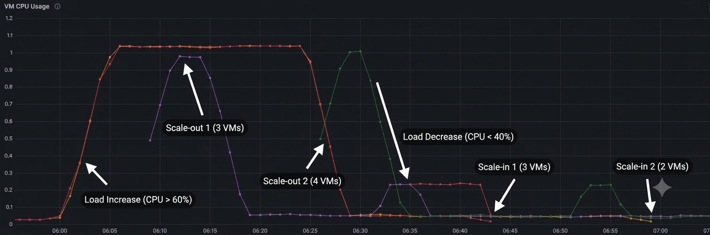
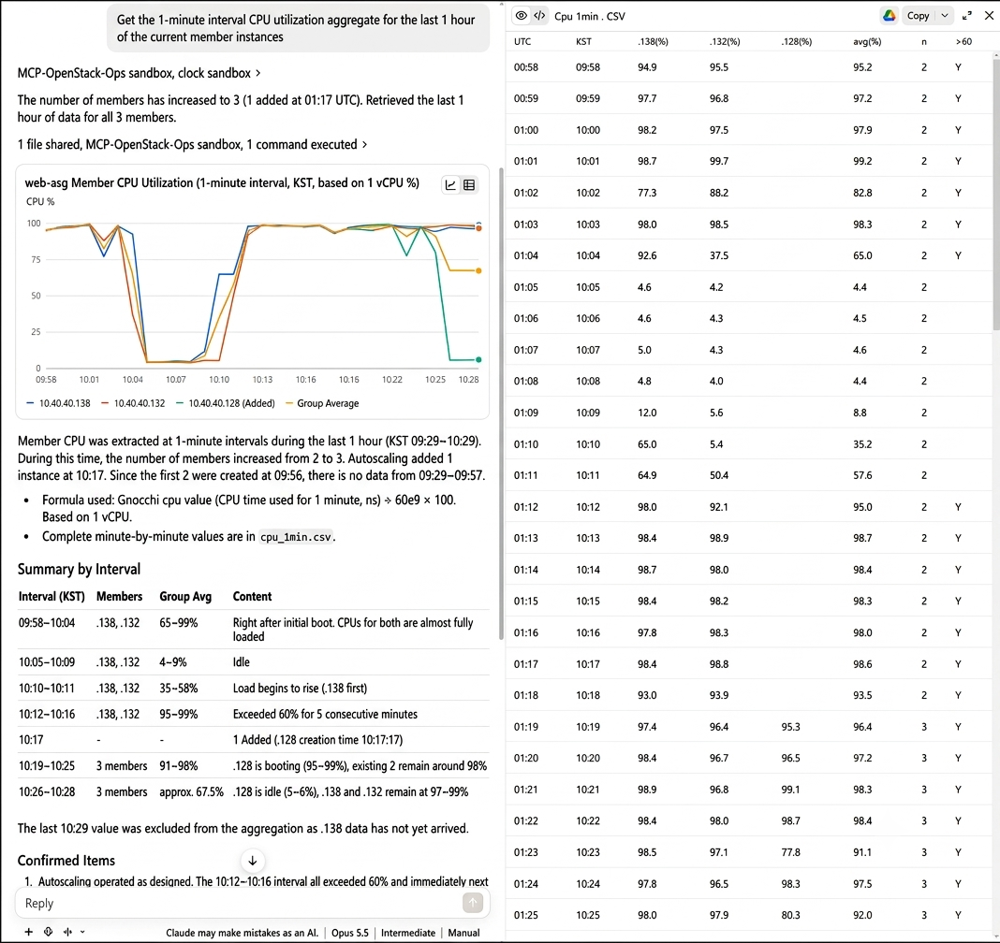
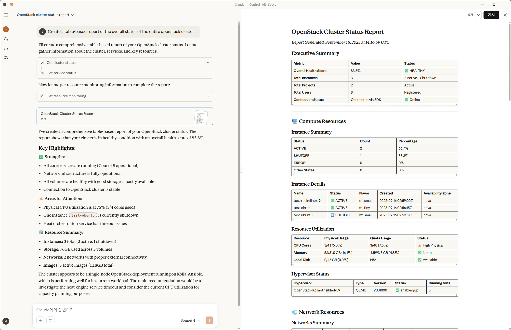
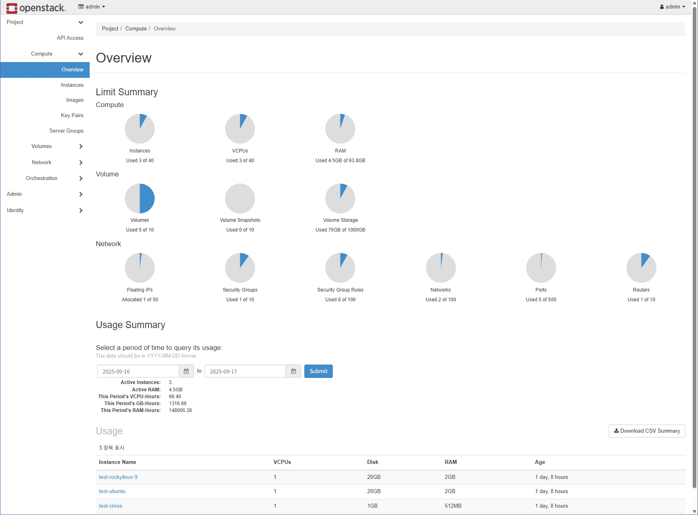

**English** | [Korean](README.ko.md)

# MCP-OpenStack-Ops

> **MCP OpenStack Operations Server**: A comprehensive MCP (Model Context Protocol) server providing OpenStack project management and monitoring capabilities with built-in safety controls and single-project scope.

[](https://mcpvault.io/servers/mcp-openstack-ops/health?utm_source=external_badge&utm_medium=referral&utm_campaign=mcp_health_report)

[](https://opensource.org/licenses/MIT)


[](https://www.buymeacoffee.com/call518)

[](https://github.com/call518/MCP-OpenStack-Ops/actions/workflows/pypi-publish.yml)


---

## What is MCP-OpenStack-Ops?

MCP-OpenStack-Ops lets an AI assistant such as Claude or a model in OpenWebUI
inspect and operate an OpenStack project in plain language. It is an
[MCP](https://modelcontextprotocol.io/) server that turns requests like "which
instances are stopped?" into OpenStack API calls and returns the results.

- **Read-only by default**: tools that create, change or delete resources are
  not even registered unless you enable them.
- **One project at a time**: each server works inside one OpenStack project and
  checks resource ownership.
- **Broad coverage**: 122 tools (62 read-only, 60 management) for Nova,
  Neutron, Cinder, Glance, Keystone, Heat, Octavia, Barbican, and Gnocchi/Aodh
  telemetry.

For an AI-generated walkthrough of the code, see
[](https://deepwiki.com/call518/MCP-OpenStack-Ops).

## What can you do with it?

**Showcase: a Heat autoscaling stack created from natural language alone**



**No Heat template was written by hand: the stack was created from this
two-line natural-language request.**

```text
Use the test-rockylinux-9 VM (web server) as the source for a new base image. Create and bring up a Heat stack with a TLS-terminating load balancer and autoscaling web servers.
- Run 2 web servers under normal conditions, with a maximum of 4. Scale out by 1 when average CPU utilization stays above 60% for 5 minutes, and scale in by 1 when it stays below 40% for 5 minutes, down to a minimum of 2. Use a 900-second cooldown and set the stack's timeout_mins to 60.
```

Using this server's tools, the MCP client snapshotted a web server VM into a
base image, generated a self-signed certificate and stored it in Barbican, and
created a Heat stack with an Octavia load balancer that terminates HTTPS and an
autoscaling group driven by Aodh CPU alarms. Under CPU load the group grew from
two to four web servers and shrank back to two when the load ended. The
request, templates and a walkthrough of the chart are in the
[Heat autoscaling tutorial](docs/heat-autoscaling-tutorial.md).

**Then ask how it is doing, in one line**



A one-line request for the members' CPU over the last hour, at 1-minute
intervals, returned per-member data from Gnocchi through this server's tools;
the client drew the chart, summary and CSV. It shows the group mean above 60%
for five minutes and the third member added right after.

Ask questions and give instructions in natural language, for example:

```text
Show me the overall cluster status
Find instances in SHUTOFF state
Show all networks and their subnets
List all volumes and their status
Show the vCPUs and memory allocated to my project and the remaining quota
Show CPU usage of web-01 over the last hour
Stop all instances with name containing 'test'
```

The last request changes resources, so it works only after you enable
modification tools. Telemetry requests need Ceilometer and Gnocchi in the
cloud.

**More requests to try:** [Example queries by area](docs/usage-guide.md#example-queries-by-area)
lists copy-ready requests, with the tools each one uses, for cluster status,
instances, networks, storage, images, identity, Heat, load balancers, Barbican secrets and TLS listeners, allocation and quotas, Gnocchi telemetry, Aodh alarms,
troubleshooting, security, batch actions, and multi-tool reports.

**Example: cluster status in Claude Desktop**



**The same project in the OpenStack Dashboard (Epoxy 2025.1)**



## Quick Start

You need an OpenStack account (Keystone host, project, user name, password)
whose APIs are reachable from the computer that runs the server. Pick one of
the two paths below; both start read-only.

<a id="claude-desktop-integration"></a>

### Option A: Claude Desktop with the extension bundle (fastest)

1. Download `mcp-openstack-ops-<version>.mcpb` from the latest
   [GitHub Release](https://github.com/call518/MCP-OpenStack-Ops/releases).
2. In Claude Desktop, open **Settings > Extensions > Advanced settings >
   Install Extension…** and select the file.
3. Fill in the settings form: Keystone host, project, user name and password
   are required; ports, domains and region are prefilled. Leave **Allow modify
   operations** off.
4. Ask Claude: `List the instances in my OpenStack project.`

Other Claude Desktop setups (`uvx`, a source checkout, the Docker server
through `mcp-remote`, a remote connector) are in the
[Claude Desktop guide](docs/claude-desktop-guide.md).

### Option B: OpenWebUI with Docker Compose

Requirements: Git, Docker with the Compose plugin, and a model provider for
OpenWebUI whose model supports tool calling.

**1. Configure**

```bash
git clone https://github.com/call518/MCP-OpenStack-Ops.git
cd MCP-OpenStack-Ops
cp .env.example .env
cp mcp-config.json.http mcp-config.json.http.local
chmod 600 mcp-config.json.http.local
openssl rand -hex 32   # use the output as WEBUI_SECRET_KEY
vi .env                # set WEBUI_SECRET_KEY and the OS_* values for your cloud
```

**2. Start**

```bash
docker compose up -d
docker compose ps      # wait until mcp-server is healthy
```

This starts OpenWebUI (`http://localhost:3000`), the MCP server
(`http://localhost:8000/mcp`) and MCPO (`http://localhost:8080`).

**3. Connect a model provider**

These steps apply to both the direct MCP connection and MCPO.

1. Open `http://localhost:3000` and create the administrator account.
2. Under **Settings → Admin → Connections**, add an OpenAI connection with URL
   `https://api.openai.com/v1`, **Auth** `Bearer` with your OpenAI API key, and
   **API Type** set to **Chat Completions**, then save it. For another provider,
   see the [OpenWebUI guide](docs/openwebui-guide.md#3-configure-openwebui-013).
3. The Quick Start calls tools through Chat Completions with model reasoning
   turned off, using this default already present in `.env.example`:

   ```dotenv
   DEFAULT_MODEL_PARAMS={"reasoning_effort":"none"}
   ```

   This value requires **API Type: Chat Completions**. With **Responses**,
   OpenWebUI 0.13.0 still sends `reasoning_effort`, and every request fails with
   `Unsupported parameter: 'reasoning_effort'`. If the `open-webui-data` volume
   already exists, set the same value under **Settings → Admin → Models → Model
   Defaults → Model Parameters** because its saved database value takes
   precedence. To keep model reasoning through **Responses** instead, see the
   [OpenWebUI guide](docs/openwebui-guide.md#33-configure-openai-reasoning-models).

**4. Connect the MCP server**

1. Under **Settings → Admin → Tools → Integrations → External Tool Servers**,
   add a connection of type `MCP (Streamable HTTP)` with URL
   `http://mcp-server:8000/mcp` and authentication `None`.
2. Under **Settings → Admin → System → Interface → Chat**, turn on **Tool
   Search** and **Defer Built-in Tools**, and set **Deferral Threshold** to `0`
   so that the full tool list fits the model's limits.
3. In a new chat, enable the connection under **Integrations → Tools** and ask:
   `Use mcp-openstack-ops to list the instances in my OpenStack project.`

> **MCPO is optional.** MCPO is a proxy that exposes the MCP tools as an
> OpenAPI (REST) server; OpenWebUI does not need it to use this server. The
> Compose file starts it so that you can choose either connection. To run
> without it, start only `docker compose up -d mcp-server open-webui`.

The [OpenWebUI guide](docs/openwebui-guide.md) explains the direct and MCPO
connections, every OpenWebUI setting, OpenAI reasoning models, and
troubleshooting.

### Other ways to install

| Setup | Guide |
| --- | --- |
| Claude Desktop with `uvx`, a source checkout, `mcp-remote`, or a remote connector | [Claude Desktop guide](docs/claude-desktop-guide.md) |
| Claude Code | [Claude Code guide](docs/claude-code-guide.md) |
| Codex (ChatGPT desktop app, CLI, IDE extension) with `uvx` or an HTTP server | [Codex guide](docs/codex-guide.md) |
| OpenWebUI through MCPO (OpenAPI) | [OpenWebUI guide](docs/openwebui-guide.md) |
| Each user signs in with their own OpenStack Application Credential (experimental) | [Multi-user guide](docs/multi-user-guide.md) |
| Several projects, HTTPS and private CAs, custom endpoints and ports | [Configuration guide](docs/configuration.md) |

To let the assistant create, change or delete resources, set
`ALLOW_MODIFY_OPERATIONS=true` (or turn on **Allow modify operations** in the
Claude Desktop form) and restart the server. OpenStack policy still decides
what the account may do.

## Features

- ✅ **Project-Scoped Operations**: Every tool enforces the configured `OS_PROJECT_NAME`, validating resource ownership so actions stay inside a single tenant.
- ✅ **Safety-Gated Writes**: Modify (`set_*`) tooling only registers when `ALLOW_MODIFY_OPERATIONS=true`, keeping default deployments read-only and auditable.
- ✅ **Broad Tool Coverage**: 122 tools across compute, networking, storage, images, identity, Heat, Octavia load balancing, Barbican secrets and telemetry. Project resources are scoped to the active project; cloud-wide administrative APIs remain subject to OpenStack policy.
- ✅ **Bulk & Filtered Actions**: Instance, volume, network, image, snapshot, and keypair managers accept comma-delimited targets or filter criteria to orchestrate bulk changes intentionally.
- ✅ **Post-Action Feedback & Async Guidance**: Management tools report per-resource results, the status read back after the action, and timing notes for asynchronous operations.
- ✅ **Monitoring & Usage Insights**: `get_service_status`, `get_resource_monitoring`, `get_usage_statistics`, and quota tools report service probes, project allocations, separate quota limits, and API-backed compute allocation-hours. These tools do not collect live utilization or trends; read-only `get_gnocchi_*` tools return telemetry time series when Ceilometer and Gnocchi are deployed.
- ✅ **Unified Instance Queries**: The `get_instance` tool consolidates name, ID, status, and free-form search paths with pagination plus summary/detailed modes.
- ✅ **Server Insight & Audit Trail**: Dedicated tools expose server events, hypervisor details, availability zones, quotas, and resource ownership to speed diagnostics.
- ✅ **Load Balancer Management**: Octavia tools cover listeners, pools, members, health monitors, flavors, quotas, and amphora operations with the same safety gates. `TERMINATED_HTTPS` listeners take certificates stored in Barbican, and pools support non-terminated HTTPS (TLS passthrough) and backend re-encryption, including client authentication (mTLS).
- ✅ **Barbican Secrets Without Payloads**: Barbican tools manage secret metadata, containers, key-generation orders, ACLs and self-signed TLS certificates. Secret payloads are never accepted or returned, so key material cannot reach the LLM; register your own certificates outside MCP ([Barbican and TLS guide](docs/barbican-tls-guide.md)).
- ✅ **Connection & Deployment Flexibility**: Connection caching, configurable service endpoints, Docker packaging, a Claude Desktop extension, and both `stdio`/`streamable-http` transports support proxy/bastion and multi-project setups.
- 🧭 **Advanced: Cross-Project Reads**: Administrators can ask about every project at once ("List VMs per project"), and operators can give read-only, cloud-wide views to non-admin teams through OpenStack policy. Off by default; see the [cross-project reads guide](docs/cross-project-guide.md).

## Safety and security

- **Read-only by default.** Management tools are registered only with
  `ALLOW_MODIFY_OPERATIONS=true`.
- **One project per server.** Resources are filtered by the current project
  and checked for ownership; run one server per project to manage several.
  Reading across projects is an advanced, opt-in feature; see the
  [cross-project reads guide](docs/cross-project-guide.md).
- **Protect HTTP access.** Over `streamable-http`, enable Bearer token
  authentication (`REMOTE_AUTH_ENABLE=true`) and HTTPS before exposing the
  server beyond localhost.

Details: [security guide](docs/security.md) and
[multi-user guide](docs/multi-user-guide.md).

## Authentication support by client

Each server authenticates to OpenStack with either one account's password (the
default) or per-user Application Credentials (multi-user mode, `streamable-http`
only). Support differs by client; for example, the Claude Desktop extension
bundle supports only the password, while Claude Desktop with `mcp-remote` in
`claude_desktop_config.json` supports both. Codex started with `uvx` from
`config.toml` supports only the password. See
[Authentication support by client](docs/security.md#authentication-support-by-client).

## Compatibility

> ⚠️ **Compatibility Notice**: This MCP server is developed and optimized for **OpenStack Epoxy (2025.1)** as the primary target environment. However, it is compatible with most modern OpenStack releases (Dalmatian, Caracal, Bobcat, etc.) as the majority of APIs remain consistent across versions. Only a few specific API endpoints may require adaptation for full compatibility with older releases.
>
> 🚧 **Coming Soon**: Dynamic multi-version OpenStack API compatibility is actively under development and will be available in upcoming releases, providing seamless support for all major OpenStack deployments automatically.

**Officially Supported Releases:**
- ✅ OpenStack **Epoxy (2025.1)** - Fully tested
- ✅ OpenStack **Dalmatian (2024.2)** - Fully tested

**OpenStackSDK Version Reference:**
| OpenStack Release | Recommended SDK Version | Notes |
|-------------------|------------------------|-------|
| Epoxy (2025.1) | `>=4.1.0,<=4.24.0` | Current default range; `uv.lock` pins 4.24.0. Unit tests pass with 4.1.0, 4.9.0, 4.22.0 and 4.24.0 (4.24.0 on 2026-11-23; live checks used 4.22.0 or earlier) |
| Dalmatian (2024.2) | `>=3.2.0` | Fully compatible |
| Caracal (2024.1) | `>=3.1.0` | May require testing |
| Bobcat (2023.2) | `>=3.0.0` | May require testing |
| Wallaby (2021.1) | `==3.1.1` | Downgrade required |

To change the SDK version for an older release, see
[OpenStack SDK version for older releases](docs/configuration.md#openstack-sdk-version-for-older-releases).

## Documentation

| Guide | Contents |
| --- | --- |
| [Usage guide](docs/usage-guide.md) | [Example queries by area](docs/usage-guide.md#example-queries-by-area), bulk and filtered actions, post-action status, pagination |
| [OpenWebUI guide](docs/openwebui-guide.md) | Docker Compose stack, direct MCP versus MCPO, OpenWebUI settings, troubleshooting |
| [Claude Desktop guide](docs/claude-desktop-guide.md) | Extension bundle, `uvx`, source checkout, `mcp-remote`, remote connector |
| [Claude Code guide](docs/claude-code-guide.md) | Registering the HTTP server in Claude Code |
| [Codex guide](docs/codex-guide.md) | `config.toml` entries for `uvx` and an HTTP server, with every stdio variable |
| [Configuration guide](docs/configuration.md) | Command-line options, environment variables, [access modes and `.env` settings](docs/configuration.md#access-modes-and-env-settings), endpoints, HTTPS, multiple projects, SDK version |
| [Security guide](docs/security.md) | Authentication support by client, project isolation, read-only default, Bearer authentication |
| [Multi-user guide](docs/multi-user-guide.md) | Per-user Application Credential authentication (experimental) |
| [Cross-project reads guide](docs/cross-project-guide.md) | Advanced, opt-in: reading across projects, setups, required OpenStack policy |
| [Barbican and TLS guide](docs/barbican-tls-guide.md) | Barbican prerequisites, why secret payloads are excluded, self-signed certificates, `TERMINATED_HTTPS` listeners, non-terminated HTTPS (TLS passthrough) and backend re-encryption, step-by-step client authentication (mTLS) |
| [Heat autoscaling tutorial](docs/heat-autoscaling-tutorial.md) | Heat stack with a `TERMINATED_HTTPS` load balancer and Aodh-driven autoscaling web servers: request, templates, verification, scaling walkthrough |
| [Development guide](docs/development.md) | Tests, live tool checks, adding tools, contributing |
| [TODO](ToDo.md) | Outstanding implementation and live-validation work |
| [OpenStack CLI vs MCP tools mapping](#-openstack-cli-vs-mcp-tools-mapping) | Every tool, its CLI equivalent, and its validation status |
| [Validation evidence](docs/validation.md) | Dates, revisions, conditions and counts of the live and unit-test checks |

---

## 📊 OpenStack CLI vs MCP Tools Mapping

✅ denotes an implemented API path, not certification of every action or
OpenStack deployment. **⚠️ Live unverified** identifies paths without successful
live validation; **❌ Not implemented** identifies unavailable capabilities.
Service availability, permissions, and asynchronous completion affect results.
See [API prerequisites and result semantics](#api-prerequisites-and-result-semantics)
and the [multi-user setup guide](docs/multi-user-guide.md).

**Validation evidence:** the live checks, Claude Code prompt checks and
unit-test results behind the Status values below are recorded in
[docs/validation.md](docs/validation.md).

**Detailed Mapping by Category**

### 1. 🖥️ **Compute (Nova)**

| OpenStack CLI Command | MCP Tool | Status | Notes |
|---------------------|---------|------|------|
| `openstack server list` | `get_instance` | ✅ | Separate reader projects each returned exactly ten owned VMs; bounded lab validation only. One call returns at most `LIST_MAX_LIMIT` items (default 100, previously a fixed 200; 2026-11-17, unit-tested only). Each instance's `flavor` reports its name and sizes; a flavor given only by ID (compute microversion below 2.47) is looked up, and sizes that cannot be determined are `null`, not 0 (2026-11-20 targeted check: names filled for all listed VMs). In detailed mode (`detailed=true`) each instance reports `description`; summary mode omits it. 2026-11-23 UTC targeted check: a description set on a VM was read back |
| `openstack server show` | `get_instance` | ✅ | Own fixture queries completed; foreign private ID returned no details; no 16-owned-ID batch claim. Each instance reports `boot_source` (`image` or `volume`); summary mode shows a volume-backed instance's image as unknown, and `detailed=true` resolves it from the boot volume. 2026-11-10 OpenStack 2026.1 check (3.7.6): `volume` for volume-backed servers in summary and detailed modes, `image` otherwise; detailed mode resolved the image name from the boot volume. `description` (detailed mode): 2026-11-23 UTC targeted check read back a description set on a VM |
| `openstack server create` | `set_instance` (action="create") | ✅ | **ENHANCED** - Bulk creation support. Boots the image on the flavor's local disk unless a volume option below is given. 2026-11-10 targeted check: a server reached ACTIVE |
| `openstack server create --boot-from-volume <size>` | `set_instance` (action="create", `boot_from_volume`, `volume_size`) | ✅ | Root disk on a new Cinder volume created from the image; optional `volume_type` and `delete_on_termination`; bulk creation supported. 2026-11-10 targeted check: three servers created in one call reached ACTIVE, each on a bootable 10 GB volume at `/dev/vda`. 2026-11-10 OpenStack 2026.1 check (3.7.6): 1 GB root volumes with `volume_type`; the root volume was deleted with the server, and kept with `delete_on_termination=false` |
| `openstack server create --volume` | `set_instance` (action="create", `boot_volume`) | ✅ | Boots one server from an existing available, bootable volume, without an image. 2026-11-10 OpenStack 2026.1 check (3.7.6): the server reached ACTIVE on that volume; an in-use, non-bootable or missing volume, and two server names, were refused without creating a server |
| `openstack server start/stop/reboot` | `set_instance` | ✅ | Tool schema exposes all actions and `reboot_type`; bulk stop/start final states verified for two test VMs per project, but reboot was not retested in this round |
| `openstack server delete` | `set_instance` (action="delete") | ✅ | Tool schema exposes delete and optional force deletion; bulk deletion with `name_contains` filtering. Every given filter must match (`name_contains` with `status` previously selected the union), and more matches than `INSTANCE_FILTER_MAX_MATCHES` (default 100) are refused without acting on any instance (2026-11-17, unit-tested only). `force=true` uses openstacksdk `delete_server(force=True)` (previously a non-existent SDK method); 2026-11-10 targeted check: forced deletion removed the server |
| `openstack server backup create` | `set_server_backup` | ✅ | Nova backup action with rotation; asynchronous, no custom metadata |
| `openstack server image create` | `set_instance` (action="snapshot") | ✅ | Accepts optional `snapshot_name` and JSON `metadata`; parameter forwarding is locally tested, not live-retested in this change |
| `openstack server shelve/unshelve` | `set_instance` | ✅ | Actions are exposed in the tool schema; instance shelving was not live-retested in this change |
| `openstack server lock/unlock` | `set_instance` | ✅ | Instance locking. `get_instance_details` reports `locked` from the SDK `is_locked` field (previously always false); 2026-11-10 targeted check: reported true after lock and false after unlock, matching Nova |
| `openstack console url show` | `set_instance` (action="console") | ✅ | Uses the Nova remote-consoles API (the legacy console actions return 404 on current Nova). `console_type`: novnc (default), spice-html5, rdp-html5, serial, webmks, spice-direct, subject to cloud support. 2026-11-10 targeted check: a noVNC URL was returned |
| `openstack server pause/unpause` | `set_instance` | ✅ | Instance pausing |
| `openstack server suspend/resume` | `set_instance` | ✅ | Instance suspension |
| `openstack server resize` | `set_instance` (action="resize") | ✅ | Uses the existing `flavor` parameter as the target flavor; action exposure is locally tested |
| `openstack server resize confirm` | `set_instance` (action="confirm_resize") | ✅ | Resize confirmation |
| `openstack server resize revert` | `set_instance` (action="revert_resize") | ✅ | Resize revert |
| `openstack server rebuild` | `set_instance` (action="rebuild") | ✅ | Uses `image` and supports optional `new_name`, JSON `metadata`, and `preserve_ephemeral`. The image is passed as openstacksdk expects (previously the rebuild failed), and `metadata` is sent only when given because Nova replaces server metadata on rebuild. 2026-11-10 targeted check: rebuilt to ACTIVE and existing metadata was kept |
| `openstack server rescue/unrescue` | `set_instance` | ✅ | Tool schema exposes both actions and optional `rescue_image_id`; not live-retested in this change |
| `openstack server migrate` | `set_server_migration` (action="migrate") | ✅ | Live migration |
| `openstack server evacuate` | `set_server_migration` (action="evacuate") | ⚠️ Live unverified | Server evacuation. `on_shared_storage` is sent only when explicitly true; Nova rejects that field from compute microversion 2.14. 2026-11-10 targeted check: on a single host whose compute service was up, Nova refused the request for that reason, not for a schema error, and the server stayed ACTIVE; an actual evacuation needs a failed host and a second compute host |
| `openstack server migration list` | `set_server_migration` (action="list") | ✅ | Migration listing. With `instance_name`, lists that server's migrations (previously always empty); a listing failure is reported instead of an empty success, and the all-migrations listing reads the SDK `server_id`. 2026-11-10 targeted check: per-server listing returned and an unknown server returned an error |
| `openstack server migration show` | `set_server_migration` (action="show") | ✅ | Migration details |
| `openstack server migration abort` | `set_server_migration` (action="abort") | ✅ | Migration abort |
| `openstack server migration confirm` | `set_server_migration` (action="confirm") | ✅ | Migration confirmation |
| `openstack server migration force complete` | `set_server_migration` (action="force_complete") | ✅ | Force migration completion |
| `openstack server add network` | `set_server_network` (action="add_network") | ✅ | Network attachment. Nova creates the interface port, so removing the network deletes it again. 2026-11-10 targeted check: attached |
| `openstack server remove network` | `set_server_network` (action="remove_network") | ✅ | Network detachment. 2026-11-10 targeted check: no interface port was left, and the network could be deleted afterwards |
| `openstack server add port` | `set_server_network` (action="add_port") | ✅ | Port attachment by port name or ID (a name was previously reported as not found). 2026-11-10 targeted check: attached by name |
| `openstack server remove port` | `set_server_network` (action="remove_port") | ✅ | Port detachment by name or ID; detaching does not delete a port you created. 2026-11-10 targeted check: detached by name and the port was kept |
| `openstack server add floating ip` | `set_server_floating_ip` (action="add") | ✅ | Floating IP association |
| `openstack server remove floating ip` | `set_server_floating_ip` (action="remove") | ✅ | Floating IP disassociation |
| `openstack server add fixed ip` | `set_server_fixed_ip` (action="add") | ✅ | Fixed IP addition through a new interface whose port Nova creates. 2026-11-10 targeted check: an address from the requested network was assigned |
| `openstack server remove fixed ip` | `set_server_fixed_ip` (action="remove") | ✅ | Detaches the whole interface that holds the address, which can be the primary interface. 2026-11-10 targeted check: removed and no interface port was left |
| `openstack server add security group` | `set_server_security_group` (action="add") | ✅ | Security group addition |
| `openstack server remove security group` | `set_server_security_group` (action="remove") | ✅ | Security group removal |
| `openstack server add volume` | `set_server_volume` (action="attach") | ✅ | Member attach reached in-use via set_server_volume; guest I/O not tested. The multiattach precheck reads the SDK `is_multiattach` field. 2026-11-10 targeted check (administrator): reached in-use |
| `openstack server remove volume` | `set_server_volume` (action="detach") | ✅ | Member detach reached available via set_server_volume. 2026-11-10 targeted check (administrator): reached available |
| `openstack server set` | `set_server_properties` (action="set") | ✅ | Server property setting |
| `openstack server unset` | `set_server_properties` (action="unset") | ✅ | Server property unsetting |
| `openstack server dump create` | `set_server_dump` | ❌ Not implemented | Nova's trigger-crash-dump action (microversion 2.17, openstacksdk `trigger_server_crash_dump`) is not exposed. The tool returns an explicit unsupported result; no dump is created |
| `openstack server event list` | `get_server_events` | ✅ | Pass the server name or UUID via `instance_name`, not `server_id`. The action list has no completion time; set `include_event_details=true` to fetch per-action event results and derive the latest finish time. Detailed lookup is capped at 10 actions. Event visibility follows Nova policy |
| `openstack server group list` | `get_server_groups` | ✅ | Server group listing. Reads `member_ids` and, from compute microversion 2.64, `policy` instead of `policies`; a listing failure is reported instead of an empty list. 2026-11-10 targeted check: listed with its policy |
| `openstack server group create/delete` | `set_server_group` | ✅ | Server group management. 2026-11-10 targeted check: create and show reported the policy and members, then the group was deleted |
| `openstack flavor list --long` | `get_flavors` | ✅ | Read-only; registered without modification tools. Reports extra specs (fetched separately below compute microversion 2.61; `null` with `extra_specs_error` when unreadable) and an `accelerators` summary of PCI passthrough and VGPU/PGPU requests; `name_contains` and `accelerators_only` filters. 2026-11-20 targeted check: 24 flavors with extra specs, two GPU flavors found |
| `openstack flavor list` | `set_flavor` (action="list") | ✅ | Same listing; registered only with modification tools. Prefer `get_flavors` |
| `openstack flavor create/delete` | `set_flavor` | ✅ | Flavor management |
| `openstack keypair list` | `get_keypair_list` | ✅ | Empty scoped read completed; member keypair creation/deletion read-back tested separately |
| `openstack keypair create/delete` | `set_keypair` | ✅ | Explicit member MCP create/delete read-back passed; no successful Claude write workflow claimed |
| `openstack hypervisor list` | `get_hypervisor_details` | ✅ | Administrator lookup verified; missing per-host capacity and incomplete totals are null, not zero. Global enhanced statistics remain separate; when `/os-hypervisors/statistics` is unavailable (removed at compute microversion 2.88), `enhanced_stats_note` explains why. That note is unit-tested only; in the 2026-11-10 targeted check the statistics API still returned data |
| `openstack availability zone list` | `get_availability_zones` | ✅ | Compute/Cinder availability reads the SDK state mapping; missing availability is null. Actual available zones verified |

### 2. 🌐 **Network (Neutron)**

| OpenStack CLI Command | MCP Tool | Status | Notes |
|---------------------|---------|------|------|
| `openstack network list` | `get_network_details` | ✅ | Two owned private networks plus one policy-visible shared external network per reader; no other test project private networks. Reports each network's `qos_policy_id` and `description`; 2026-11-23 UTC targeted check: both read back from a test network |
| `openstack network show` | `get_network_details` (network_name) | ✅ | Foreign-ID negative checked. A name that matches nothing returns an explicit error (previously an empty success). 2026-11-10 targeted check (administrator): named lookup returned the network and a missing name returned the error; a dual-project positive lookup by reader roles is still not asserted. `qos_policy_id` and `description` in the result: 2026-11-23 UTC targeted check read both back |
| `openstack network create` | `set_networks` (action="create") | ✅ | Default mtu=0 omits the wire field: backend MTU 1450 verified; explicit 1400 retained in both member projects |
| `openstack network delete` | `set_networks` (action="delete") | ✅ | Both default/explicit-MTU test networks removed through actual TCP MCP, API absence confirmed |
| `openstack network set` | `set_networks` (action="update") | ✅ | **ENHANCED** - Bulk updates |
| `openstack subnet list` | `get_network_details` (includes subnets) | ✅ | Owned and shared external network subnets returned; three visible subnets per test reader |
| `openstack subnet create/delete` | `set_subnets` | ✅ | Create omits an unset `gateway_ip`, so Neutron assigns the first address of the CIDR (previously it sent null, which creates a subnet without a gateway), and forwards `description` (previously dropped); `list` and `show` report `description`. 2026-11-23 UTC targeted check: a subnet created without `gateway_ip` got the first address and read back its description; delete returned Neutron's 409 while a router interface used the subnet, and succeeded after the interface was removed. Earlier live check: member TCP MCP subnet create read back; deletion allowed parent network removal in both projects |
| `openstack router list` | `get_routers` | ✅ | Reports static `routes`; when the interface lookup fails, `interfaces` and `interface_count` are `null` with `interfaces_error` (previously an empty list). 2026-11-23 UTC targeted check (administrator): routers listed with their interfaces and a static route. The `interfaces_error` path is **Live unverified** (a failing interface lookup could not be induced), and reader results were not attributed separately |
| `openstack router create/delete` | `set_routers` | ✅ | Project-owned routers; attached interfaces are not removed automatically |
| `openstack floating ip list` | `get_floating_ips` | ✅ | Floating IP listing. A failed query returns an error instead of a placeholder address. 2026-11-10 targeted check: listed. Reports each floating IP's `qos_policy_id`; 2026-11-23 UTC targeted check: read back |
| `openstack floating ip create` | `set_floating_ip` (action="create") | ✅ | Floating IP creation. `description`, `port_id` and `floating_ip_address` are forwarded (previously dropped). 2026-11-10 targeted check: created with its description; `port_id` and `floating_ip_address` on create were not live-tested |
| `openstack floating ip delete` | `set_floating_ip` (action="delete") | ✅ | Floating IP deletion. 2026-11-10 targeted check: released |
| `openstack floating ip set` | `set_floating_ip` (action="set") | ✅ | Floating IP property setting |
| `openstack floating ip show` | `set_floating_ip` (action="show") | ✅ | Floating IP details. 2026-11-10 targeted check: shown by ID |
| `openstack floating ip unset --port` | `set_floating_ip` (action="disassociate"), `set_server_floating_ip` (action="remove") | ✅ | Detaches the port and keeps the floating IP. `set_server_floating_ip` (action="remove") is the same path as `openstack server remove floating ip`; `disassociate` has no separate dated live check |
| `openstack floating ip unset --tag` / `--all-tag` | — | ❌ Not implemented | No tool clears a floating IP's tags. `set_floating_ip` (action="unset") exposes no parameter that selects what to clear and always returns an error; use `disassociate` to detach the port, and `set_network_qos_policies` (action="disassociate") to clear its QoS policy |
| `openstack floating ip pool list` | `get_floating_ip_pools` | ✅ | Available global pool capacity remains unknown (`available_ips=null`). A failed query returns an error instead of a placeholder pool. 2026-11-10 targeted check: the external network pool was listed |
| `openstack floating ip port forwarding create` | `set_floating_ip_port_forwarding` (action="create") | ✅ | Creates a rule. Floating IP by ID or address, owned by the current project (since 2026-11-23; previously `delete`, `show` and `set` took only an ID, and an administrator could act on another project's floating IP). 2026-11-23 UTC targeted check (Neutron `port_forwarding` service plugin and L3 agent extension enabled): create, list, set (description), show and delete passed, and the DNAT rule appeared in and left the router namespace; after the fix every action refused another project's floating IP. Forwarded traffic was not measured: the lab host cannot reach the external network |
| `openstack floating ip port forwarding delete` | `set_floating_ip_port_forwarding` (action="delete") | ✅ | Deletes a rule. Floating IP by ID or address, owned by the current project (since 2026-11-23; previously `delete`, `show` and `set` took only an ID, and an administrator could act on another project's floating IP). 2026-11-23 UTC targeted check (Neutron `port_forwarding` service plugin and L3 agent extension enabled): create, list, set (description), show and delete passed, and the DNAT rule appeared in and left the router namespace; after the fix every action refused another project's floating IP. Forwarded traffic was not measured: the lab host cannot reach the external network |
| `openstack floating ip port forwarding list` | `set_floating_ip_port_forwarding` (action="list") | ✅ | Lists the rules of one floating IP. Floating IP by ID or address, owned by the current project (since 2026-11-23; previously `delete`, `show` and `set` took only an ID, and an administrator could act on another project's floating IP). 2026-11-23 UTC targeted check (Neutron `port_forwarding` service plugin and L3 agent extension enabled): create, list, set (description), show and delete passed, and the DNAT rule appeared in and left the router namespace; after the fix every action refused another project's floating IP. Forwarded traffic was not measured: the lab host cannot reach the external network |
| `openstack floating ip port forwarding set` | `set_floating_ip_port_forwarding` (action="set") | ✅ | Changes description or internal target. Floating IP by ID or address, owned by the current project (since 2026-11-23; previously `delete`, `show` and `set` took only an ID, and an administrator could act on another project's floating IP). 2026-11-23 UTC targeted check (Neutron `port_forwarding` service plugin and L3 agent extension enabled): create, list, set (description), show and delete passed, and the DNAT rule appeared in and left the router namespace; after the fix every action refused another project's floating IP. Forwarded traffic was not measured: the lab host cannot reach the external network |
| `openstack floating ip port forwarding show` | `set_floating_ip_port_forwarding` (action="show") | ✅ | Shows one rule; Neutron returns no timestamps for rules, so `created_at` and `updated_at` are `null` (previously "unknown"). Floating IP by ID or address, owned by the current project (since 2026-11-23; previously `delete`, `show` and `set` took only an ID, and an administrator could act on another project's floating IP). 2026-11-23 UTC targeted check (Neutron `port_forwarding` service plugin and L3 agent extension enabled): create, list, set (description), show and delete passed, and the DNAT rule appeared in and left the router namespace; after the fix every action refused another project's floating IP. Forwarded traffic was not measured: the lab host cannot reach the external network |
| `openstack security group list` | `get_security_groups` | ✅ | Scoped reader list completed; default and test groups visible. A failed query returns an error instead of a placeholder `default` group. Each rule reports its `description`; 2026-11-23 UTC targeted check: read back |
| `openstack security group create/delete` | `set_security_groups` | ✅ | Project-owned security groups |
| `openstack security group rule create/delete` | `set_security_group_rules` | ✅ | Implemented for project-owned groups. Create requires an explicit CIDR or project-owned remote group; delete verifies the rule belongs to the selected group. 2026-11-23 UTC targeted check: a rule with a CIDR and description was created and read back; a rule without CIDR or remote group was refused; deleting the rule through another group was refused, and through its own group succeeded |
| `openstack port list/show` | `set_network_ports` (action="list"/"show") | ✅ | Require modification-tool registration. Both return only ports owned by the current project (since 2026-11-23; previously an administrator credential also got every other project's ports) and report `description`, `qos_policy_id` (attached to the port) and `qos_network_policy_id` (inherited from its network). 2026-11-23 UTC targeted check (administrator): list returned the project's 9 ports while the credential saw 13, and a port read back its description and two different QoS policy IDs |
| `openstack port create/delete` | `set_network_ports` | ✅ | Create omits unset `security_groups`, so Neutron applies the project's default group (previously it sent an empty list, which creates a port without any security group), and forwards `description` (previously dropped). 2026-11-23 UTC targeted check: a port created without `security_groups` got the project's default group and its description; delete succeeded and the port was gone |
| `openstack network qos policy list` | `get_network_qos_policies`, `set_network_qos_policies` (action="list") | ✅ | Lists project-owned policies with their rules, and separately `shared_from_other_projects`. 2026-11-21 UTC targeted check: owned policies listed with rules. 2026-11-23 UTC targeted check: a policy that another project shared was listed in `shared_from_other_projects` with its rule |
| `openstack network qos policy show` | `get_network_qos_policies` (policy_name), `set_network_qos_policies` (action="show") | ✅ | Owned policies and policies other projects share; returns rules, `owned`, and a `warning` for shared policies. 2026-11-21 UTC targeted check: owned policy shown with its rules. 2026-11-23 UTC targeted check: another project's shared policy was shown with `owned: false` and the `warning`; updating it was refused |
| `openstack network qos policy create` | `set_network_qos_policies` (action="create") | ✅ | `shared=true` shares the policy with all projects and returns a `warning`. 2026-11-21 UTC targeted check: created; sharing was checked through `update`, not at creation |
| `openstack network qos policy set` | `set_network_qos_policies` (action="update") | ✅ | `new_name`, `description`, `shared` (`--share`/`--no-share`) on project-owned policies; an omitted `shared` keeps the current value. 2026-11-21 UTC targeted check: rename, description, share on and off read back, and the shared value was kept when omitted. 2026-11-23 UTC targeted check: unsharing an owned policy that another project's network used returned Neutron's 409 as an error |
| `openstack network qos policy delete` | `set_network_qos_policies` (action="delete") | ✅ | Project-owned policies only. 2026-11-21 UTC targeted check: deleted and confirmed absent |
| `openstack network qos rule create/set/delete` | `set_network_qos_policies` (action="add_rule"/"update_rule"/"delete_rule") | ✅ | Project-owned policies only. `rule_type`: bandwidth_limit, dscp_marking, minimum_bandwidth, packet_rate_limit, minimum_packet_rate; `rule` takes a JSON object whose fields are checked per type; update and delete read the type from the policy by `rule_id`. Rule types the QoS driver does not support are rejected by Neutron. Rule changes on a shared policy apply at once to other projects' resources. 2026-11-21 UTC targeted check: one rule of each of the five types added, a bandwidth rule updated and a DSCP rule deleted, all read back; an invalid DSCP mark was rejected by Neutron |
| `openstack network qos rule list` | `set_network_qos_policies` (action="show") | ✅ | Rules are returned with the policy. 2026-11-21 UTC targeted check: rules read back |
| `openstack port set/unset --qos-policy` | `set_network_qos_policies` (action="associate"/"disassociate", target_type="port") | ✅ | Project-owned ports only; accepts owned or shared policies. Takes effect on running traffic immediately. Success only when a read-back shows the expected `qos_policy_id`; disassociate requires that the port currently uses the named policy. 2026-11-21 UTC targeted check on a running VM port (ML2/OVS, hybrid iptables firewall): a 10 Mbps egress and ingress policy set `ingress_policing_rate` 10000 and a linux-htb queue with `max-rate` 10000000 on the `qvo` port, and disassociation removed both; throughput was not measured. Another project's port was refused and left unchanged |
| `openstack network set/unset --qos-policy` | `set_network_qos_policies` (action="associate"/"disassociate", target_type="network") | ✅ | Same rules as ports; applies to every port of the network that has no port-level policy. 2026-11-21 UTC targeted check: associate and disassociate confirmed by read-back on a network without ports; enforcement on member ports was not checked |
| `openstack floating ip set/unset --qos-policy` | `set_network_qos_policies` (action="associate"/"disassociate", target_type="floating_ip") | ✅ | Target by floating IP ID or address. The L3 agent must load the `fip_qos` extension. 2026-11-21 UTC targeted check: associate and disassociate by address confirmed by read-back on an unattached floating IP; enforcement in the router namespace was not checked |
| `openstack router set --qos-policy` / `--no-qos-policy` | `set_network_qos_policies` (action="associate"/"disassociate", target_type="router") | ✅ | Router external gateway; sends only `network_id` and `qos_policy_id`, so fixed IPs and SNAT stay unchanged. Fails for a router without a gateway. The L3 agent must load the `gateway_ip_qos` extension. 2026-11-21 UTC targeted check: associate and disassociate confirmed by read-back, gateway fixed IPs and SNAT unchanged, and a router without a gateway was refused; enforcement in the router namespace was not checked |
| `openstack network agent list` | `get_service_status` (includes agents) | ⚠️ Live unverified | Reader service-policy restrictions; partial data is not proof of global health. 2026-11-10 and 2026-11-23 targeted checks returned agents as administrator only (2026-11-23: all four agents of the lab) |
| `openstack network agent set` | `set_network_agents` | ✅ | Enable/disable cloud-wide agents; usually admin-only. 2026-11-23 UTC targeted check (administrator): the metadata agent was disabled and enabled again, and `is_admin_state_up` read back false, then true |

### 3. 💾 **Storage (Cinder)**

When the Block Storage service is not deployed, the Cinder volume, snapshot,
type, backup, group, QoS, transfer and server-volume paths report an explicit
"Block Storage (Cinder) service is not available" error with endpoint URLs
redacted. This was checked live on OpenStack 2026.1 without Cinder with
release 3.7.3 (see [validation](docs/validation.md)); the storage code is
unchanged since.

| OpenStack CLI Command | MCP Tool | Status | Notes |
|---------------------|---------|------|------|
| `openstack volume list` | `get_volume_list` | ✅ | Exactly ten owned volumes per reader; no other test project volume IDs returned. `multiattach` and `source_volid` read the SDK `is_multiattach` and `source_volume_id` fields. 2026-11-10 targeted check: listed with those fields |
| `openstack volume show` | `get_volume_list` | ✅ | Listing-based client filtering; no dedicated get_volume_list filter argument |
| `openstack volume create/delete` | `set_volume` | ✅ | Volume creation/deletion. 2026-11-10 targeted check: a 1 GB volume reached available and two volumes were deleted |
| `openstack volume create --snapshot` | `set_volume` (action="create", `source_snapshot`) | ✅ | Project snapshot by name or ID. `size` is sent only when larger than the snapshot; otherwise the volume takes the snapshot's size. Cinder may reject a `volume_type` other than the snapshot's ("requested type is not compatible"); to change the type, upload the volume to an image and create the new volume from that image. 2026-11-22 UTC targeted check: a 20 GB volume from the Cinder snapshot behind a boot-from-volume server snapshot reached available with the snapshot's size; an unknown snapshot was refused. A `volume_type` different from the snapshot's was not retried |
| `openstack image create --volume` | `set_volume` (action="upload_to_image", `image_name`, `disk_format`, `container_format`, `visibility`, `protected`) | ✅ | Cinder's `os-volume_upload_image`: Cinder copies the data to Glance itself; no image data passes through the MCP server, and no file path or URL is taken. One project-owned volume per call; the volume must be available, or in-use with `force=true` (the image may then be inconsistent). Asynchronous: returns the image ID with its current status; confirm `active` with `get_image_detail_list`. Glance needs room for a full copy. Turns the 0-byte image of a boot-from-volume server snapshot into an image with data: create a volume with `source_snapshot`, then upload it. 2026-11-22 UTC targeted check: a 20 GB volume uploaded as qcow2 went from `queued` to `active` in 90 s (849,084,416 bytes), the volume returned to available, and a `vt-qos-test-fe-pergb-min` volume created from the image was available and bootable. `visibility`, `protected`, `container_format`, `force` on an in-use volume and booting a server from the image were not checked |
| `openstack volume create --source`, `openstack volume migrate`, `openstack volume transfer request create` | — | ❌ Not implemented | `set_volume` rejects `source_volume`, `transfer_name`, `host`, `force_host_copy`, `lock_volume`, `backup_name` and `incremental` before any API call (previously ignored while the action ran). Use `set_volume_backups` for backups |
| `openstack volume set --size` | `set_volume` (action="extend") | ✅ | Positive new_size takes precedence over size; size remains a fallback. A test volume reached the requested size and available state; API acceptance alone is not completion |
| `openstack volume set` (other properties) | — | ❌ Not implemented | set_volume has no modify/update action; do not send this unsupported action |
| `openstack volume type list` | `get_volume_types` | ✅ | Volume type listing, private types included (since 2026-11-23; Cinder lists only public types to an administrator unless asked, so private types were missing). A failed query returns an error instead of a placeholder `standard` type. 2026-11-10 targeted check: listed. 2026-11-23 UTC targeted check: a private type was listed after the fix |
| `openstack volume type create/delete` | `set_volume_types` | ✅ | Volume type management; usually admin-only |
| `openstack volume snapshot list` | `get_volume_snapshots` | ✅ | Two owned base snapshots per reader; API final states checked |
| `openstack volume snapshot create/delete` | `set_snapshot` | ✅ | Explicit member MCP snapshots reached available and were deleted. Post-action status resolves snapshots instead of reporting an unknown resource type; no restore/I/O claim. 2026-11-10 targeted check (administrator): reached available and was deleted |
| `openstack backup list` | `get_volume_backups` | ✅ | Three owned available backups per reader; base backup creation used real Cinder APIs |
| `openstack backup create/delete` | `set_volume_backups` | ✅ | Volume backup management. 2026-11-10 targeted check: a backup reached available and was deleted |
| `openstack volume backup restore` | `set_volume_backups` (action="restore") | ✅ | Restores to a new volume named by `volume_name`, or to `volume_id`. Works with both the `volume_id=` and the `volume=` (openstacksdk 4.14+) restore signatures. 2026-11-10 targeted check (openstacksdk 4.22.0): restored to a new volume that reached available; restoring into an existing volume was not tested |
| `openstack volume transfer request list` | `get_volume_transfers` | ✅ | Request listing only; authorization keys are excluded |
| `openstack server volume list` | `get_server_volumes` | ✅ | Server volume listing. A server that does not exist returns an explicit error (previously an empty success). 2026-11-10 targeted check: listed the attached volume; a missing server returned the error |
| `openstack server add/remove volume` | `set_server_volume` / `set_volume` (action="attach"/"detach") | ✅ | Both paths reached in-use then available in both member projects; foreign endpoints rejected; guest I/O not tested |
| `openstack volume group list` | `get_volume_groups` | ✅ | Requires Cinder generic groups (API >= 3.13) |
| `openstack volume group create` | `set_volume_groups` | ✅ | Create/list/show/delete; create requires group_type and volume_types |
| `openstack volume qos list` | `get_volume_qos` | ✅ | Cinder QoS specifications; subject to cloud policy |
| `openstack volume qos show` | `get_volume_qos` (`qos_name`) | ✅ | Shows one specification and its current volume type associations. 2026-11-23 UTC targeted check: associations of two test types read back |
| `openstack volume qos create` | `set_volume_qos` | ✅ | Create/list/show/set/delete specifications. Creation does not automatically associate a volume type; use the explicit `associate` action |
| `openstack volume qos associate` | `set_volume_qos` (action="associate") | ✅ | Associates a specification with a volume type by name or ID, then reads the associations back and reports `accepted` separately from `confirmed`. Private volume types are found since 2026-11-23 (previously only public types). 2026-11-23 UTC targeted check: associations by name and by ID were confirmed, and a private type by name after the fix |
| `openstack volume qos disassociate` | `set_volume_qos` (action="disassociate") | ✅ | Disassociates one volume type by name or ID and reads the associations back. 2026-11-23 UTC targeted check: one of two associations was removed and confirmed; a private type after the fix |
| `openstack volume qos disassociate --all` | `set_volume_qos` (action="disassociate_all") | ✅ | Disassociates every volume type and reads the associations back. 2026-11-23 UTC targeted check: both associations were removed and confirmed |

### 4. 🖼️ **Image (Glance)**

| OpenStack CLI Command | MCP Tool | Status | Notes |
|---------------------|---------|------|------|
| `openstack image list` | `get_image_detail_list` | ✅ | Image listing. A failed query returns an error instead of an empty list. 2026-11-10 targeted check: listed |
| `openstack image show` | `get_image_detail_list` (filtering) | ✅ | Specific image query |
| `openstack image create` | `set_image` (action="create") | ✅ | Creates the image record with min_disk, min_ram and properties only. No image data is uploaded, so the image stays `queued` and cannot boot servers |
| `openstack image create --file` / `--import` | — | ❌ Not implemented | No tool uploads or imports image data. To make an image from a Cinder volume or snapshot, use `set_volume` (action="upload_to_image") |
| `openstack image delete` | `set_image` (action="delete") | ✅ | Only images owned by the current project; other projects' public, shared or community images are refused (previously allowed). Deleting an owned image passed a 2026-11-22 targeted check. 2026-11-23 UTC targeted check: another project's public image was refused and kept |
| `openstack image set` | `set_image` (action="update") | ✅ | Only images owned by the current project (previously any visible image). Adding properties keeps the image's other custom properties (before 2026-11-22 it removed them); this passed a 2026-11-22 targeted check on an owned image. 2026-11-23 UTC targeted check: another project's public image was refused and its properties were unchanged |
| `openstack image save` | — | ❌ Not implemented | `set_image` supports create, delete, update and list only; there is no download action |
| `openstack image add project` | `set_image_members` (action="add") | ✅ | Add a project to an image with shared visibility |
| `openstack image member list` | `get_image_members` | ✅ | Image member listing |
| `openstack image member create` | `set_image_members` | ✅ | Image member management |
| `openstack image set --property` | `set_image_metadata` | ✅ | `show` reads any visible image; `set` applies only to images owned by the current project (previously any visible image). `set` adding a property to an owned image and keeping the others passed a 2026-11-22 targeted check. 2026-11-23 UTC targeted check: `show` read another project's public image, and `set` on it was refused with its properties unchanged |
| `openstack image set --public/private` | `set_image_visibility` | ✅ | `show` reads any visible image; `set` applies only to images owned by the current project (previously any visible image). 2026-11-23 UTC targeted check: an owned image changed from private to shared; `set` on another project's public image was refused and it stayed public |

### 5. 👥 **Identity (Keystone)**

| OpenStack CLI Command | MCP Tool | Status | Notes |
|---------------------|---------|------|------|
| `openstack user list` | `get_user_list` | ✅ | Users that have a role assignment in the current project, not every user of the domain. A reader is denied by Keystone, and the explicit failure is returned. Reports each user's `description`; email and timestamps that Keystone does not return are `null` (previously "N/A"). 2026-11-23 UTC targeted check (administrator): the project's users were listed, and a new user appeared with its description after it got a role in the project |
| `openstack user show` | `get_user_list` | ✅ | No single-user lookup; read the user from the project user listing. 2026-11-23 UTC targeted check as in the row above |
| `openstack user create/delete` | `set_users` | ✅ | Password from a server environment variable; no role grants |
| `openstack project list` | `get_project_details` (`all_projects=true`) | ✅ | Without `all_projects`, only the current project with its resource counts. With `all_projects=true` and `ALLOW_CROSS_PROJECT_READ=true`, a summary of every project Keystone policy allows. 2026-11-13 targeted check: administrator listed three projects; a `member` received an explicit Keystone policy-denial failure |
| `openstack project show` | `get_project_details` (name param) | ✅ | Without `all_projects`, only the current project. With `all_projects=true` and a name or ID that matches one project, that project's details and resource counts, including another project's. 2026-11-13 targeted check: administrator's counts for two other projects matched direct API counts; a `member` received the Keystone policy-denial failure |
| `openstack project create/delete` | `set_project` | ✅ | Project management |
| `openstack project create --parent`, `openstack project set --tag` | — | ❌ Not implemented | `set_project` rejects `parent` and `tags` before any API call (previously ignored while the action ran) |
| `openstack role list` | `get_role_assignments` | ✅ | Role listing |
| `openstack role assignment list` | `get_role_assignments` | ✅ | A failed query returns an error instead of a placeholder assignment. 2026-11-10 targeted check: listed as administrator; reader roles were denied by Keystone policy in an earlier round |
| `openstack role create` | `set_roles` (action="create") | ✅ | Role creation; `set_roles` also lists roles |
| `openstack role delete` | — | ❌ Not implemented | `set_roles` supports list and create only |
| `openstack domain list` | `get_domains` | ✅ | Subject to Keystone policy |
| `openstack domain create/delete` | `set_domains` | ✅ | Disable explicitly with update before delete |
| `openstack group list` | `get_identity_groups` | ✅ | Subject to Keystone policy |
| `openstack group create/delete` | `set_identity_groups` | ✅ | Group management |
| `openstack service list` | `get_service_status` | ⚠️ Live unverified | Reader service-policy restrictions; partial data is not proof of global health. Lists Nova and Cinder services and Neutron agents; Glance and Heat rows only show that their API answered (host "unknown"). Compute and volume service zones read the SDK `availability_zone` field (previously always `unknown`). 2026-11-10 and 2026-11-23 targeted checks confirmed this as administrator only; Octavia, Barbican, Aodh and Gnocchi are not reported |
| `openstack service list` (Keystone catalog) | `set_services` (action="list") | ✅ | Reads the SDK `is_enabled` field (previously every service showed enabled). 2026-11-10 targeted check: enabled flags matched Keystone |
| `openstack service create/delete` | — | ❌ Not implemented | `set_services` supports list only |
| `openstack endpoint list` | — | ❌ Not implemented | No tool lists the Keystone endpoint catalog. `get_service_status` does not read endpoints; it only checks that the Glance and Heat APIs answer (corrected 2026-11-23; the mapping previously claimed endpoints) |

### 6. 🔥 **Orchestration (Heat)**

| OpenStack CLI Command | MCP Tool | Status | Notes |
|---------------------|---------|------|------|
| `openstack stack list` | `get_heat_stacks` | ✅ | The stack's project ID or Heat self link must match the current project; unknown and foreign owners are excluded. Own and foreign test stacks were checked. `owner` reads the SDK `owner_id` field, and a failed query returns an error instead of a placeholder stack. 2026-11-10 targeted check: an owned test stack was listed |
| `openstack stack show` | `get_heat_stacks` | ✅ Partial | Select the target from the returned list; no name/filter parameter. Resource/event/template/output queries use get_heat_stack_details |
| `openstack stack create` | `set_heat_stack` (action="create") | ✅ | Stack creation. 2026-11-10 targeted check: reached CREATE_COMPLETE. `files` (JSON object of file name to content, for provider/nested templates): 2026-11-15 targeted check with 3.9.1, an AutoScalingGroup whose members came from a nested template in `files` was created and scaled out and in by Aodh alarms. `timeout_mins`: the same check read back 90 on the stack. `environment`: 2026-11-23 UTC targeted check, `parameter_defaults` and a `resource_registry` alias for a nested template in `files` were applied. The server never reads local paths or URLs for `files`. An `OS::Heat::Stack` member of an AutoScalingGroup fails to scale from an Aodh alarm (Keystone forbids trust redelegation); use a nested template in `files` |
| `openstack stack delete` | `set_heat_stack` (action="delete") | ✅ | Foreign-project deletion rejected; owned stack deletion completed after the ownership change. 2026-11-10 targeted check: deleted |
| `openstack stack update` | `set_heat_stack` (action="update") | ✅ | Requires matching stack ownership. The default `PUT` replaces the stack definition: omitted parameters revert to template defaults. The result reads the SDK `status` field (previously the tool reported a failure after Heat accepted the update). 2026-11-10 targeted check: an owned stack update was reported as accepted and reached UPDATE_COMPLETE. `files`, `environment` and `timeout_mins`: 2026-11-23 UTC targeted check, an update with a changed nested template, new `parameter_defaults` and `timeout_mins=20` reached UPDATE_COMPLETE; the outputs showed the new values, an omitted parameter reverted to its default, and Heat read back 20 |
| `openstack stack update --existing` | `set_heat_stack` (action="update", `existing=true`) | ✅ | `PATCH` that keeps the stored template, parameters, files and environment and changes only the supplied fields; template is optional. 2026-11-23 UTC targeted check: one parameter changed, while the stored environment value and the nested resource were kept (its random value unchanged) |
| `openstack stack suspend/resume` | — | ❌ Not implemented | set_heat_stack supports create, delete, update and validate only |
| `openstack orchestration template validate` | `set_heat_stack` (action="validate") | ✅ | Posts the template with `files` and `environment` to Heat's `/validate`; the stack name is only a label. 2026-11-15 targeted check with 3.9.1: a template with a nested member template in `files` passed |
| `openstack stack resource list` | `get_heat_stack_details` (section="resources") | ✅ | Actual Heat resources. `nested_depth` (like `-n`) reads the Heat API directly and adds `parent_resource` to nested rows; before 2026-11-23 openstacksdk dropped it and only top-level resources were returned. 2026-11-23 UTC targeted check: depth 1 returned the nested resource with its parent after the fix |
| `openstack stack event list` | `get_heat_stack_details` (section="events") | ✅ | Owned stack events retrieved after the ownership change. `nested_depth`: 2026-11-23 UTC targeted check returned the nested stack's events |
| `openstack stack template show` | `get_heat_stack_details` (section="template") | ✅ | Owned stack template retrieved after the ownership change |
| `openstack stack output list` | `get_heat_stack_details` (section="outputs") | ✅ | Owned stack outputs retrieved after the ownership change |

### 7. ⚖️ **Load Balancer (Octavia)**

The Octavia tools read the openstacksdk attribute names (`is_admin_state_up`,
`is_enabled`, the listener `load_balancer_id`, the L7 rule `rule_value` and
plural quota fields), list pool members with `members(pool)`, create L7 rules
with `create_l7_rule(policy, ...)`, and filter listeners by load balancer. These
corrections were first unit-tested against real openstacksdk resource objects
only, when no live test cloud had Octavia; rows marked ✅ were later checked
live on a Kolla-Ansible cloud with Octavia, as their Notes state.

| OpenStack CLI Command | MCP Tool | Status | Notes |
|---------------------|---------|------|------|
| `openstack loadbalancer list` | `get_load_balancer_list` | ✅ | Load balancer listing with pagination; one call returns at most `LIST_MAX_LIMIT` items (default 100, previously a fixed 200). Reports `vip_qos_policy_id`, `flavor_id` and `availability_zone`; timestamps Octavia has not set are `null` (previously the string "None"; unit-tested only). 2026-11-23 UTC targeted check (Octavia 16.1.1, amphora provider, SINGLE topology): a load balancer created with an Octavia flavor and availability zone was listed with both |
| `openstack loadbalancer show` | `get_load_balancer_details` | ✅ | 2026-11-12 targeted Octavia read check passed. Load balancer detailed information, including `vip_qos_policy_id`; pools are matched to listeners from each pool's `listeners` references. 2026-11-22 UTC targeted check: `vip_qos_policy_id` reported. `flavor_id` and `availability_zone` in the result: 2026-11-23 UTC targeted check read both back |
| `openstack loadbalancer create` | `set_load_balancer` (action="create") | ✅ | Load balancer creation; `admin_state_up` defaults to true. 2026-11-22 UTC targeted check: one amphora load balancer reached ACTIVE in 586 s (TCG). `provider`, `flavor_id` and `availability_zone` were not checked |
| `openstack loadbalancer delete` | `set_load_balancer` (action="delete") | ✅ | Load balancer deletion. 2026-11-22 UTC targeted check: cascade delete accepted and the load balancer confirmed absent. Non-cascade delete was not checked |
| `openstack loadbalancer set` | `set_load_balancer` (action="set"/"update") | ✅ | `name`, `description`, `admin_state_up`, `vip_qos_policy`. `admin_state_up` is sent only when given; before 2026-11-22 every `set` also sent `admin_state_up=true`, which could re-enable a disabled load balancer. 2026-11-22 UTC targeted check: disabled with `admin_state_up=false`, then a description-only `set` kept it disabled. Renaming was not checked |
| `openstack loadbalancer stats show` | `set_load_balancer` (action="stats") | ✅ | Load balancer statistics. 2026-11-23 UTC targeted check (Octavia 16.1.1, amphora provider, SINGLE topology): connection and byte counters rose after six HTTP requests to the VIP |
| `openstack loadbalancer status show` | `set_load_balancer` (action="status") | ✅ | Octavia status tree (`GET /lbaas/loadbalancers/{id}/status`): listeners, pools, members and health monitors with their states. Previously returned only the load balancer's own state. 2026-11-16 targeted check: returned a load balancer with two listeners sharing one pool of two members, all ACTIVE/ONLINE |
| `openstack loadbalancer failover` | `set_load_balancer` (action="failover") | ✅ | Load balancer failover; asynchronous. 2026-11-23 UTC targeted check (Octavia 16.1.1, amphora provider, SINGLE topology): the amphora was replaced, the load balancer was ACTIVE again after 390 s, and HTTP and L7 redirect traffic through the VIP still worked |
| `openstack loadbalancer unset` | `set_load_balancer` (action="unset") | ✅ | Clears `description` or `vip_qos_policy` (see the next row). 2026-11-23 UTC targeted check: clearing `description` was read back |
| `openstack loadbalancer create/set/unset --vip-qos-policy-id` | `set_load_balancer` (action="create"/"set"/"unset", `vip_qos_policy`) | ✅ Partial | Neutron QoS policy by name or ID, owned by or shared with the project, sent as Octavia's `vip_qos_policy_id`. With the amphora provider, Octavia applies it to the amphora VRRP ports, not the VIP port, and does not check rule types. `unset` requires the policy that is currently attached and returns a `warning`. Heat's `OS::Octavia::LoadBalancer` (2025.1) has no QoS property, so attach the policy with this tool after the stack is created. 2026-11-22 UTC targeted check (Octavia 16.1.1, one amphora, ML2/OVS): `create` with a DSCP policy and `set` to a bandwidth policy each reached ACTIVE, and both the load balancer and the VRRP port read back the policy; an unknown policy and `unset` of a policy that was not attached were refused. `unset` cleared the load balancer's `vip_qos_policy_id`, but the VRRP port kept the bandwidth policy: Octavia's update flow applies QoS before it saves the new value and falls back to the stored policy. DSCP marking and rates were not measured; policies shared by other projects are **Live unverified** |
| **Listener Management** | | | |
| `openstack loadbalancer listener list` | `get_load_balancer_listeners` | ✅ | Listener listing for load balancer; reports `provisioning_status`, `operating_status`, `default_tls_container_ref`, `sni_container_refs` and `connection_limit`. 2026-11-23 UTC targeted check (Octavia 16.1.1, amphora provider, SINGLE topology): an HTTP listener was listed with `connection_limit` 100 |
| `openstack loadbalancer listener create` | `set_load_balancer_listener` (action="create") | ✅ | Listener creation (HTTP/HTTPS/TCP/UDP). 2026-11-23 UTC targeted check (Octavia 16.1.1, amphora provider, SINGLE topology): an HTTP listener reached ACTIVE and served traffic |
| `openstack loadbalancer listener create --protocol TERMINATED_HTTPS --default-tls-container-ref --sni-container-refs` | `set_load_balancer_listener` (action="create"/"set", `default_tls_container_ref`, `sni_container_refs`) | ✅ | Barbican secret or certificate container by name, ID or href (names resolved to hrefs); `default_tls_container_ref` required for `TERMINATED_HTTPS`; certificate errors carry a prerequisite hint. See the [Barbican and TLS guide](docs/barbican-tls-guide.md). 2026-11-15 targeted check (OpenWebUI, single account): a `TERMINATED_HTTPS` listener on port 443, given a self-signed secret by name and the existing HTTP pool, reached ACTIVE/ONLINE beside the HTTP listener. A later run on the same day, through a Claude client, created a new secret and listener the same way; `curl -vk` to the floating IP and the VIP completed a TLSv1.3 handshake with that certificate (h2 negotiated) and got HTTP 200 from each of the two HTTP members. Not checked: `sni_container_refs` and `set`. |
| `openstack loadbalancer listener delete` | `set_load_balancer_listener` (action="delete") | ✅ | Listener deletion. 2026-11-23 UTC targeted check (Octavia 16.1.1, amphora provider, SINGLE topology): deleted and gone from the listing |
| `openstack loadbalancer listener show` | `get_load_balancer_listeners` | ✅ | Listener detailed information. 2026-11-23 UTC targeted check (Octavia 16.1.1, amphora provider, SINGLE topology): shown. `set_load_balancer_listener` action="show" lacked `connection_limit` and reports it since 2026-11-23 (unit-tested only) |
| `openstack loadbalancer listener set` | `set_load_balancer_listener` (action="set"/"update") | ✅ | Listener property update; sends only the values given (before 2026-11-22 every update also sent `admin_state_up=true`). 2026-11-22 UTC targeted check: a name-only `set` on a disabled listener kept it disabled. Other properties were not checked |
| `openstack loadbalancer listener stats show` | `set_load_balancer_listener` (action="stats") | ✅ | Listener statistics. 2026-11-23 UTC targeted check (Octavia 16.1.1, amphora provider, SINGLE topology): six connections were counted after six HTTP requests |
| `openstack loadbalancer listener unset` | `set_load_balancer_listener` (action="unset") | ✅ | Clears the description, the connection limit (back to unlimited) or the default pool; pass any value in the field to clear. 2026-11-23 UTC targeted check (Octavia 16.1.1, amphora provider, SINGLE topology): the description was cleared and `connection_limit` read back -1 |
| **Pool Management** | | | |
| `openstack loadbalancer pool list` | `get_load_balancer_pools` | ✅ | 2026-11-12 targeted Octavia read check passed. Pool listing (all or by listener); reports `listener_ids`, `loadbalancer_ids` and `health_monitor_id` from the Octavia response |
| `openstack loadbalancer pool create` | `set_load_balancer_pool` (action="create") | ✅ | Pool creation with algorithms. 2026-11-23 UTC targeted check (Octavia 16.1.1, amphora provider, SINGLE topology): a `ROUND_ROBIN` HTTP pool reached ACTIVE and served traffic |
| `openstack loadbalancer pool delete` | `set_load_balancer_pool` (action="delete") | ✅ | Pool deletion. 2026-11-23 UTC targeted check (Octavia 16.1.1, amphora provider, SINGLE topology): deleted with its remaining member and gone from the listing |
| `openstack loadbalancer pool set` | `set_load_balancer_pool` (action="set") | ✅ | Pool property update; sends only the values given and refuses a `set` with nothing to change (before 2026-11-22 every update also sent `admin_state_up=true` and `lb_algorithm=ROUND_ROBIN`). 2026-11-22 UTC targeted check: a name-only `set` kept `LEAST_CONNECTIONS` and the disabled state, and an empty `set` was refused |
| `openstack loadbalancer pool create/set --enable-tls --ca-tls-container-ref --crl-container-ref --tls-version --tls-ciphers --alpn-protocol` | `set_load_balancer_pool` (action="create"/"set", `tls_enabled`, `ca_tls_container_ref`, `crl_container_ref`, `tls_versions`, `tls_ciphers`, `alpn_protocols`) | ✅ Partial | Backend re-encryption; certificate references by Barbican name, ID or href. Pool results report these fields. 2026-11-23 UTC targeted check (Octavia 16.1.1, amphora provider, SINGLE topology): `set` with `tls_enabled`, a CA certificate secret, `tls_versions`, `tls_ciphers` and `alpn_protocols` reached ACTIVE and Octavia read them back; the plain-HTTP member then failed its health check and the VIP returned 503, and setting `tls_enabled` to false restored 200. `crl_container_ref` and member certificate verification against a TLS member are **Live unverified**. See the [Barbican and TLS guide](docs/barbican-tls-guide.md#tls-to-the-members) |
| `openstack loadbalancer pool create/set --tls-container-ref` | `set_load_balancer_pool` (`tls_container_ref`) | ✅ Partial | Client authentication for backend re-encryption: the client certificate for members that require mutual TLS (mTLS). openstacksdk has no such pool field, so a request with it goes to the Octavia API directly; `show` reads it from the Octavia response. 2026-11-23 UTC targeted check (Octavia 16.1.1, amphora provider, SINGLE topology): a Barbican certificate container was set, the load balancer reached ACTIVE, and `show` read it back. A member that requires mTLS was not tested (**Live unverified**) |
| `openstack loadbalancer pool show` | `get_load_balancer_pools` | ✅ | 2026-11-12 targeted Octavia read check passed. Pool detailed information, including `listener_ids`, `loadbalancer_ids` and `health_monitor_id` |
| `openstack loadbalancer pool stats show` | N/A | ❌ Not implemented | No registered tool/action for this CLI operation |
| `openstack loadbalancer pool unset` | N/A | ❌ Not implemented | No registered tool/action for this CLI operation |
| **Member Management** | | | |
| `openstack loadbalancer member list` | `get_load_balancer_pool_members` | ✅ | Pool member listing. 2026-11-23 UTC targeted check (Octavia 16.1.1, amphora provider, SINGLE topology): with an HTTP health monitor, the member serving HTTP was `ONLINE` and the member without a web server was `ERROR` |
| `openstack loadbalancer member create` | `set_load_balancer_pool_member` (action="create") | ✅ | Pool member creation. 2026-11-23 UTC targeted check (Octavia 16.1.1, amphora provider, SINGLE topology): two members reached ACTIVE |
| `openstack loadbalancer member delete` | `set_load_balancer_pool_member` (action="delete") | ✅ | Pool member deletion. 2026-11-23 UTC targeted check (Octavia 16.1.1, amphora provider, SINGLE topology): deleted and gone from the listing |
| `openstack loadbalancer member set` | `set_load_balancer_pool_member` (action="set") | ✅ | Pool member property update; sends only the values given, accepts `weight=0`, and refuses a `set` with nothing to change (before 2026-11-22 every update also sent `admin_state_up=true`, `backup=false` and, unless given, `weight=1`). 2026-11-22 UTC targeted check: a name-only `set` kept weight 10, the disabled state and `backup=true`, and `weight=0` was applied |
| `openstack loadbalancer member show` | `get_load_balancer_pool_members` | ✅ | Pool member detailed information. 2026-11-23 UTC targeted check (Octavia 16.1.1, amphora provider, SINGLE topology): shown with its operating status |
| `openstack loadbalancer member unset` | N/A | ❌ Not implemented | No registered tool/action for this CLI operation |
| **Health Monitor Management** | | | |
| `openstack loadbalancer healthmonitor list` | `get_load_balancer_health_monitors` | ✅ | 2026-11-12 targeted Octavia read check passed. Health monitor listing (all or by pool); reports `pool_ids` from the Octavia response |
| `openstack loadbalancer healthmonitor create` | `set_load_balancer_health_monitor` (action="create") | ✅ | Health monitor creation; types include `TLS-HELLO` for non-terminated HTTPS (TLS passthrough) pools. 2026-11-23 UTC targeted check (Octavia 16.1.1, amphora provider, SINGLE topology): an HTTP monitor reached ACTIVE and set the member operating statuses |
| `openstack loadbalancer healthmonitor delete` | `set_load_balancer_health_monitor` (action="delete") | ✅ | Health monitor deletion. 2026-11-23 UTC targeted check (Octavia 16.1.1, amphora provider, SINGLE topology): deleted and gone from the listing |
| `openstack loadbalancer healthmonitor set` | `set_load_balancer_health_monitor` (action="set") | ✅ | Health monitor update; sends only the values given and refuses a `set` with nothing to change (before 2026-11-22 every update also sent `admin_state_up=true` and the default timing and HTTP values). 2026-11-22 UTC targeted check: a name-only `set` kept delay 30, timeout 7, retries 4/5, `HEAD /health`, `200-204` and the disabled state |
| `openstack loadbalancer healthmonitor show` | `get_load_balancer_health_monitors` | ✅ | 2026-11-12 targeted Octavia read check passed. Health monitor detailed information, including `pool_ids` |
| `openstack loadbalancer healthmonitor unset` | N/A | ❌ Not implemented | No registered tool/action for this CLI operation |
| **L7 Policy Management** | | | |
| `openstack loadbalancer l7policy list` | `get_load_balancer_l7_policies` | ✅ | L7 policy listing. 2026-11-23 UTC targeted check (Octavia 16.1.1, amphora provider, SINGLE topology): listed |
| `openstack loadbalancer l7policy create` | `set_load_balancer_l7_policy` (action="create") | ✅ | This management tool supports create/delete only. 2026-11-23 UTC targeted check (Octavia 16.1.1, amphora provider, SINGLE topology): a `REDIRECT_TO_URL` policy with a `PATH STARTS_WITH` rule answered a matching request with 302 to the URL, and other requests with 200 |
| `openstack loadbalancer l7policy delete` | `set_load_balancer_l7_policy` (action="delete") | ✅ | L7 policy deletion. 2026-11-23 UTC targeted check (Octavia 16.1.1, amphora provider, SINGLE topology): deleted and gone from the listing |
| `openstack loadbalancer l7policy set` | N/A | ❌ Not implemented | No registered tool/action for this CLI operation |
| `openstack loadbalancer l7policy show` | `get_load_balancer_l7_policies` | ✅ | L7 policy details. 2026-11-23 UTC targeted check (Octavia 16.1.1, amphora provider, SINGLE topology): shown through the listing |
| `openstack loadbalancer l7policy unset` | N/A | ❌ Not implemented | No registered tool/action for this CLI operation |
| **L7 Rule Management** 🆕 | | | |
| `openstack loadbalancer l7rule list` | `get_load_balancer_l7_rules` | ✅ | L7 rule listing. 2026-11-23 UTC targeted check (Octavia 16.1.1, amphora provider, SINGLE topology): listed |
| `openstack loadbalancer l7rule create` | `set_load_balancer_l7_rule` (action="create") | ✅ | L7 rule creation. 2026-11-23 UTC targeted check (Octavia 16.1.1, amphora provider, SINGLE topology): a `PATH STARTS_WITH` rule reached ACTIVE and took effect on traffic |
| `openstack loadbalancer l7rule delete` | `set_load_balancer_l7_rule` (action="delete") | ✅ | L7 rule deletion. 2026-11-23 UTC targeted check (Octavia 16.1.1, amphora provider, SINGLE topology): deleted and gone from the listing |
| `openstack loadbalancer l7rule set` | N/A | ❌ Not implemented | No registered tool/action for this CLI operation |
| `openstack loadbalancer l7rule show` | `get_load_balancer_l7_rules` | ✅ | L7 rule details. 2026-11-23 UTC targeted check (Octavia 16.1.1, amphora provider, SINGLE topology): shown through the listing |
| `openstack loadbalancer l7rule unset` | N/A | ❌ Not implemented | No registered tool/action for this CLI operation |
| **Amphora Management** 🆕 | | | |
| `openstack loadbalancer amphora list` | `get_load_balancer_amphorae` | ✅ | Amphora listing. 2026-11-23 UTC targeted check (Octavia 16.1.1, amphora provider, SINGLE topology): listed, and showed the replacement amphora after each failover |
| `openstack loadbalancer amphora show` | `set_load_balancer_amphora` (action="show") | ✅ | Amphora details. 2026-11-23 UTC targeted check (Octavia 16.1.1, amphora provider, SINGLE topology): shown |
| `openstack loadbalancer amphora configure` | `set_load_balancer_amphora` (action="configure") | ✅ | Amphora agent configuration update; Octavia accepts it (HTTP 202) and applies it asynchronously, and the result says "accepted" (before 2026-11-23 it said "updated"). 2026-11-23 UTC targeted check (Octavia 16.1.1, amphora provider, SINGLE topology): accepted, and the Octavia worker log showed the update finished about 1 s later |
| `openstack loadbalancer amphora failover` | `set_load_balancer_amphora` (action="failover") | ✅ | Amphora failover; asynchronous. 2026-11-23 UTC targeted check (Octavia 16.1.1, amphora provider, SINGLE topology): a new amphora replaced the old one, the load balancer was ACTIVE again after 470 s, and HTTP and L7 redirect traffic still worked |
| `openstack loadbalancer amphora delete` | N/A | ❌ | Not supported by OpenStack SDK |
| `openstack loadbalancer amphora stats show` | N/A | ❌ | Not supported by OpenStack SDK |
| **Provider Management** | | | |
| `openstack loadbalancer provider list` | `get_load_balancer_providers` | ✅ | Provider listing. 2026-11-23 UTC targeted check (Octavia 16.1.1, amphora provider, SINGLE topology): listed `amphora` |
| `openstack loadbalancer provider capability list` | N/A | ❌ Not implemented | No registered tool/action for this CLI operation |
| **Availability Zone Management** 🆕 | | | |
| `openstack loadbalancer availabilityzone list` | `get_load_balancer_availability_zones` | ✅ | Availability zone listing. 2026-11-23 UTC targeted check (Octavia 16.1.1, amphora provider, SINGLE topology): listed a test zone with its profile ID |
| `openstack loadbalancer availabilityzone show` | `get_load_balancer_availability_zones` | ✅ | Availability zone details, through the listing. 2026-11-23 UTC targeted check (Octavia 16.1.1, amphora provider, SINGLE topology): shown |
| `openstack loadbalancer availabilityzone create` | `set_load_balancer_availability_zone` (action="create") | ✅ | Availability zone creation from an existing availability zone profile (no tool creates profiles). 2026-11-23 UTC targeted check (Octavia 16.1.1, amphora provider, SINGLE topology): created, and a load balancer created in it reached ACTIVE |
| `openstack loadbalancer availabilityzone delete` | `set_load_balancer_availability_zone` (action="delete") | ✅ | Availability zone deletion. 2026-11-23 UTC targeted check (Octavia 16.1.1, amphora provider, SINGLE topology): Octavia's 409 was returned while a load balancer used the zone, and the delete succeeded after the load balancer was gone |
| `openstack loadbalancer availabilityzone set` | N/A | ❌ Not implemented | No registered tool/action for this CLI operation |
| `openstack loadbalancer availabilityzone unset` | N/A | ❌ Not implemented | No registered tool/action for this CLI operation |
| **Flavor Management** 🆕 | | | |
| `openstack loadbalancer flavor list` | `get_load_balancer_flavors` | ✅ | Flavor listing. 2026-11-23 UTC targeted check (Octavia 16.1.1, amphora provider, SINGLE topology): listed a test flavor with its profile ID |
| `openstack loadbalancer flavor show` | `get_load_balancer_flavors` | ✅ | Flavor details, through the listing. 2026-11-23 UTC targeted check (Octavia 16.1.1, amphora provider, SINGLE topology): shown |
| `openstack loadbalancer flavor create` | `set_load_balancer_flavor` (action="create") | ✅ | Flavor creation from an existing flavor profile (no tool creates profiles). 2026-11-23 UTC targeted check (Octavia 16.1.1, amphora provider, SINGLE topology): created, and a load balancer created with it reached ACTIVE |
| `openstack loadbalancer flavor delete` | `set_load_balancer_flavor` (action="delete") | ✅ | Flavor deletion. 2026-11-23 UTC targeted check (Octavia 16.1.1, amphora provider, SINGLE topology): Octavia's 409 was returned while a load balancer used the flavor, and the delete succeeded after the load balancer was gone |
| `openstack loadbalancer flavor set` | N/A | ❌ Not implemented | No registered tool/action for this CLI operation |
| `openstack loadbalancer flavor unset` | N/A | ❌ Not implemented | No registered tool/action for this CLI operation |
| **Flavor Profile Management** | | | |
| `openstack loadbalancer flavorprofile list` | N/A | ❌ Not implemented | No registered tool/action for this CLI operation |
| `openstack loadbalancer flavorprofile show` | N/A | ❌ Not implemented | No registered tool/action for this CLI operation |
| `openstack loadbalancer flavorprofile create` | N/A | ❌ Not implemented | No registered tool/action for this CLI operation |
| `openstack loadbalancer flavorprofile set` | N/A | ❌ Not implemented | No registered tool/action for this CLI operation |
| `openstack loadbalancer flavorprofile unset` | N/A | ❌ Not implemented | No registered tool/action for this CLI operation |
| `openstack loadbalancer flavorprofile delete` | N/A | ❌ Not implemented | No registered tool/action for this CLI operation |
| **Quota Management** 🆕 | | | |
| `openstack loadbalancer quota list` | `get_load_balancer_quotas` | ✅ | Quota listing. Octavia's list returns `null` for limits a project has not overridden (the defaults apply). 2026-11-23 UTC targeted check (Octavia 16.1.1, amphora provider, SINGLE topology): listed |
| `openstack loadbalancer quota show` | `get_load_balancer_quotas` | ✅ | Quota details for one project, with effective values (-1 is unlimited). 2026-11-23 UTC targeted check (Octavia 16.1.1, amphora provider, SINGLE topology): shown |
| `openstack loadbalancer quota set` | `set_load_balancer_quota` (action="set") | ✅ | Quota setting; limits not given are kept. 2026-11-23 UTC targeted check (Octavia 16.1.1, amphora provider, SINGLE topology): two limits were set and read back from Octavia, and a later `set` of a third limit kept them |
| `openstack loadbalancer quota reset` | `set_load_balancer_quota` (action="reset") | ✅ | Quota reset to the defaults. 2026-11-23 UTC targeted check (Octavia 16.1.1, amphora provider, SINGLE topology): the project's limits returned to the defaults |

### 8. 🔐 **Key Manager (Barbican)**

Secret payloads are excluded on purpose. Barbican and openstacksdk can store
and return them, but tool arguments and results pass through the LLM, so no
tool accepts or returns a payload: register your own certificates and keys
outside MCP and reference them by name or href. Reads use Barbican's metadata
API, never the SDK's payload-downloading `get_secret`/`find_secret`. See the
[Barbican and TLS guide](docs/barbican-tls-guide.md).

| OpenStack CLI Command | MCP Tool | Status | Notes |
|---------------------|---------|------|------|
| `openstack secret list` | `get_secrets` | ✅ | Metadata of current-project secrets; `secret_type` filter; `limit` 1-1000 with `truncated`. 2026-11-23 UTC targeted check (Barbican, single secret store): listed; the `symmetric` filter returned one secret, and `limit=1` returned one with `truncated: true` |
| `openstack secret get` | `get_secrets` (`name`) | ✅ | By name, ID or href; metadata and consumers only. 2026-11-23 UTC targeted check (Barbican, single secret store): shown by name |
| `openstack secret get --payload` / `--decrypt` | N/A | ❌ Not implemented | Intentionally excluded: payloads would reach the LLM |
| `openstack secret store` (user payload) | N/A | ❌ Not implemented | Intentionally excluded: payloads would reach the LLM. Register user certificates outside MCP |
| `openssl req -x509` + `openstack secret store` | `set_secret` (action="create_self_signed_tls") | ✅ | Key and certificate generated in the MCP server and stored as an unencrypted PKCS#12 `opaque` secret; returns the href, public certificate and fingerprint, never the key. 2026-11-15 targeted check: created a secret with IP SANs; the result held the href, public certificate, fingerprint and expiry, and no key or payload. |
| `openstack secret delete` | `set_secret` (action="delete") | ✅ | By name, ID or href. 2026-11-23 UTC targeted check (Barbican, single secret store): deleted by name and by ID; an ambiguous name was refused |
| `openstack secret container list` / `show` | `get_secret_containers` | ✅ | List, or one container by name, ID or href. 2026-11-23 UTC targeted check (Barbican, single secret store): listed and shown |
| `openstack secret container create` | `set_secret_container` (action="create") | ✅ | `generic`, `certificate` or `rsa` from existing secrets given by name, ID or href. 2026-11-23 UTC targeted check (Barbican, single secret store): `generic` and `certificate` containers were created from secrets by name and ID; `rsa` through this tool is **Live unverified** (an `rsa` container came from an asymmetric order) |
| `openstack secret container delete` | `set_secret_container` (action="delete") | ✅ | The secrets are kept. 2026-11-23 UTC targeted check (Barbican, single secret store): deleted, and the secrets stayed |
| `openstack secret order list` / `get` | `get_secret_orders` | ✅ | Raw order data, including `container_ref` of asymmetric orders. 2026-11-23 UTC targeted check (Barbican, single secret store): both orders listed and shown as ACTIVE with `secret_ref` or `container_ref` |
| `openstack secret order create` | `set_secret_order` (action="create") | ✅ | `key` (default aes 256 cbc) or `asymmetric` (default rsa 2048); Barbican generates the key; asynchronous. 2026-11-23 UTC targeted check (Barbican, single secret store): a `key` and an `asymmetric` order reached ACTIVE |
| `openstack secret order delete` | `set_secret_order` (action="delete") | ✅ | Deletes the order record; the generated secret or container stays. 2026-11-23 UTC targeted check (Barbican, single secret store): both orders deleted |
| `openstack acl get` | `get_secret_acl` | ✅ | Secret or container. 2026-11-23 UTC targeted check (Barbican, single secret store): read for a secret and a container |
| `openstack acl user add` / `user remove` / `submit` / `delete` | `set_secret_acl` (action="add_users"/"remove_users"/"set"/"delete") | ✅ | Secret or container; `set` replaces the user list and optionally `project_access`. 2026-11-23 UTC targeted check (Barbican, single secret store): `add_users`, `set` with `project_access=false`, `remove_users` (which kept `project_access`) and `delete` were read back on a secret, and `add_users` on a container |
| Barbican effective quotas (`GET /v1/quotas`) | `get_key_manager_quotas` | ✅ | Current project's effective quotas. Project quota changes are not implemented. 2026-11-23 UTC targeted check (Barbican, single secret store): returned -1 (unlimited) for all five |
| Secret store backends (`GET /v1/secret-stores`) | `get_secret_stores` | ⚠️ Live unverified | Served only when Barbican enables multiple secret store backends. 2026-11-23 UTC targeted check (Barbican, single secret store): the lab has one backend, and the documented error (Barbican's 404) was returned; a successful listing is **Live unverified** |

### 9. 📊 **Monitoring & Logging**

Allocation and measured telemetry are separate. `get_resource_monitoring`,
`get_quota`, and `get_usage_statistics` report flavor allocations, quotas,
capacity, and allocation-hours from Nova. `get_gnocchi_*` tools report observed
time series collected by Ceilometer into Gnocchi. Tool descriptions cross-reference
each other so that requests for utilization, load, or trends use Gnocchi. They
also instruct the model to report an uncollected measured metric as not
collected instead of substituting allocations. When the Keystone catalog has no
metric endpoint, the `get_gnocchi_*` tools report "Metric service (Gnocchi) is
not available in this cloud" (checked live on OpenStack 2026.1).

| OpenStack CLI Command | MCP Tool | Status | Notes |
|---------------------|---------|------|------|
| Resource monitoring | `get_resource_monitoring` | ⚠️ Live unverified | Reader physical-capacity policy restrictions; allocations are separate from capacity; no live utilization. Capacity that Nova omits from hypervisor details (compute microversion 2.88 and later) is `null` with the reason in `capacity_error` (since 2026-11-23; previously `null` without a reason). 2026-11-23 UTC targeted check (administrator): allocations and quota returned, capacity `null` with that reason |
| Service status | `get_service_status` | ⚠️ Live unverified | Reader service-policy restrictions; partial data is not proof of global health |
| Cluster overview | `get_service_status` + `get_resource_monitoring` | ⚠️ Live unverified | Reader physical-capacity policy restrictions; allocations are separate from capacity; no live utilization |
| Service log metadata | `set_service_logs` | Partial | Service listing only; log retrieval is unavailable without a logging backend. Network agents are listed from the SDK `is_admin_state_up` field (previously omitted); 2026-11-10 targeted check: listed with network agents |
| Resource metadata | `set_metrics` | Partial | Nova/Neutron/Cinder list/summary only; does not call Gnocchi. Use `get_gnocchi_*` for telemetry |
| `gnocchi resource list/search/show/history` | `get_gnocchi_resources` | ✅ | Current-project resources; list, attribute filter, show with metrics map, and history passed live |
| `gnocchi metric list/show` | `get_gnocchi_metrics` | ✅ | List, per-resource details, show by resource + name, and show by metric UUID passed live |
| `gnocchi measures show` | `get_gnocchi_measures` | ✅ | By resource + name and by metric UUID passed live, including start, granularity, resample, refresh, latest-N limit, and `rate:mean` for `cpu`; `memory.usage`, disk, and network measures were read. Unsupported aggregation and missing metric returned failures |
| `gnocchi aggregates` | `get_gnocchi_aggregates` | ✅ | Current-project search is always applied. Passed live: project-wide `cpu` `rate:mean` mean, `top`, `groupby="flavor_name"`, and the `memory.usage`/`memory` ratio expression. Ranking across several resources is unit-tested only because the test project had one instance. A metric UUID owned outside the project returned 404 in expression mode. Mixed modes and missing metrics returned failures with hints. Unfilled gaps are returned as null |
| `gnocchi archive-policy/archive-policy-rule/resource-type list`, `gnocchi capabilities list`, `gnocchi status` | `get_gnocchi_service_info` | ✅ | All five sections returned live with the admin test account; a denied section is reported per section |
| Alarm management | `set_alarms` | ✅ | list/create/show/delete passed live, by name and by ID. Evaluation passed live: `cpu` alarms with `aggregation_method="rate:mean"` reached `ok` and `alarm` as expected, and a `vcpus` alarm reached `alarm`. Aodh accepted alarms for a nonexistent resource and for the default `cpu_util`, which current Ceilometer does not collect; check metrics with `get_gnocchi_metrics` first |
| Compute agents | `set_compute_agents` | ✅ | list/show of Nova services and hypervisors. `show` by `agent_id` looks the service up in the service listing (the SDK has no single-service lookup; this previously failed), and zones and hypervisor capacity read the SDK field names. 2026-11-10 targeted check (administrator): list with hypervisors, show by ID, show by host, and an explicit error for an unknown ID |
| Usage statistics | `get_usage_statistics` | ✅ | Period compute allocation-hours plus separately labeled current snapshots |

### 10. 📏 **Usage & Quota**

| OpenStack CLI Command | MCP Tool | Status | Notes |
|---------------------|---------|------|------|
| `openstack quota show` | `get_quota` | ✅ | Quota query. The network floating IP quota reads the SDK `floating_ips` field (previously always -1). 2026-11-10 targeted check: matched the Neutron quota. Compute usage sums vCPUs and RAM from the flavor embedded in each server (Nova 2.47+, where the flavor `id` holds its name) and reports null with `unsized_instances` when a flavor cannot be sized; previously every lookup failed silently and usage was 0. 2026-11-16 targeted check: two `m1.small` servers reported 2 vCPUs and 4096 MB (previously 0 and 0). Each service also reports `usage_percent`, null for unlimited, zero or missing limits and for unknown usage; a failed backup or security group rule count is null with its error instead of 0 (2026-11-17, unit-tested only) |
| `openstack quota set` | `set_quota` (action="set") | ✅ | Routes supplied fields to Nova/Neutron/Cinder; partial failures are reported |
| `openstack quota delete` | `set_quota` (action="delete") | ✅ | Resets all three service quotas to defaults; requires modification tools |
| `openstack usage show` | `get_usage_statistics` | ✅ | Current-project Nova simple tenant usage; not monetary charges |
| `openstack limits show` | `get_quota` (includes limits) | ✅ | Limits query |
| Resource allocations | `get_resource_monitoring` | ⚠️ Live unverified | Reader physical-capacity policy restrictions; allocations are separate from capacity; no live utilization |

### 11. 🗂️ **Cross-project reads (advanced, opt-in)**

Off by default and not needed for single-project use. These rows apply only
when the server sets `ALLOW_CROSS_PROJECT_READ=true` and OpenStack policy lets
the credential read across projects; see the
[cross-project reads guide](docs/cross-project-guide.md).

| OpenStack CLI Command | MCP Tool | Status | Notes |
|---------------------|---------|------|------|
| `openstack server list --all-projects` | `get_instance_details`, `search_instances`, `get_instances_by_status` (`all_projects=true`) | ✅ | Requires `ALLOW_CROSS_PROJECT_READ=true`; OpenStack policy decides access ([cross-project reads guide](docs/cross-project-guide.md)). Rows carry `project_id` and `project_name`. 2026-11-13 targeted check: administrator listed three projects' servers; a `member` received an explicit Nova policy-denial error in fixed-credential and multi-user modes |
| `openstack server group list --all-projects` | `get_server_groups` (`all_projects=true`) | ✅ | Requires `ALLOW_CROSS_PROJECT_READ=true`; OpenStack policy decides access. Rows carry `project_id` and `project_name`. 2026-11-14 targeted check: administrator listed another project's server group; a `member` received only its own with `scope.warning` |
| `openstack network list` (administrator, every project) | `get_network_details` (`all_projects=true`) | ✅ | Requires `ALLOW_CROSS_PROJECT_READ=true`. Neutron has no all-projects flag and never denies a list; it returns what the credential can see, so a result without another project's unshared resource carries `scope.warning`. Only with the default `network_name`; other projects' shared and external networks do not count. 2026-11-13 targeted check: administrator listed three projects' networks; a `member` received its own and the shared external network with the warning |
| `openstack router list` (administrator, every project) | `get_routers` (`all_projects=true`) | ✅ | Requires `ALLOW_CROSS_PROJECT_READ=true`. Neutron has no all-projects flag and never denies a list; it returns what the credential can see, so a result without another project's unshared resource carries `scope.warning`. 2026-11-13 targeted check: administrator listed routers of two projects; a `member` received only its own router with the warning |
| `openstack floating ip list` (administrator, every project) | `get_floating_ips` (`all_projects=true`) | ✅ | Requires `ALLOW_CROSS_PROJECT_READ=true`. Neutron has no all-projects flag and never denies a list; it returns what the credential can see, so a result without another project's unshared resource carries `scope.warning`. 2026-11-13 targeted check: administrator listed floating IPs of two projects; a `member` received only its own with the warning |
| `openstack security group list --all-projects` | `get_security_groups` (`all_projects=true`) | ✅ | Requires `ALLOW_CROSS_PROJECT_READ=true`. Neutron has no all-projects flag and never denies a list; it returns what the credential can see, so a result without another project's unshared resource carries `scope.warning`. Rows carry `shared`. 2026-11-13 targeted check: administrator listed three projects' groups, including Octavia's in the `service` project; a `member` received only its own with the warning |
| `openstack port list` (administrator, every project) | `set_network_ports` (action="list", `all_projects=true`) | ✅ | Requires `ALLOW_CROSS_PROJECT_READ=true` and modification-tool registration; `list` only. Rows carry `project_id` and `project_name`, and the result has `scope`. Includes Octavia amphora VRRP ports, which Octavia creates with its own Neutron credential (the `service` project in the Kolla lab), not in the load balancer's project; confirmed from the Octavia 16.1.1 source and configuration. 2026-11-23 UTC targeted check (administrator): 10 ports were listed with `project_name` and `scope`: ports of 2 projects, including the `service` project's Octavia health-manager port, and a router gateway port and a floating IP port without a project. No load balancer existed at that moment, so a VRRP port was not read |
| `openstack volume list --all-projects` | `get_volume_list` (`all_projects=true`) | ✅ | Requires `ALLOW_CROSS_PROJECT_READ=true`. Cinder narrows an unauthorized request to the caller's project instead of denying it, so a current-project-only result carries `scope.warning`. 2026-11-13 targeted check: administrator listed two projects' volumes; a `member` received only its own volume with the warning |
| `openstack volume snapshot list --all-projects` | `get_volume_snapshots` (`all_projects=true`) | ✅ | Requires `ALLOW_CROSS_PROJECT_READ=true`; narrowed results carry `scope.warning` as for volumes. 2026-11-13 targeted check: administrator listed another project's snapshot; a `member` received only its own snapshot with the warning |
| `openstack volume backup list --all-projects` | `get_volume_backups` (`all_projects=true`) | ✅ | Requires `ALLOW_CROSS_PROJECT_READ=true`. Cinder narrows an unauthorized request to the caller's project and shows owner projects only to administrators, so a result without visible owners carries its own `scope.warning`. 2026-11-14 targeted check: administrator listed another project's backup with its project; a `member` received its own backup without an owner and the warning |
| `openstack volume group list --all-projects` | `get_volume_groups` (`all_projects=true`) | ✅ | Requires `ALLOW_CROSS_PROJECT_READ=true`. Cinder narrows an unauthorized request to the caller's project and shows owner projects only to administrators, so a result without visible owners carries its own `scope.warning`. Owners are read at microversion 3.58. 2026-11-14 targeted check: administrator listed another project's group with its project; a `member` received its own group without an owner and the warning |
| `openstack image list` (administrator, every project) | `get_image_detail_list` (`all_projects=true`) | ✅ | Requires `ALLOW_CROSS_PROJECT_READ=true`. Glance has no all-projects flag and returns other projects' private images only to administrators, while public images are visible to everyone; a result without another project's non-public image carries `scope.warning`. 2026-11-14 targeted check: administrator listed images of three projects; a `member` received its own and public images with the warning |
| `openstack stack list --all-projects` | `get_heat_stacks` (`all_projects=true`) | ✅ | Requires `ALLOW_CROSS_PROJECT_READ=true`; sends Heat's `global_tenant` query. Heat's default `stacks:global_index` policy is `deny_everybody`, so the request returns a policy-denial error even for administrators unless the operator changes that policy. 2026-11-14 targeted check: administrator and `member` both received the policy-denial error; after `stacks:global_index` was allowed for a dedicated role, a `member` with that role listed stacks of two projects |
| `openstack loadbalancer list` (administrator, every project) | `get_load_balancer_list` (`all_projects=true`) | ✅ | Requires `ALLOW_CROSS_PROJECT_READ=true`. Octavia narrows an unauthorized request to the caller's project, so a current-project-only result carries `result.scope.warning`; the scope covers every page. 2026-11-14 targeted check: administrator listed load balancers of two projects; a `member` received only its own with the warning |

---

### API prerequisites and result semantics

The feature table marks implemented API paths, not verification against every OpenStack deployment. Service and policy requirements must be checked in the target deployment. A missing service, extension, required microversion, or permission is an operation failure, not an empty successful result.

- **Modification tools:** the MCP server registers `set_*` management tools only when `ALLOW_MODIFY_OPERATIONS=true`. Existing action guards also reject writes when disabled. Dedicated read-only `get_*` tools remain available. API authorization is enforced by the target cloud; agent, user, domain, type and QoS administration may require elevated OpenStack roles.
- **Alarms:** `set_alarms` calls the Keystone catalog's `alarming` endpoint for the configured interface/region. It supports list/create/show/delete of project alarms and creates `gnocchi_resources_threshold` alarms. Aodh, Gnocchi, the specified resource and a collected metric are required. The default metric `cpu_util` is kept for compatibility, but Ceilometer has not produced it since Stein, so such alarms stay `insufficient data`. For CPU alarms, use `metric="cpu"` with `aggregation_method="rate:mean"`; the threshold is CPU nanoseconds per granularity window (percent / 100 × granularity × 10⁹ × vCPUs; 80% of one vCPU over 300 s is `2.4e11`). `metric`, `resource_type`, `aggregation_method`, `granularity`, `evaluation_periods`, and `alarm_actions` can be supplied. An empty action list creates an alarm without notifications. There is no simulation fallback.
- **Usage:** `get_usage_statistics` calls Nova simple tenant usage for the current project. Requires Nova API microversion 2.40 or newer for complete pagination. Date bounds are UTC midnight, start inclusive and end exclusive; start must precede end. `usage_statistics.period_compute` contains paginated Nova allocation-hours, not actual CPU load, billed currency, or network/storage history. Nova accounts using VM lifetime and the latest flavor; stop/pause/resize history is not reconstructed. Existing `compute`, `network`, and `storage` fields are current snapshots, labeled by `snapshot_fields` and `snapshot_timestamp`. An unavailable period API returns failure. A failed snapshot section is reported as partial failure.
- **Capacity:** `get_resource_monitoring` separates flavor allocations from project quota limits and the physical totals of visible hypervisors. Missing physical totals or incomplete flavor allocations return `null`, not invented capacity or zero usage. Physical totals and project allocations have different scopes. This tool does not collect live utilization or trends.
- **Floating IP pools:** `total_ips` is the exact sum of visible subnet allocation ranges; `used_ips` counts visible Floating IP objects. Global `available_ips` is `null`: other projects and non-floating ports may consume addresses that are not visible to the caller.
- **Volume groups:** the cloud must support Cinder generic groups (microversion 3.13 or newer). Create requires an existing `group_type` and comma-delimited `volume_types`. Deletion does not delete member volumes unless `delete_volumes=true` is explicitly supplied. Async creation/deletion responses mean accepted, not finished.
- **Identity and images:** `set_users` reads a new user's password from the server variable named by `password_env`; never put passwords in prompts. It does not grant project roles. Disable a domain explicitly with `set_domains(action="update", enabled=false)` before deleting it. Image member modifications require an image owned by the current project, shared visibility, and appropriate Glance policy; adding a member does not automatically accept the recipient's membership.
- **Telemetry (Gnocchi):** the read-only `get_gnocchi_resources`, `get_gnocchi_metrics`, `get_gnocchi_measures`, `get_gnocchi_aggregates`, and `get_gnocchi_service_info` tools use `gnocchiclient` with the Keystone catalog's `metric` endpoint for the configured interface/region. Ceilometer must be collecting data into Gnocchi; it has no API of its own. Results are limited to resources whose `project_id` is the current project. Metrics are created by the Ceilometer service project, so ownership is checked through the embedded resource. Available metrics depend on deployment. Notification-based metrics such as `vcpus`, `memory`, and `disk.root.size` record flavor sizes. Polled metrics such as `cpu`, `memory.usage`, `disk.device.*`, and `network.*` require a working ceilometer-compute agent and a running instance. `cpu` is cumulative nanoseconds; use `aggregation="rate:mean"` when the archive policy supports it. Current Ceilometer does not produce `cpu_util`. Measures and aggregation methods are limited by each metric's archive policy. `get_gnocchi_aggregates` accepts either structured parameters or an operations expression; both add a current-project resource search, so expression metric references resolve as metric names on matched resources. Arithmetic between metrics returns points only where every operand has data. Gnocchi write operations (measure ingestion, resource/metric/archive policy changes) are not implemented.
- **Barbican and TLS listeners:** the Barbican tools use the Keystone catalog's `key-manager` endpoint; without it they report "Barbican (key-manager) service is not available". Creating secrets requires the role Barbican's policy demands (`admin` or `creator` under the legacy policy, project `member` under Secure RBAC). For `TERMINATED_HTTPS` listeners, Octavia's default `barbican_acl_auth` grants its service user read access to the referenced secret when the listener is created; the requesting user must be allowed to change that secret's ACL. These are deployment prerequisites, described in the [Barbican and TLS guide](docs/barbican-tls-guide.md).
- **Logs and telemetry:** `set_service_logs(action="show")` and `set_metrics(action="show")` return explicit unsupported errors. No centralized logging backend is implemented. `set_metrics` list/summary operations expose Nova/Neutron/Cinder resource metadata only; use the Gnocchi tools for telemetry samples.

---

## Contributing

Contributions are welcome. See the [development guide](docs/development.md) for
running the tests, adding tools, and the pull request workflow.

## License

This project is licensed under the MIT License - see the LICENSE file for details.
