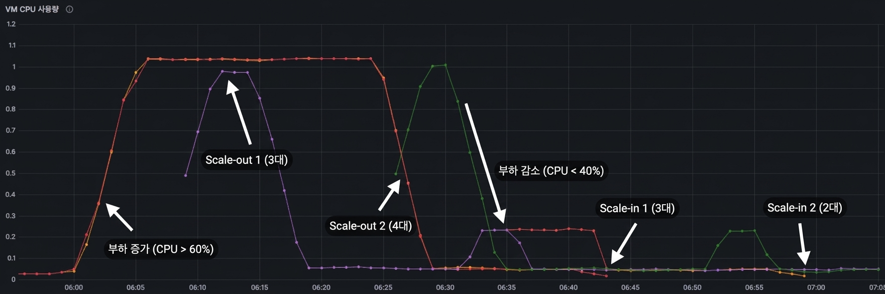
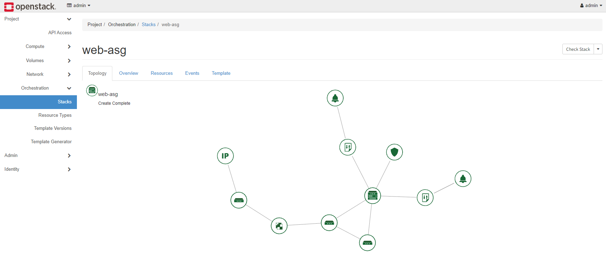
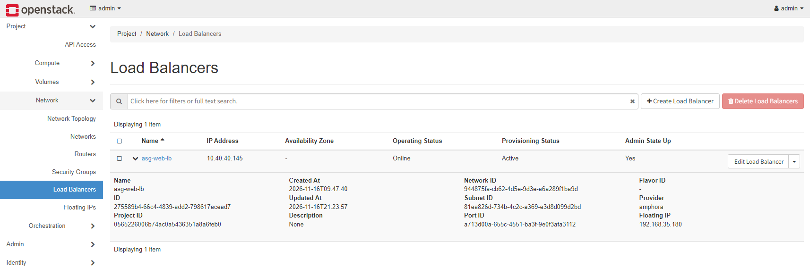
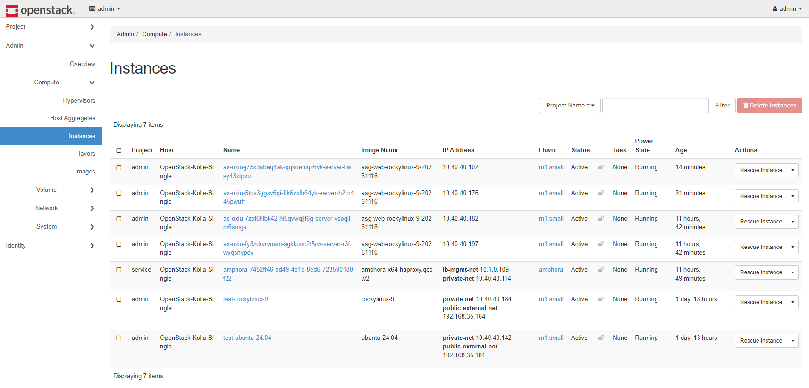

[English](heat-autoscaling-tutorial.md) | **Korean**

# Heat 튜토리얼: TLS 로드밸런서와 오토스케일링 웹서버



**Heat 템플릿을 직접 작성하지 않고, 두 줄짜리 자연어 요청만으로 스택을 만들었습니다.**
MCP 클라이언트가 [요청](#요청-내용)을 이 서버의 도구 호출로 바꿨고, 그 도구들이
기준 이미지를 만들고, 인증서를 Barbican에 등록하고, 스택을 생성했습니다.

CPU 부하가 걸리면 웹서버 그룹이 2대에서 3대, 4대로 늘어나고, 부하가 끝나면
다시 2대로 줄어듭니다. 신규 멤버의 부팅 부하는 추가 확장을 일으키지 않고
지나갑니다.

이 튜토리얼은 차트 뒤의 Heat 스택을 다룹니다. HTTPS를 종료하는 Octavia
로드밸런서와 Aodh CPU 알람으로 동작하는 웹서버 오토스케일링 그룹입니다. MCP
클라이언트에 전달한 [요청](#요청-내용), 클라이언트가 스스로 채운 내용, 클라이언트가
생성한 템플릿, 결과 확인 방법, 차트 해석([스케일링 실습](#스케일링-실습))을
다룹니다.

스크린샷은 Nova가 QEMU TCG(KVM 없음)로 동작하는 단일 노드 Kolla 클라우드에서
실행한 결과이며, VM과 amphora 부팅이 느립니다. 요청의 cooldown과 스택 timeout은
이 환경에 맞춘 값이므로 환경에 따라 조정하세요.

## 구성 요소

| 구성 요소 | Heat 리소스 | 역할 |
| --- | --- | --- |
| 기준 이미지 | (스택 생성 전에 만듦) | 동작 중인 웹서버 VM의 스냅샷 |
| 로드밸런서 | `OS::Octavia::LoadBalancer` | private 서브넷의 VIP |
| HTTPS 리스너 | `OS::Octavia::Listener` | Barbican 인증서를 쓰는 443/tcp `TERMINATED_HTTPS` |
| Pool | `OS::Octavia::Pool` | `HTTP`, `ROUND_ROBIN` |
| Health monitor | `OS::Octavia::HealthMonitor` | `HTTP GET /`, `200` 기대 |
| Floating IP | `OS::Neutron::FloatingIPAssociation` | VIP를 외부에 노출 |
| 멤버 security group | `OS::Neutron::SecurityGroup` | 서브넷에서 오는 80/tcp, 22/tcp, ICMP 허용 |
| 오토스케일링 그룹 | `OS::Heat::AutoScalingGroup` | 멤버 2~4대. 각 멤버는 `files`로 넘기는 중첩 템플릿 |
| 멤버 | `member.yaml`: `OS::Nova::Server` + `OS::Octavia::PoolMember` | 80/tcp 웹서버, pool에 등록 |
| 스케일링 정책 | `OS::Heat::ScalingPolicy` (×2) | 멤버 +1 / −1, cooldown 900초 |
| CPU 알람 | `OS::Aodh::GnocchiAggregationByResourcesAlarm` (×2) | 평균 CPU 60% 초과 / 40% 미만이 5분 유지 |

트래픽 흐름: 클라이언트 → floating IP → VIP(여기서 TLS 종료) → pool → 멤버
80/tcp. 스케일링 흐름: Ceilometer → Gnocchi `cpu` 측정값 → Aodh 알람 →
`trust+` signal URL → 스케일링 정책 → 오토스케일링 그룹이 멤버(서버와 pool
member)를 함께 추가하거나 제거합니다.

## 사전 조건

스택 밖에서 준비합니다. 배포와 계정 설정입니다.

1. **서비스:** Heat, Octavia, Barbican, Aodh, Gnocchi, Ceilometer(compute
   polling)가 배포되어 Keystone catalog에 있어야 합니다.
2. **MCP 서버에서 변경 작업 허용** (`ALLOW_MODIFY_OPERATIONS=true`.
   [설정 가이드](configuration.ko.md#환경-변수) 참고)
3. **Barbican과 Octavia 인증서:** 계정이 시크릿을 만들 수 있고, Octavia가
   `TERMINATED_HTTPS`용으로 그 시크릿을 읽을 수 있어야 합니다.
   [Barbican과 TLS 가이드](barbican-tls-guide.ko.md#사전-조건)를 참고하세요.
4. **1분 단위 CPU 측정값:** 알람이 `granularity: 60`을 쓰므로 Ceilometer가
   `cpu`를 60초 이하 주기로 수집하고, 메트릭의 archive policy가 60초
   granularity를 유지해야 합니다. Aodh 평가 주기도 60초여야 합니다.
   `get_gnocchi_metrics` 또는 `openstack metric archive-policy show <policy>`로
   확인합니다.
5. **기준 이미지로 쓸 웹서버 VM.** 이 실행에서는 80/tcp로 HTTP를 제공하던
   `test-rockylinux-9`를 썼습니다. 스냅샷 전에 멤버가 새 인스턴스로 부팅되도록
   `cloud-init clean`을 실행했고, 느린 TCG 부팅에 맞춰 게스트의 장치 대기 시간을
   늘려 두었습니다.
6. **사용 중이지 않은 floating IP.**

## 요청 내용

MCP 클라이언트에 아래 요청을 그대로 전달했습니다.

```text
test-rockylinux-9 VM(웹서버)으로 새 기준 이미지를 만들어서 TLS 종료형 LB + 웹서버 오토스케일링 구성을 Heat 스택으로 만들어서 가동해줘.
평상시 2대, 최대 4대. 평균 CPU가 5분 연속 60%를 넘으면 1대씩 늘리고, 5분 연속 40% 밑이면 2대까지 1대씩 줄여줘. cooldown은 900초, 스택 timeout_mins는 60.
```

요청에는 스케일링 목표와 느린 환경을 위한 값 두 개만 있습니다.

| 요청 | 생성된 스택 |
| --- | --- |
| `test-rockylinux-9`로 새 기준 이미지 | 스냅샷 이미지(`web-rocky9-base-20261117`)를 `image` 기본값으로 사용 |
| TLS 종료형 로드밸런서 | 443/tcp `TERMINATED_HTTPS` 리스너 |
| 평상시 2대, 최대 4대, 최소 2대 | `min_size: 2`, `desired_capacity: 2`, `max_size: 4` |
| 60% 초과 시 +1 / 40% 미만 시 −1, 5분 연속 | `granularity: 60`, `evaluation_periods: 5`인 알람 2개가 각각 ±1 스케일링 정책을 호출 |
| cooldown 900초 | 그룹과 두 정책 모두 `cooldown: 900` |
| `timeout_mins` 60 | 스택 생성 시 지정(CLI로는 `--timeout 60`) |

- **cooldown 900초.** 신규 멤버의 부팅 부하(여기서는 약 7분)는 그룹 평균을
  올립니다. 스케일링 후 정책은 900초 동안 signal을 무시하며, 이는 부팅 시간과
  5분 평가 구간을 덮습니다.
- **`timeout_mins: 60`.** amphora 부팅과 멤버 부팅이 스택 timeout에 포함되며,
  TCG에서는 둘 다 느립니다.

## 클라이언트가 스스로 채운 내용

템플릿의 나머지는 클라이언트가 요청과 이 서버의 도구 설명을 바탕으로 정했습니다.

- **`OS::Heat::Stack` 대신 `files`의 중첩 템플릿.** Aodh는 Keystone trust로
  스케일링 정책을 호출하고, 스케일링은 그 trust로 멤버를 만듭니다.
  `OS::Heat::Stack` 멤버는 새 최상위 스택을 만들므로 trust 재위임(redelegation)이
  필요하고, Keystone은 이를 HTTP 403으로 거부합니다. 중첩 템플릿
  (`type: member.yaml`)은 Heat 내부에서 생성되므로 동작합니다. `set_heat_stack`은
  중첩 템플릿 내용을 같은 이름의 키로 `files`에 받아야 하며, MCP 서버는 로컬
  경로나 URL을 읽지 않습니다.
- **signal URL의 `trust+` 접두어.** `signal_url`은 미리 서명된 Heat URL입니다.
  `trust+`를 붙이면 Aodh notifier가 URL을 익명으로 호출하지 않고 알람의 trust로
  인증합니다.
- **나노초 단위 임계값.** Stein 이후 Ceilometer는 `cpu_util`을 만들지 않습니다.
  알람은 `metric: cpu`와 `aggregation_method: rate:mean`을 쓰며, 그 값은
  granularity 구간당 CPU 시간(나노초)입니다:
  `percent / 100 × granularity × 1e9 × vCPUs`. `m1.small` 같은 1 vCPU flavor와
  `granularity: 60`에서는 60% = `36000000000`, 40% = `24000000000`입니다.
  다른 flavor는 다시 계산하세요.
- **평균에 포함되는 서버.** 각 멤버 서버는 메타데이터
  `metering.server_group: <부모 스택 ID>`를 가집니다. Ceilometer는 이를 Gnocchi
  `server_group` 속성으로 저장하고, 알람 query는 그 인스턴스만 선택합니다. 기준
  VM이나 다른 서버는 계산에 포함되지 않습니다.
- **`repeat_actions: true`.** Aodh는 기본적으로 상태가 바뀔 때만 알립니다. repeat
  actions를 켜면 `alarm` 상태가 유지되는 동안 평가마다 signal을 보냅니다.
  cooldown 중의 signal은 무시되고, cooldown이 끝난 뒤의 signal로 다시 확장합니다.
  부하가 계속 높을 때 그룹이 3대에서 4대로 늘어나는 방식입니다.
- **floating IP용 자체 서명 인증서.** 클라이언트가 사용 중이지 않은 floating IP를
  고르고, 그 주소로 자체 서명 인증서를 발급해 Barbican에 저장한 뒤 그 href를
  `tls_secret_ref`로 넘겼습니다.
- **Pool과 health monitor.** `ROUND_ROBIN`을 쓰는 `HTTP` pool과, 웹서버가 응답하는
  멤버에만 트래픽을 보내도록 HTTP health monitor(`GET /`, `200` 기대)를 둡니다.
  그룹이 monitor에 의존하므로 멤버는 monitor 다음에 생성됩니다.
- **멤버 security group.** 스택이 서브넷에서 오는 80/tcp, 22/tcp, ICMP를 허용하는
  자체 security group을 만듭니다. VIP와 멤버가 같은 서브넷에 있으므로 amphora는
  그 서브넷에서 멤버에 접근합니다.
- **`member.yaml`의 `OS::stack_id` 출력.** 멤버의 참조 ID를 중첩 스택 ID 대신
  서버 ID로 만듭니다.

## 생성된 템플릿

MCP 클라이언트가 요청에 따라 생성한 템플릿을 그대로 옮겼습니다. `web-asg.yaml`이
메인 템플릿(`template`)이고, `member.yaml`은 `files`에 키 `member.yaml`로 넘기는
중첩 템플릿입니다. 파라미터 기본값(이미지, 네트워크, 키 페어, 서브넷 CIDR)은 이
실습 환경의 이름이므로 환경에 맞게 바꾸세요.

`web-asg.yaml`:

```yaml
heat_template_version: 2018-08-31

description: >
  Octavia TERMINATED_HTTPS LB + Rocky Linux 9 web server AutoScalingGroup
  (min 2 / max 4), scaled by Aodh alarms on the group-average CPU.

parameters:
  image:
    type: string
    default: web-rocky9-base-20261117
  flavor:
    type: string
    default: m1.small
  key_name:
    type: string
    default: mykey
  network:
    type: string
    default: private-net
  subnet:
    type: string
    default: private-subnet
  subnet_cidr:
    type: string
    default: 10.40.40.0/24
  floating_ip_id:
    type: string
    description: Pre-allocated FIP for the LB VIP (TLS cert CN/SAN)
  floating_ip_address:
    type: string
    description: Address of floating_ip_id (output only)
  tls_secret_ref:
    type: string
    description: Barbican PKCS#12 secret href
  member_port:
    type: number
    default: 80
  # Gnocchi cpu metric: archive policy ceilometer-1min-rate (60 s only).
  # rate:mean threshold = percent/100 * 60 s * 1e9 ns * vCPUs (m1.small = 1 vCPU)
  cpu_high_ns:
    type: number
    default: 36000000000   # 60 %
  cpu_low_ns:
    type: number
    default: 24000000000   # 40 %

resources:
  member_sg:
    type: OS::Neutron::SecurityGroup
    properties:
      name: web-asg-member-sg
      rules:
        - {protocol: tcp, port_range_min: {get_param: member_port}, port_range_max: {get_param: member_port}, remote_ip_prefix: {get_param: subnet_cidr}}
        - {protocol: tcp, port_range_min: 22, port_range_max: 22, remote_ip_prefix: {get_param: subnet_cidr}}
        - {protocol: icmp, remote_ip_prefix: {get_param: subnet_cidr}}

  lb:
    type: OS::Octavia::LoadBalancer
    properties:
      name: web-asg-lb
      vip_subnet: {get_param: subnet}

  listener_https:
    type: OS::Octavia::Listener
    properties:
      name: web-asg-https
      loadbalancer: {get_resource: lb}
      protocol: TERMINATED_HTTPS
      protocol_port: 443
      default_tls_container_ref: {get_param: tls_secret_ref}

  pool:
    type: OS::Octavia::Pool
    properties:
      name: web-asg-pool
      listener: {get_resource: listener_https}
      protocol: HTTP
      lb_algorithm: ROUND_ROBIN

  monitor:
    type: OS::Octavia::HealthMonitor
    properties:
      pool: {get_resource: pool}
      type: HTTP
      http_method: GET
      url_path: /
      expected_codes: "200"
      delay: 5
      timeout: 5
      max_retries: 3

  vip_fip_assoc:
    type: OS::Neutron::FloatingIPAssociation
    properties:
      floatingip_id: {get_param: floating_ip_id}
      port_id: {get_attr: [lb, vip_port_id]}

  web_asg:
    type: OS::Heat::AutoScalingGroup
    depends_on: monitor
    properties:
      min_size: 2
      desired_capacity: 2
      max_size: 4
      cooldown: 900
      resource:
        type: member.yaml
        properties:
          image: {get_param: image}
          flavor: {get_param: flavor}
          key_name: {get_param: key_name}
          network: {get_param: network}
          subnet: {get_param: subnet}
          security_group: {get_resource: member_sg}
          pool_id: {get_resource: pool}
          member_port: {get_param: member_port}
          metadata: {"metering.server_group": {get_param: "OS::stack_id"}}

  scale_up_policy:
    type: OS::Heat::ScalingPolicy
    properties:
      adjustment_type: change_in_capacity
      auto_scaling_group_id: {get_resource: web_asg}
      scaling_adjustment: 1
      cooldown: 900

  scale_down_policy:
    type: OS::Heat::ScalingPolicy
    properties:
      adjustment_type: change_in_capacity
      auto_scaling_group_id: {get_resource: web_asg}
      scaling_adjustment: -1
      cooldown: 900

  cpu_alarm_high:
    type: OS::Aodh::GnocchiAggregationByResourcesAlarm
    properties:
      description: Group avg CPU > 60% for 5 consecutive minutes
      metric: cpu
      aggregation_method: rate:mean
      granularity: 60
      evaluation_periods: 5
      threshold: {get_param: cpu_high_ns}
      comparison_operator: gt
      resource_type: instance
      repeat_actions: true
      alarm_actions:
        - str_replace:
            template: trust+url
            params:
              url: {get_attr: [scale_up_policy, signal_url]}
      query:
        list_join:
          - ''
          - - '{"=": {"server_group": "'
            - {get_param: "OS::stack_id"}
            - '"}}'

  cpu_alarm_low:
    type: OS::Aodh::GnocchiAggregationByResourcesAlarm
    properties:
      description: Group avg CPU < 40% for 5 consecutive minutes
      metric: cpu
      aggregation_method: rate:mean
      granularity: 60
      evaluation_periods: 5
      threshold: {get_param: cpu_low_ns}
      comparison_operator: lt
      resource_type: instance
      repeat_actions: true
      alarm_actions:
        - str_replace:
            template: trust+url
            params:
              url: {get_attr: [scale_down_policy, signal_url]}
      query:
        list_join:
          - ''
          - - '{"=": {"server_group": "'
            - {get_param: "OS::stack_id"}
            - '"}}'

outputs:
  lb_vip:
    value: {get_attr: [lb, vip_address]}
  https_url:
    value:
      str_replace:
        template: https://FIP/
        params:
          FIP: {get_param: floating_ip_address}
  asg_size:
    value: {get_attr: [web_asg, current_size]}
  member_ips:
    value: {get_attr: [web_asg, outputs_list, server_ip]}
  scale_up_url:
    value: {get_attr: [scale_up_policy, signal_url]}
  scale_down_url:
    value: {get_attr: [scale_down_policy, signal_url]}
```

`member.yaml`:

```yaml
heat_template_version: 2018-08-31

description: Web server member (volume-backed snapshot image) registered to the Octavia pool

parameters:
  image: {type: string}
  flavor: {type: string}
  key_name: {type: string}
  network: {type: string}
  subnet: {type: string}
  security_group: {type: string}
  pool_id: {type: string}
  member_port: {type: number}
  metadata: {type: json}

resources:
  server:
    type: OS::Nova::Server
    properties:
      image: {get_param: image}
      flavor: {get_param: flavor}
      key_name: {get_param: key_name}
      metadata: {get_param: metadata}
      networks:
        - network: {get_param: network}
      security_groups:
        - {get_param: security_group}

  pool_member:
    type: OS::Octavia::PoolMember
    properties:
      pool: {get_param: pool_id}
      address: {get_attr: [server, first_address]}
      protocol_port: {get_param: member_port}
      subnet: {get_param: subnet}

outputs:
  server_ip:
    value: {get_attr: [server, first_address]}
  OS::stack_id:
    value: {get_resource: server}
```

OpenStack CLI로 같은 스택을 만들려면 두 파일을 한 디렉터리에 두고 floating IP와
Barbican 시크릿 href를 넘깁니다.

```bash
openstack stack create web-asg -t web-asg.yaml --timeout 60 \
  --parameter floating_ip_id=<floating IP ID> \
  --parameter floating_ip_address=<floating IP address> \
  --parameter tls_secret_ref=<Barbican secret href>
```

## 클라이언트가 수행하는 단계

MCP 클라이언트는 요청을 대략 아래 순서의 도구 호출로 바꿉니다. 쓰기 작업은
비동기이므로 각 단계는 다음으로 넘어가기 전에 조회로 확인합니다.

1. **기준 이미지.** 웹서버 VM에 `set_instance`(`action="snapshot"`,
   `snapshot_name`)를 실행하고 `get_image_detail_list`에서 이미지가 `active`가
   될 때까지 기다립니다.
2. **Floating IP.** `get_floating_ips`로 포트에 연결되지 않은 주소를 고릅니다.
3. **인증서.** floating IP를 `common_name`과 `subject_alt_names`에 넣어
   `set_secret`(`action="create_self_signed_tls"`)을 실행합니다. 시크릿 href와
   공개 인증서만 반환되고 개인 키는 Barbican에 남습니다. 이 href가
   `tls_secret_ref` 파라미터가 됩니다.
4. **검증(권장).** `template`, `files`(`{"member.yaml": "<content>"}`),
   `parameters`로 `set_heat_stack`(`action="validate"`)을 실행합니다.
5. **생성.** 같은 입력으로 `set_heat_stack`(`action="create"`,
   `timeout_mins=60`)을 실행합니다. 호출은 스택 완료가 아니라 Heat가 요청을
   접수했을 때 반환됩니다.
6. **대기.** 스택이 `CREATE_COMPLETE`(또는 실패)가 될 때까지 `get_heat_stacks`로
   확인합니다. TCG에서는 amphora 부팅과 멤버 2대 부팅이 포함됩니다.
7. **`timeout_mins` 확인.** `get_heat_stacks`는 스택마다 `timeout_mins`를
   반환하며, 값이 `60`이어야 합니다. CLI로는 다음과 같습니다.

   ```bash
   openstack stack show web-asg -c timeout_mins
   ```

8. **알람과 notifier 확인.** `set_alarms`(`action="list"` 또는 `"show"`)로 두
   알람과 `trust+` 액션을 확인합니다. MCP 도구는 서비스 로그를 읽을 수 없으므로
   HTTP 200 확인은 controller의 Aodh notifier 로그로 합니다. 멤버 부팅이 끝나
   유휴 상태가 되면 scale-in 알람이 약 5분 안에 `alarm` 상태가 되어 scale-in
   정책을 호출합니다(그룹이 이미 최소 크기이므로 제거되는 멤버는 없습니다). Kolla 배포에서는:

   ```bash
   grep '<scale-in alarm ID>' /var/log/kolla/aodh/aodh-notifier.log | tail
   ```

   그 알람에 대한 notifier 응답 줄에서 상태 `200`을 확인합니다(예:
   `... gets response: 200 OK.`. 문구는 Aodh 릴리스에 따라 다릅니다).
   `get_heat_stack_details`(`section="events"`)의 스케일링 정책
   `SIGNAL_COMPLETE` 이벤트로 Heat가 signal을 받았는지 확인할 수 있습니다.

## 결과 확인

**스택.** Horizon의 Orchestration 화면에서 스택이 `Create Complete`로 표시됩니다.
토폴로지에는 알람, 스케일링 정책, 오토스케일링 그룹, 멤버 security group,
로드밸런서 리소스, floating IP가 있습니다.



**로드밸런서.** 로드밸런서가 `Online` / `Active`이고 VIP에 floating IP가 연결되어
있습니다.



**HTTPS.** 리스너는 자체 서명 인증서를 제시하므로 검증을 건너뛰거나(`-k`) 그
인증서를 신뢰하도록 설정합니다. 요청을 반복하면 멤버에 차례로 분배됩니다.

```bash
curl -vk https://<floating IP>/
```

**인스턴스.** 멤버 이름은 Heat가 생성하며(여기서는 `member.yaml`의 `server`
리소스에 따라 `as-oxiu-...-server-...`), 멤버는 스냅샷 이미지로 부팅합니다.
아래 스크린샷은 멤버 4대일 때 찍은 것으로, 스택과 함께 만들어진 원래 멤버 2대와
14분, 31분 전에 scale-out으로 추가된 멤버 2대가 있습니다. amphora(`service`
프로젝트 소유)와 기준 VM `test-rockylinux-9`는 멤버가 아닙니다.



## 스케일링 실습

멤버에 CPU 부하를 주고(예: `stress-ng`) VM별 CPU를 관찰합니다. 이 튜토리얼 맨 위
차트가 그런 실행의 예이며, y축은 vCPU 단위 CPU 사용량(1 = vCPU 하나가 완전히 사용
중)이고 시각은 대략적인 값입니다.

| 시각(대략) | 이벤트 | 설명 |
| --- | --- | --- |
| 06:00–06:05 | 원래 멤버 2대의 부하가 100%로 상승 | 평균 CPU가 60%를 넘음 |
| ~06:09 | Scale-out 1 (3대) | 60% 초과가 5분 유지됨. 신규 멤버(보라)는 약 7분간 100% 가까이 쓰며 부팅한 뒤 유휴 상태가 됨 |
| ~06:26 | Scale-out 2 (4대) | 3대 평균이 여전히 60% 초과(2대가 100%). 알람이 계속 signal을 보내고, 900초 cooldown이 끝나자 다시 확장 |
| ~06:25–06:35 | 부하 제거, 네 번째 멤버의 부팅 부하 종료 | 평균 CPU가 40% 아래로 떨어짐 |
| ~06:43 | Scale-in 1 (3대) | 40% 미만이 5분 유지되고 cooldown이 지남. Heat는 가장 오래된 멤버부터 제거(빨간 선이 끝남) |
| ~06:59 | Scale-in 2 (2대) | 약 16분 뒤, 다음 cooldown 이후. 그룹이 최소 크기로 돌아옴 |

차트에서 확인되는 설정의 효과:

- 신규 멤버의 부팅 부하(보라 ~06:10–06:17, 초록 ~06:27–06:34)는 약 7분으로
  900초 cooldown보다 짧아서, 부팅 부하만으로 추가 확장이 일어나지 않았습니다.
- 스케일링 동작 사이 간격은 최소 약 15분, 즉 cooldown입니다.
- scale-in은 그룹의 `min_size`인 2대에서 멈춥니다.

## 문제 해결

실패하면 삭제나 재시도 대신 상태를 보고합니다.

- `get_heat_stacks`: 스택 상태와 `stack_status_reason`.
- `get_heat_stack_details`(`section="events"`, `nested_depth=2`): 오토스케일링
  그룹 안의 멤버를 포함한 실패 리소스.
- `get_load_balancer_details`, `get_load_balancer_listeners`,
  `get_load_balancer_pool_members`: Octavia 상태.

| 증상 | 가능한 원인 |
| --- | --- |
| 스케일링이 HTTP 403(trust redelegation)으로 실패 | 멤버가 `OS::Heat::Stack`임. `files`의 중첩 템플릿을 사용 |
| `validate`나 `create`가 `member.yaml`을 찾지 못함 | `files`에 중첩 템플릿 내용이 없거나 키가 `type:`과 다름 |
| 스택이 timeout으로 실패 | amphora 부팅과 멤버 부팅을 합친 시간보다 `timeout_mins`가 짧음 |
| 리스너 생성이 인증서 오류로 실패 | Barbican 사전 조건 또는 ACL. [Barbican과 TLS 가이드](barbican-tls-guide.ko.md#문제-해결) 참고 |
| 알람이 `insufficient data`에 머묾 | 60초 `cpu` 측정값이 없음(수집 주기 또는 archive policy), 또는 멤버에 `metering.server_group`이 없음 |
| 알람은 울리지만 스케일링되지 않음 | cooldown 중, 그룹이 `max_size`/`min_size`에 도달, 또는 액션 URL에 `trust+`가 없음. notifier 로그와 정책 이벤트를 확인 |
| 생성 직후 scale-out | 알람이 멤버의 부팅 부하를 계산함. 그룹 완료 후 기다리는 `OS::Heat::Delay` 등으로 알람을 늦게 만들도록 요청 |
