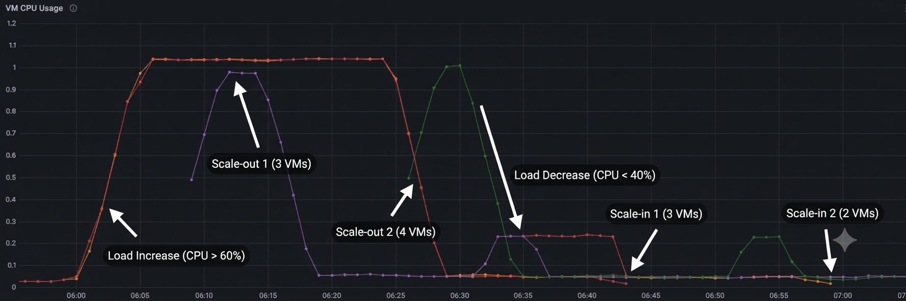
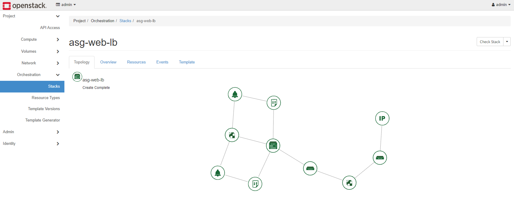
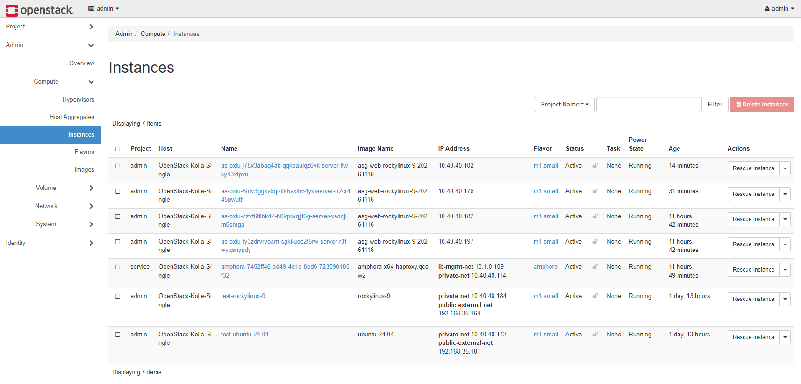

**English** | [Korean](heat-autoscaling-tutorial.ko.md)

# Heat tutorial: TLS load balancer with autoscaling web servers



Under CPU load, the web server group grows from two to three and then four
members, and shrinks back to two when the load ends. Each new member's boot
spike passes without setting off another scale-out.

This tutorial walks through the Heat stack behind the chart: an Octavia load
balancer that terminates HTTPS and an autoscaling group of web servers driven
by Aodh CPU alarms. It shows [the request](#the-request) given to the MCP
client, explains each requirement, shows the templates such a stack uses, and
shows how to verify the result and read the chart
([Exercise the scaling](#exercise-the-scaling)).

The screenshots come from a run on a single-node Kolla cloud where Nova uses
QEMU TCG (no KVM), so VMs and amphorae boot slowly. Several settings below
(stack timeout, alarm delay, cooldown) are sized for that environment; adjust
them for yours.

## What you build

| Component | Heat resource | Role |
| --- | --- | --- |
| Base image | (prepared before the stack) | Snapshot of a working web server VM |
| Load balancer | `OS::Octavia::LoadBalancer` | VIP on the private subnet |
| HTTPS listener | `OS::Octavia::Listener` | `TERMINATED_HTTPS` on 443/tcp with a Barbican certificate |
| Pool | `OS::Octavia::Pool` | `HTTP`, `ROUND_ROBIN` |
| Floating IP | `OS::Neutron::FloatingIPAssociation` | Exposes the VIP externally |
| Autoscaling group | `OS::Heat::AutoScalingGroup` | 2 to 4 members; each member is a nested template in `files` |
| Member | `member.yaml`: `OS::Nova::Server` + `OS::Octavia::PoolMember` | Web server on 80/tcp, registered in the pool |
| Scaling policies | `OS::Heat::ScalingPolicy` (×2) | +1 / −1 member, 900-second cooldown |
| Alarm delay | `OS::Heat::Delay` | Waits 10 minutes after the group completes |
| CPU alarms | `OS::Aodh::GnocchiAggregationByResourcesAlarm` (×2) | Mean CPU > 60% / < 40% for 5 minutes |

Traffic flows: client → floating IP → VIP (TLS ends here) → pool → member
80/tcp. Scaling flows: Ceilometer → Gnocchi `cpu` measures → Aodh alarm →
`trust+` signal URL → scaling policy → autoscaling group adds or removes a
member (server and pool member together).

## Prerequisites

Prepare these outside the stack. They are deployment and account settings.

1. **Services:** Heat, Octavia, Barbican, Aodh, Gnocchi and Ceilometer
   (compute polling) are deployed and in the Keystone catalog.
2. **Modify operations are enabled** on the MCP server
   (`ALLOW_MODIFY_OPERATIONS=true`; see the
   [Configuration guide](configuration.md#environment-variables)).
3. **Barbican and Octavia certificates:** the account may create secrets, and
   Octavia can read them for `TERMINATED_HTTPS`. See the
   [Barbican and TLS guide](barbican-tls-guide.md#prerequisites).
4. **One-minute CPU measures:** the alarms use `granularity: 60`, so
   Ceilometer must poll `cpu` at least every 60 seconds, and the metric's
   archive policy must keep a 60-second granularity. Aodh's evaluation interval
   should also be 60 seconds. Check with `get_gnocchi_metrics`, or
   `openstack metric archive-policy show <policy>`.
5. **A web server VM** to use as the base image. In this run it was
   `test-rockylinux-9`, already serving HTTP on 80/tcp. Before the snapshot,
   `cloud-init clean` was run on it so that members boot as new instances, and
   the guest's device wait timeout was increased for slow TCG boots.
6. **An unused floating IP** and a security group that allows 80/tcp to the
   members.

## The request

The following request was given to the MCP client as-is. Each requirement is
explained in the next section.

```text
Use the test-rockylinux-9 VM (web server) as the source for a new base image. Create and bring up a Heat stack with a TLS-terminating load balancer and autoscaling web servers.
- Run 2 web servers under normal conditions, with a maximum of 4. Scale out by 1 when average CPU utilization exceeds 60%, and scale in by 1 when it drops below 40%, down to a minimum of 2.
  - Trigger scaling only when the condition holds for 5 consecutive minutes (granularity: 60, evaluation_periods: 5).
  - The Aodh evaluation interval is already set to 60 seconds.
- Have all web servers provide the same service over HTTP on TCP port 80.
- Configure the load balancer for TLS-terminated HTTPS.
  - Use the TERMINATED_HTTPS protocol and TCP port 443 for the external listener.
  - Generate a new self-signed certificate for TLS termination, register it in Barbican, and use its reference as default_tls_container_ref.
  - Configure the pool behind the listener to use the HTTP protocol and the ROUND_ROBIN algorithm. Register each ASG web server as a pool member on TCP port 80.
  - Associate an unused Floating IP with the VIP to expose the load balancer externally.
- Stop test-rockylinux-9 and take a new snapshot for the base image. Do not use an existing image. Start the original VM again after the snapshot completes.
  - The device wait timeout has already been increased, and cloud-init clean has already been run.
- Define each ASG member (server and pool member) in a nested template passed via files. Do not use OS::Heat::Stack.
- Set the alarm actions to the ScalingPolicy signal_url values prefixed with trust+. Consider the task complete only after verifying that the Aodh notifier receives an HTTP 200 response after creation.
This is a single-node environment running QEMU TCG without KVM, so VMs and amphorae take a long time to boot. The CPU load from booting a new member has been observed to last about 7 minutes.
- Set the stack's timeout_mins to 60 and verify that the setting was applied. If you cannot verify it with the available tools, provide the command to check it.
- Wait until stack creation completes.
- Use OS::Heat::Delay to create the alarms 10 minutes after ASG creation completes, so the initial boot load does not trigger scale-out.
- Set the ScalingPolicy cooldown to 900 seconds to prevent consecutive scale-outs caused by the boot load from newly added members.
- If anything fails, report only the current state and the cause of the failure. Do not delete the stack or any resources, and do not retry.
```

## Why each requirement matters

- **Nested template in `files`, not `OS::Heat::Stack`.** Aodh calls the
  scaling policy with a Keystone trust. Scaling then creates members with that
  trust; an `OS::Heat::Stack` member creates a new top-level stack, which needs
  trust redelegation, and Keystone rejects it with HTTP 403. A nested template
  (`type: member.yaml`) is created inside Heat and works. `set_heat_stack`
  needs the nested template's content in `files`, keyed by the same name; the
  MCP server does not read local paths or URLs.
- **`trust+` prefix on the signal URL.** `signal_url` is a pre-signed Heat
  URL. With `trust+`, the Aodh notifier authenticates with the alarm's trust
  instead of calling the URL anonymously.
- **Thresholds in nanoseconds.** Since Stein, Ceilometer no longer produces
  `cpu_util`. The alarms use `metric: cpu` with `aggregation_method: rate:mean`,
  whose value is CPU time in nanoseconds per granularity window:
  `percent / 100 × granularity × 1e9 × vCPUs`. For a 1-vCPU flavor such as
  `m1.small` and `granularity: 60`: 60% = `36000000000`, 40% = `24000000000`.
  Recalculate for other flavors.
- **Which servers are averaged.** Each member server carries the metadata
  `metering.server_group: <parent stack ID>`. Ceilometer stores it as the
  Gnocchi `server_group` attribute, and the alarm query selects only those
  instances. The base VM and other servers are not counted.
- **`OS::Heat::Delay` before the alarms.** The group is complete when its
  servers are ACTIVE, but under TCG the guests are still booting at full CPU.
  Alarms created then would scale out at once. The delay depends on the group,
  the alarms depend on the delay, so alarms exist only 10 minutes later.
- **Cooldown 900 seconds.** A new member's boot load (about 7 minutes here)
  raises the group average. After a scaling action the policy ignores signals
  for 900 seconds, which covers the boot plus the 5-minute evaluation window.
- **`timeout_mins: 60`.** Amphora boot, member boot and the 10-minute delay all
  count toward the stack timeout. Heat's default can be too short under TCG.
- **`repeat_actions: true`.** Aodh normally notifies only on a state change.
  With repeat actions, an alarm that stays in `alarm` keeps signalling every
  evaluation; signals during the cooldown are ignored, and the next one after
  the cooldown scales again. This is how the group grows from 3 to 4 while the
  load stays high.
- **No delete or retry on failure.** Deleting a failed stack destroys the
  evidence. Ask for the current state and the cause instead (see
  [Troubleshooting](#troubleshooting)).

## Example templates

The templates below implement the request. They are an example written for this
guide from the request and the tool descriptions; the stack in the screenshots
was generated by the MCP client and may differ in names and details. Run
`set_heat_stack` with `action="validate"` before `create`.

Main template (`template`):

```yaml
heat_template_version: 2021-04-16
description: TLS-terminated Octavia LB with autoscaling web servers

parameters:
  image: {type: string, description: Base image created from the web server snapshot}
  flavor: {type: string, default: m1.small}
  network: {type: string, description: Private network for members}
  subnet: {type: string, description: Private subnet for the VIP and members}
  security_group: {type: string, description: Allows 80/tcp to members}
  floating_ip_id: {type: string, description: ID of an unused floating IP}
  tls_container_ref: {type: string, description: Barbican secret href (PKCS#12)}

resources:
  lb:
    type: OS::Octavia::LoadBalancer
    properties:
      name: asg-web-lb
      vip_subnet: {get_param: subnet}

  listener:
    type: OS::Octavia::Listener
    properties:
      loadbalancer: {get_resource: lb}
      protocol: TERMINATED_HTTPS
      protocol_port: 443
      default_tls_container_ref: {get_param: tls_container_ref}

  pool:
    type: OS::Octavia::Pool
    properties:
      listener: {get_resource: listener}
      protocol: HTTP
      lb_algorithm: ROUND_ROBIN

  vip_floating_ip:
    type: OS::Neutron::FloatingIPAssociation
    properties:
      floatingip_id: {get_param: floating_ip_id}
      port_id: {get_attr: [lb, vip_port_id]}

  asg:
    type: OS::Heat::AutoScalingGroup
    properties:
      min_size: 2
      max_size: 4
      resource:
        type: member.yaml
        properties:
          image: {get_param: image}
          flavor: {get_param: flavor}
          network: {get_param: network}
          subnet: {get_param: subnet}
          security_group: {get_param: security_group}
          pool_id: {get_resource: pool}
          metadata: {"metering.server_group": {get_param: "OS::stack_id"}}

  scale_out_policy:
    type: OS::Heat::ScalingPolicy
    properties:
      adjustment_type: change_in_capacity
      auto_scaling_group_id: {get_resource: asg}
      scaling_adjustment: 1
      cooldown: 900

  scale_in_policy:
    type: OS::Heat::ScalingPolicy
    properties:
      adjustment_type: change_in_capacity
      auto_scaling_group_id: {get_resource: asg}
      scaling_adjustment: -1
      cooldown: 900

  alarm_delay:
    type: OS::Heat::Delay
    depends_on: asg
    properties:
      min_wait: 600
      actions: [CREATE]

  cpu_alarm_high:
    type: OS::Aodh::GnocchiAggregationByResourcesAlarm
    depends_on: alarm_delay
    properties:
      description: Scale out when mean CPU > 60% for 5 minutes
      metric: cpu
      aggregation_method: rate:mean
      granularity: 60
      evaluation_periods: 5
      threshold: 36000000000   # 60% of 1 vCPU over 60 s, in ns
      comparison_operator: gt
      resource_type: instance
      query:
        str_replace:
          template: '{"=": {"server_group": "stack_id"}}'
          params:
            stack_id: {get_param: "OS::stack_id"}
      repeat_actions: true
      alarm_actions:
        - str_replace:
            template: trust+url
            params:
              url: {get_attr: [scale_out_policy, signal_url]}

  cpu_alarm_low:
    type: OS::Aodh::GnocchiAggregationByResourcesAlarm
    depends_on: alarm_delay
    properties:
      description: Scale in when mean CPU < 40% for 5 minutes
      metric: cpu
      aggregation_method: rate:mean
      granularity: 60
      evaluation_periods: 5
      threshold: 24000000000   # 40% of 1 vCPU over 60 s, in ns
      comparison_operator: lt
      resource_type: instance
      query:
        str_replace:
          template: '{"=": {"server_group": "stack_id"}}'
          params:
            stack_id: {get_param: "OS::stack_id"}
      repeat_actions: true
      alarm_actions:
        - str_replace:
            template: trust+url
            params:
              url: {get_attr: [scale_in_policy, signal_url]}

outputs:
  vip_address:
    value: {get_attr: [lb, vip_address]}
```

Member template (`files` key `member.yaml`):

```yaml
heat_template_version: 2021-04-16
description: One web server and its pool member

parameters:
  image: {type: string}
  flavor: {type: string}
  network: {type: string}
  subnet: {type: string}
  security_group: {type: string}
  pool_id: {type: string}
  metadata: {type: json}

resources:
  server:
    type: OS::Nova::Server
    properties:
      image: {get_param: image}
      flavor: {get_param: flavor}
      networks: [{network: {get_param: network}}]
      security_groups: [{get_param: security_group}]
      metadata: {get_param: metadata}

  member:
    type: OS::Octavia::PoolMember
    properties:
      pool: {get_param: pool_id}
      address: {get_attr: [server, networks, {get_param: network}, 0]}
      protocol_port: 80
      subnet: {get_param: subnet}
```

## Steps the client performs

The MCP client turns the request into tool calls roughly in this order. Each
write is asynchronous, so every step is confirmed with a read before the next.

1. **Base image.** `set_instance` (`action="stop"`) on the web server VM,
   confirm `SHUTOFF`; `set_instance` (`action="snapshot"`, `snapshot_name`)
   and wait until `get_image_detail_list` shows the image `active`; then
   `set_instance` (`action="start"`) and confirm `ACTIVE`.
2. **Floating IP.** `get_floating_ips` to pick an address that is not
   associated with a port.
3. **Certificate.** `set_secret` (`action="create_self_signed_tls"`) with the
   floating IP as `common_name` and in `subject_alt_names`. Only the secret href
   and the public certificate are returned; the private key stays in Barbican.
   The href becomes the `tls_container_ref` parameter.
4. **Validate.** `set_heat_stack` (`action="validate"`) with `template`,
   `files` (`{"member.yaml": "<content>"}`) and `parameters`.
5. **Create.** `set_heat_stack` (`action="create"`, `timeout_mins=60`) with the
   same inputs. The call returns when Heat accepts the request, not when the
   stack is complete.
6. **Wait.** Poll `get_heat_stacks` until the stack is `CREATE_COMPLETE` (or
   failed). Under TCG this includes amphora boot, two member boots and the
   10-minute delay.
7. **Check `timeout_mins`.** `get_heat_stacks` returns `timeout_mins` for each
   stack; it should read `60`. The CLI equivalent is:

   ```bash
   openstack stack show asg-web-lb -c timeout_mins
   ```

8. **Check the alarms and the notifier.** `set_alarms` (`action="list"` or
   `"show"`) shows both alarms with the `trust+` actions. The MCP tools cannot
   read service logs, so the HTTP 200 check uses the Aodh notifier log on the
   controller. When the members are idle, the scale-in alarm enters `alarm`
   about 5 minutes after creation and calls the scale-in policy (the group is
   already at its minimum, so nothing is removed). On a Kolla deployment:

   ```bash
   grep '<scale-in alarm ID>' /var/log/kolla/aodh/aodh-notifier.log | tail
   ```

   Look for the notifier's response line for that alarm with status `200`
   (for example `... gets response: 200 OK.`; the wording depends on the Aodh
   release). The scaling policy's `SIGNAL_COMPLETE` events in
   `get_heat_stack_details` (`section="events"`) confirm that Heat received the
   signal.

## Verify the result

**Stack.** Horizon's Orchestration view shows the stack `Create Complete`. The
topology contains the alarms, scaling policies, the autoscaling group, load
balancer resources and the floating IP.



**Load balancer.** The load balancer is `Online` / `Active`, with the floating
IP associated to its VIP.


**HTTPS.** The listener presents the self-signed certificate, so skip
verification (`-k`) or trust that certificate. Repeated requests are spread
over the members in turn:

```bash
curl -vk https://<floating IP>/
```

**Instances.** Heat generates the member names (here `as-oxiu-...-server-...`,
after the `server` resource of `member.yaml`), and the members boot from the
snapshot image. The screenshot below was taken at four members: two
original members created with the stack, and two added by scale-out 14 and 31
minutes earlier. The amphora (owned by the `service` project) and the base VM
`test-rockylinux-9` are not members.



## Exercise the scaling

Put CPU load on the members, for example with `stress-ng`, and watch the
per-VM CPU. The chart at the top of this tutorial is from the same run; its
y-axis is CPU usage in vCPUs (1 = one vCPU fully busy), and the times are
approximate.

| Time (approx.) | Event | Explanation |
| --- | --- | --- |
| 06:00–06:05 | Load on the two original members rises to 100% | Mean CPU crosses 60% |
| ~06:09 | Scale-out 1 (3 VMs) | 5 minutes above 60%; the new member (purple) boots at near 100% CPU for about 7 minutes, then idles |
| ~06:26 | Scale-out 2 (4 VMs) | The mean of 3 members is still above 60% (two at 100%); the alarm keeps signalling and scales again once the 900-second cooldown ends |
| ~06:25–06:35 | Load removed; the fourth member's boot load ends | Mean CPU falls below 40% |
| ~06:43 | Scale-in 1 (3 VMs) | Below 40% for 5 minutes and after the cooldown; Heat removes the oldest member first (the red line ends) |
| ~06:59 | Scale-in 2 (2 VMs) | About 16 minutes later, after the next cooldown; the group returns to its minimum |

What the chart shows about the settings:

- The new members' boot load (purple at ~06:10–06:17, green at ~06:27–06:34)
  lasts about 7 minutes, shorter than the 900-second cooldown, so boot load
  alone never caused another scale-out.
- Scale actions are spaced at least about 15 minutes apart, the cooldown.
- Scale-in stops at two members, the group's `min_size`.

## Troubleshooting

When something fails, report the state instead of deleting or retrying:

- `get_heat_stacks` for the stack status and `stack_status_reason`.
- `get_heat_stack_details` with `section="events"` and `nested_depth=2` for the
  failing resource, including members inside the autoscaling group.
- `get_load_balancer_details`, `get_load_balancer_listeners` and
  `get_load_balancer_pool_members` for Octavia states.

| Symptom | Likely cause |
| --- | --- |
| Scaling fails with HTTP 403 (trust redelegation) | Members are `OS::Heat::Stack`; use a nested template in `files` |
| `validate` or `create` cannot find `member.yaml` | The nested template's content is missing from `files`, or its key differs from `type:` |
| Stack fails with a timeout | `timeout_mins` too short for amphora boot, member boot and the delay together |
| Listener creation fails with a certificate error | Barbican prerequisites or ACLs; see the [Barbican and TLS guide](barbican-tls-guide.md#troubleshooting) |
| Alarms stay `insufficient data` | No 60-second `cpu` measures (polling interval or archive policy), or the members lack `metering.server_group` |
| Alarm fires but nothing scales | Signal still in cooldown, group at `max_size`/`min_size`, or the action URL lacks `trust+`; check the notifier log and the policy events |
| Scale-out right after creation | Alarms created without the delay, so boot load counted |
