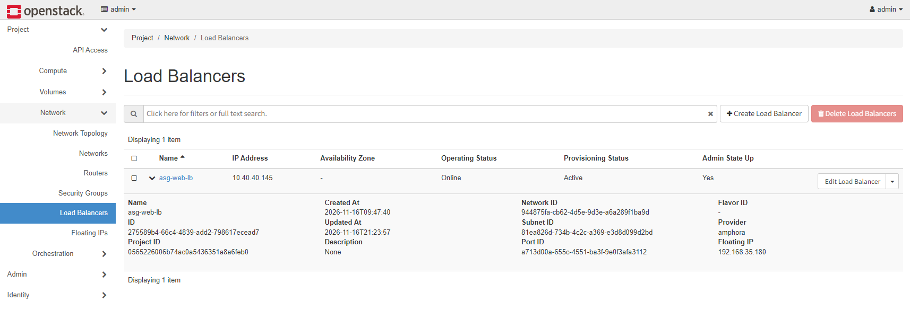

**English** | [Korean](heat-autoscaling-tutorial.ko.md)

# Heat tutorial: TLS load balancer with autoscaling web servers


**No Heat template was written by hand: the stack was created from a
two-line natural-language request.** The MCP client turned
[the request](#the-request) into calls to this server's tools, which built the
base image, stored the certificate in Barbican and created the stack.

Under CPU load, the web server group grows from two to three and then four
members, and shrinks back to two when the load ends. Each new member's boot
spike passes without setting off another scale-out.

This tutorial walks through the Heat stack behind the chart: an Octavia load
balancer that terminates HTTPS and an autoscaling group of web servers driven
by Aodh CPU alarms. It shows [the request](#the-request) given to the MCP
client, what the client added on its own, the templates it generated, and how
to verify the result and read the chart
([Exercise the scaling](#exercise-the-scaling)).

The screenshots come from a run on a single-node Kolla cloud where Nova uses
QEMU TCG (no KVM), so VMs and amphorae boot slowly. The request's cooldown and
stack timeout are sized for that environment; adjust them for yours.

## What you build

| Component | Heat resource | Role |
| --- | --- | --- |
| Base image | (created before the stack) | Snapshot of a working web server VM |
| Load balancer | `OS::Octavia::LoadBalancer` | VIP on the private subnet |
| HTTPS listener | `OS::Octavia::Listener` | `TERMINATED_HTTPS` on 443/tcp with a Barbican certificate |
| Pool | `OS::Octavia::Pool` | `HTTP`, `ROUND_ROBIN` |
| Health monitor | `OS::Octavia::HealthMonitor` | `HTTP GET /`, expects `200` |
| Floating IP | `OS::Neutron::FloatingIPAssociation` | Exposes the VIP externally |
| Member security group | `OS::Neutron::SecurityGroup` | Allows 80/tcp, 22/tcp and ICMP from the subnet |
| Autoscaling group | `OS::Heat::AutoScalingGroup` | 2 to 4 members; each member is a nested template in `files` |
| Member | `member.yaml`: `OS::Nova::Server` + `OS::Octavia::PoolMember` | Web server on 80/tcp, registered in the pool |
| Scaling policies | `OS::Heat::ScalingPolicy` (×2) | +1 / −1 member, 900-second cooldown |
| CPU alarms | `OS::Aodh::GnocchiAggregationByResourcesAlarm` (×2) | Mean CPU > 60% / < 40% for 5 minutes |

Traffic flows: client → floating IP → VIP (TLS ends here) → pool → member
80/tcp. Scaling flows: Ceilometer → Gnocchi `cpu` measures → Aodh alarm →
`trust+` signal URL → scaling policy → autoscaling group adds or removes a
member (server and pool member together).

## Prerequisites

Prepare these outside the stack. They are deployment and account settings.

1. **Services:** Heat, Octavia, Barbican, Aodh, Gnocchi and Ceilometer
   (compute polling) are deployed and in the Keystone catalog.
2. **Modify operations are enabled** on the MCP server
   (`ALLOW_MODIFY_OPERATIONS=true`; see the
   [Configuration guide](configuration.md#environment-variables)).
3. **Barbican and Octavia certificates:** the account may create secrets, and
   Octavia can read them for `TERMINATED_HTTPS`. See the
   [Barbican and TLS guide](barbican-tls-guide.md#prerequisites).
4. **One-minute CPU measures:** the alarms use `granularity: 60`, so
   Ceilometer must poll `cpu` at least every 60 seconds, and the metric's
   archive policy must keep a 60-second granularity. Aodh's evaluation interval
   should also be 60 seconds. Check with `get_gnocchi_metrics`, or
   `openstack metric archive-policy show <policy>`.
5. **A web server VM** to use as the base image. In this run it was
   `test-rockylinux-9`, already serving HTTP on 80/tcp. Before the snapshot,
   `cloud-init clean` was run on it so that members boot as new instances, and
   the guest's device wait timeout was increased for slow TCG boots.
6. **An unused floating IP.**

## The request

The following request was given to the MCP client:

```text
Use the test-rockylinux-9 VM (web server) as the source for a new base image. Create and bring up a Heat stack with a TLS-terminating load balancer and autoscaling web servers.
- Run 2 web servers under normal conditions, with a maximum of 4. Scale out by 1 when average CPU utilization stays above 60% for 5 minutes, and scale in by 1 when it stays below 40% for 5 minutes, down to a minimum of 2. Use a 900-second cooldown and set the stack's timeout_mins to 60.
```

The request states only the scaling targets and two values for the slow
environment:

| Request | Generated stack |
| --- | --- |
| New base image from `test-rockylinux-9` | Snapshot image (`web-rocky9-base-20261117`) as the `image` default |
| TLS-terminating load balancer | Listener with `TERMINATED_HTTPS` on 443/tcp |
| 2 normally, at most 4, at least 2 | `min_size: 2`, `desired_capacity: 2`, `max_size: 4` |
| +1 above 60% / −1 below 40%, for 5 minutes | Two alarms with `granularity: 60`, `evaluation_periods: 5`, each calling a ±1 scaling policy |
| 900-second cooldown | `cooldown: 900` on the group and on both policies |
| `timeout_mins` 60 | Passed when the stack is created (`--timeout 60` in the CLI) |

- **Cooldown 900 seconds.** A new member's boot load (about 7 minutes here)
  raises the group average. After a scaling action the policy ignores signals
  for 900 seconds, which covers the boot plus the 5-minute evaluation window.
- **`timeout_mins: 60`.** Amphora boot and member boot count toward the stack
  timeout, and both are slow under TCG.

For more request examples, including one that also creates volume and network
QoS in the stack, see
[Full-stack requests in the usage guide](usage-guide.md#heat-request-examples).

## What the client added on its own

Everything else in the templates was worked out by the client from the request
and this server's tool descriptions:

- **Nested template in `files`, not `OS::Heat::Stack`.** Aodh calls the
  scaling policy with a Keystone trust. Scaling then creates members with that
  trust; an `OS::Heat::Stack` member creates a new top-level stack, which needs
  trust redelegation, and Keystone rejects it with HTTP 403. A nested template
  (`type: member.yaml`) is created inside Heat and works. `set_heat_stack`
  needs the nested template's content in `files`, keyed by the same name; the
  MCP server does not read local paths or URLs.
- **`trust+` prefix on the signal URL.** `signal_url` is a pre-signed Heat
  URL. With `trust+`, the Aodh notifier authenticates with the alarm's trust
  instead of calling the URL anonymously.
- **Thresholds in nanoseconds.** Since Stein, Ceilometer no longer produces
  `cpu_util`. The alarms use `metric: cpu` with `aggregation_method: rate:mean`,
  whose value is CPU time in nanoseconds per granularity window:
  `percent / 100 × granularity × 1e9 × vCPUs`. For a 1-vCPU flavor such as
  `m1.small` and `granularity: 60`: 60% = `36000000000`, 40% = `24000000000`.
  Recalculate for other flavors.
- **Which servers are averaged.** Each member server carries the metadata
  `metering.server_group: <parent stack ID>`. Ceilometer stores it as the
  Gnocchi `server_group` attribute, and the alarm query selects only those
  instances. The base VM and other servers are not counted.
- **`repeat_actions: true`.** Aodh normally notifies only on a state change.
  With repeat actions, an alarm that stays in `alarm` keeps signalling every
  evaluation; signals during the cooldown are ignored, and the next one after
  the cooldown scales again. This is how the group grows from 3 to 4 while the
  load stays high.
- **Self-signed certificate for the floating IP.** The client picked an unused
  floating IP, issued a self-signed certificate for that address, stored it in
  Barbican and passed its href as `tls_secret_ref`.
- **Pool and health monitor.** An `HTTP` pool with `ROUND_ROBIN`, and an HTTP
  health monitor (`GET /`, expects `200`) so that a member receives traffic only
  once its web server answers. The group depends on the monitor, so members are
  created after it.
- **Member security group.** The stack creates its own security group that
  allows 80/tcp, 22/tcp and ICMP from the subnet. The amphora reaches the
  members from that subnet, because the VIP and the members share it.
- **`OS::stack_id` output in `member.yaml`.** It makes the server's ID the
  member's reference ID, instead of the nested stack's ID.

## Generated templates

These are the templates the MCP client generated for the request, unchanged.
`web-asg.yaml` is the main template (`template`), and `member.yaml` is the
nested template passed in `files` under the key `member.yaml`. The parameter
defaults (image, network, key pair, subnet CIDR) are names from this lab; change
them for yours.

`web-asg.yaml`:

```yaml
heat_template_version: 2018-08-31

description: >
  Octavia TERMINATED_HTTPS LB + Rocky Linux 9 web server AutoScalingGroup
  (min 2 / max 4), scaled by Aodh alarms on the group-average CPU.

parameters:
  image:
    type: string
    default: web-rocky9-base-20261117
  flavor:
    type: string
    default: m1.small
  key_name:
    type: string
    default: mykey
  network:
    type: string
    default: private-net
  subnet:
    type: string
    default: private-subnet
  subnet_cidr:
    type: string
    default: 10.40.40.0/24
  floating_ip_id:
    type: string
    description: Pre-allocated FIP for the LB VIP (TLS cert CN/SAN)
  floating_ip_address:
    type: string
    description: Address of floating_ip_id (output only)
  tls_secret_ref:
    type: string
    description: Barbican PKCS#12 secret href
  member_port:
    type: number
    default: 80
  # Gnocchi cpu metric: archive policy ceilometer-1min-rate (60 s only).
  # rate:mean threshold = percent/100 * 60 s * 1e9 ns * vCPUs (m1.small = 1 vCPU)
  cpu_high_ns:
    type: number
    default: 36000000000   # 60 %
  cpu_low_ns:
    type: number
    default: 24000000000   # 40 %

resources:
  member_sg:
    type: OS::Neutron::SecurityGroup
    properties:
      name: web-asg-member-sg
      rules:
        - {protocol: tcp, port_range_min: {get_param: member_port}, port_range_max: {get_param: member_port}, remote_ip_prefix: {get_param: subnet_cidr}}
        - {protocol: tcp, port_range_min: 22, port_range_max: 22, remote_ip_prefix: {get_param: subnet_cidr}}
        - {protocol: icmp, remote_ip_prefix: {get_param: subnet_cidr}}

  lb:
    type: OS::Octavia::LoadBalancer
    properties:
      name: web-asg-lb
      vip_subnet: {get_param: subnet}

  listener_https:
    type: OS::Octavia::Listener
    properties:
      name: web-asg-https
      loadbalancer: {get_resource: lb}
      protocol: TERMINATED_HTTPS
      protocol_port: 443
      default_tls_container_ref: {get_param: tls_secret_ref}

  pool:
    type: OS::Octavia::Pool
    properties:
      name: web-asg-pool
      listener: {get_resource: listener_https}
      protocol: HTTP
      lb_algorithm: ROUND_ROBIN

  monitor:
    type: OS::Octavia::HealthMonitor
    properties:
      pool: {get_resource: pool}
      type: HTTP
      http_method: GET
      url_path: /
      expected_codes: "200"
      delay: 5
      timeout: 5
      max_retries: 3

  vip_fip_assoc:
    type: OS::Neutron::FloatingIPAssociation
    properties:
      floatingip_id: {get_param: floating_ip_id}
      port_id: {get_attr: [lb, vip_port_id]}

  web_asg:
    type: OS::Heat::AutoScalingGroup
    depends_on: monitor
    properties:
      min_size: 2
      desired_capacity: 2
      max_size: 4
      cooldown: 900
      resource:
        type: member.yaml
        properties:
          image: {get_param: image}
          flavor: {get_param: flavor}
          key_name: {get_param: key_name}
          network: {get_param: network}
          subnet: {get_param: subnet}
          security_group: {get_resource: member_sg}
          pool_id: {get_resource: pool}
          member_port: {get_param: member_port}
          metadata: {"metering.server_group": {get_param: "OS::stack_id"}}

  scale_up_policy:
    type: OS::Heat::ScalingPolicy
    properties:
      adjustment_type: change_in_capacity
      auto_scaling_group_id: {get_resource: web_asg}
      scaling_adjustment: 1
      cooldown: 900

  scale_down_policy:
    type: OS::Heat::ScalingPolicy
    properties:
      adjustment_type: change_in_capacity
      auto_scaling_group_id: {get_resource: web_asg}
      scaling_adjustment: -1
      cooldown: 900

  cpu_alarm_high:
    type: OS::Aodh::GnocchiAggregationByResourcesAlarm
    properties:
      description: Group avg CPU > 60% for 5 consecutive minutes
      metric: cpu
      aggregation_method: rate:mean
      granularity: 60
      evaluation_periods: 5
      threshold: {get_param: cpu_high_ns}
      comparison_operator: gt
      resource_type: instance
      repeat_actions: true
      alarm_actions:
        - str_replace:
            template: trust+url
            params:
              url: {get_attr: [scale_up_policy, signal_url]}
      query:
        list_join:
          - ''
          - - '{"=": {"server_group": "'
            - {get_param: "OS::stack_id"}
            - '"}}'

  cpu_alarm_low:
    type: OS::Aodh::GnocchiAggregationByResourcesAlarm
    properties:
      description: Group avg CPU < 40% for 5 consecutive minutes
      metric: cpu
      aggregation_method: rate:mean
      granularity: 60
      evaluation_periods: 5
      threshold: {get_param: cpu_low_ns}
      comparison_operator: lt
      resource_type: instance
      repeat_actions: true
      alarm_actions:
        - str_replace:
            template: trust+url
            params:
              url: {get_attr: [scale_down_policy, signal_url]}
      query:
        list_join:
          - ''
          - - '{"=": {"server_group": "'
            - {get_param: "OS::stack_id"}
            - '"}}'

outputs:
  lb_vip:
    value: {get_attr: [lb, vip_address]}
  https_url:
    value:
      str_replace:
        template: https://FIP/
        params:
          FIP: {get_param: floating_ip_address}
  asg_size:
    value: {get_attr: [web_asg, current_size]}
  member_ips:
    value: {get_attr: [web_asg, outputs_list, server_ip]}
  scale_up_url:
    value: {get_attr: [scale_up_policy, signal_url]}
  scale_down_url:
    value: {get_attr: [scale_down_policy, signal_url]}
```

`member.yaml`:

```yaml
heat_template_version: 2018-08-31

description: Web server member (volume-backed snapshot image) registered to the Octavia pool

parameters:
  image: {type: string}
  flavor: {type: string}
  key_name: {type: string}
  network: {type: string}
  subnet: {type: string}
  security_group: {type: string}
  pool_id: {type: string}
  member_port: {type: number}
  metadata: {type: json}

resources:
  server:
    type: OS::Nova::Server
    properties:
      image: {get_param: image}
      flavor: {get_param: flavor}
      key_name: {get_param: key_name}
      metadata: {get_param: metadata}
      networks:
        - network: {get_param: network}
      security_groups:
        - {get_param: security_group}

  pool_member:
    type: OS::Octavia::PoolMember
    properties:
      pool: {get_param: pool_id}
      address: {get_attr: [server, first_address]}
      protocol_port: {get_param: member_port}
      subnet: {get_param: subnet}

outputs:
  server_ip:
    value: {get_attr: [server, first_address]}
  OS::stack_id:
    value: {get_resource: server}
```

To create the same stack with the OpenStack CLI instead, put both files in one
directory and pass the floating IP and the Barbican secret href:

```bash
openstack stack create web-asg -t web-asg.yaml --timeout 60 \
  --parameter floating_ip_id=<floating IP ID> \
  --parameter floating_ip_address=<floating IP address> \
  --parameter tls_secret_ref=<Barbican secret href>
```

## Steps the client performs

The MCP client turns the request into tool calls roughly in this order. Each
write is asynchronous, so every step is confirmed with a read before the next.

1. **Base image.** `set_instance` (`action="snapshot"`, `snapshot_name`) on
   the web server VM, then wait until `get_image_detail_list` shows the image
   `active`.
2. **Floating IP.** `get_floating_ips` to pick an address that is not
   associated with a port.
3. **Certificate.** `set_secret` (`action="create_self_signed_tls"`) with the
   floating IP as `common_name` and in `subject_alt_names`. Only the secret href
   and the public certificate are returned; the private key stays in Barbican.
   The href becomes the `tls_secret_ref` parameter.
4. **Validate (recommended).** `set_heat_stack` (`action="validate"`) with
   `template`, `files` (`{"member.yaml": "<content>"}`) and `parameters`.
5. **Create.** `set_heat_stack` (`action="create"`, `timeout_mins=60`) with the
   same inputs. The call returns when Heat accepts the request, not when the
   stack is complete.
6. **Wait.** Poll `get_heat_stacks` until the stack is `CREATE_COMPLETE` (or
   failed). Under TCG this includes amphora boot and two member boots.
7. **Check `timeout_mins`.** `get_heat_stacks` returns `timeout_mins` for each
   stack; it should read `60`. The CLI equivalent is:

   ```bash
   openstack stack show web-asg -c timeout_mins
   ```

8. **Check the alarms and the notifier.** `set_alarms` (`action="list"` or
   `"show"`) shows both alarms with the `trust+` actions. The MCP tools cannot
   read service logs, so an HTTP 200 check uses the Aodh notifier log on the
   controller. Once the members have finished booting and are idle, the
   scale-in alarm enters `alarm` within about 5 minutes and calls the scale-in
   policy (the group is already at its minimum, so nothing is removed). On a Kolla deployment:

   ```bash
   grep '<scale-in alarm ID>' /var/log/kolla/aodh/aodh-notifier.log | tail
   ```

   Look for the notifier's response line for that alarm with status `200`
   (for example `... gets response: 200 OK.`; the wording depends on the Aodh
   release). The scaling policy's `SIGNAL_COMPLETE` events in
   `get_heat_stack_details` (`section="events"`) confirm that Heat received the
   signal.

## Verify the result

**Stack.** Horizon's Orchestration view shows the stack `Create Complete`. The
topology contains the alarms, scaling policies, the autoscaling group, the
member security group, load balancer resources and the floating IP.


**Load balancer.** The load balancer is `Online` / `Active`, with the floating
IP associated to its VIP.



**HTTPS.** The listener presents the self-signed certificate, so skip
verification (`-k`) or trust that certificate. Repeated requests are spread
over the members in turn:

```bash
curl -vk https://<floating IP>/
```

**Instances.** Heat generates the member names (here `as-oxiu-...-server-...`,
after the `server` resource of `member.yaml`), and the members boot from the
snapshot image. The screenshot below was taken at four members: two
original members created with the stack, and two added by scale-out 14 and 31
minutes earlier. The amphora (owned by the `service` project) and the base VM
`test-rockylinux-9` are not members.


## Exercise the scaling

Put CPU load on the members, for example with `stress-ng`, and watch the
per-VM CPU. The chart at the top of this tutorial shows such a run; its
y-axis is CPU usage in vCPUs (1 = one vCPU fully busy), and the times are
approximate.

| Time (approx.) | Event | Explanation |
| --- | --- | --- |
| 06:00–06:05 | Load on the two original members rises to 100% | Mean CPU crosses 60% |
| ~06:09 | Scale-out 1 (3 VMs) | 5 minutes above 60%; the new member (purple) boots at near 100% CPU for about 7 minutes, then idles |
| ~06:26 | Scale-out 2 (4 VMs) | The mean of 3 members is still above 60% (two at 100%); the alarm keeps signalling and scales again once the 900-second cooldown ends |
| ~06:25–06:35 | Load removed; the fourth member's boot load ends | Mean CPU falls below 40% |
| ~06:43 | Scale-in 1 (3 VMs) | Below 40% for 5 minutes and after the cooldown; Heat removes the oldest member first (the red line ends) |
| ~06:59 | Scale-in 2 (2 VMs) | About 16 minutes later, after the next cooldown; the group returns to its minimum |

What the chart shows about the settings:

- The new members' boot load (purple at ~06:10–06:17, green at ~06:27–06:34)
  lasts about 7 minutes, shorter than the 900-second cooldown, so boot load
  alone never caused another scale-out.
- Scale actions are spaced at least about 15 minutes apart, the cooldown.
- Scale-in stops at two members, the group's `min_size`.

**Ask for the CPU data in natural language.** You do not need Grafana to follow
the scaling. The screenshot below is from the `web-asg` stack built from the
[two-line creation request](#the-request) above. A separate one-line request
for the members' CPU over the last hour at 1-minute intervals made the MCP
client read the members' Gnocchi `cpu` measures through this server's tools.
The client then drew the chart, the interval summary and the CSV itself,
converting each value to percent of one vCPU (`cpu` ns per minute ÷ 60e9 ×
100).


The data matches the alarm settings: the group mean stayed above 60% from
10:12 to 10:16 KST, five consecutive minutes, and the third member
(`.128`) was created at 10:17. That member then booted at 95–99% CPU for about
7 minutes before idling at 5–6%.

## Troubleshooting

When something fails, report the state instead of deleting or retrying:

- `get_heat_stacks` for the stack status and `stack_status_reason`.
- `get_heat_stack_details` with `section="events"` and `nested_depth=2` for the
  failing resource, including members inside the autoscaling group.
- `get_load_balancer_details`, `get_load_balancer_listeners` and
  `get_load_balancer_pool_members` for Octavia states.

| Symptom | Likely cause |
| --- | --- |
| Scaling fails with HTTP 403 (trust redelegation) | Members are `OS::Heat::Stack`; use a nested template in `files` |
| `validate` or `create` cannot find `member.yaml` | The nested template's content is missing from `files`, or its key differs from `type:` |
| Stack fails with a timeout | `timeout_mins` too short for amphora boot and member boot together |
| Listener creation fails with a certificate error | Barbican prerequisites or ACLs; see the [Barbican and TLS guide](barbican-tls-guide.md#troubleshooting) |
| Alarms stay `insufficient data` | No 60-second `cpu` measures (polling interval or archive policy), or the members lack `metering.server_group` |
| Alarm fires but nothing scales | Signal still in cooldown, group at `max_size`/`min_size`, or the action URL lacks `trust+`; check the notifier log and the policy events |
| Scale-out right after creation | The alarms counted the members' boot load. Ask for the alarms to be created later, for example with an `OS::Heat::Delay` that waits after the group completes |
